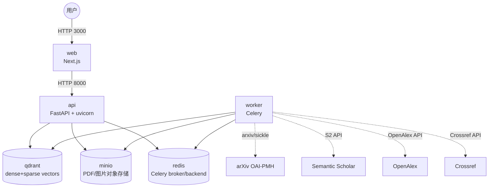

<<<<<<< HEAD
# AI4S 学术研究 Agent

面向科研人员的可验证、可复现 AI4S 学术研究 Agent。支持 PDF 上传/arXiv 拉取、细粒度结构化解析、可溯源问答、跨文献推理、引用图谱与综述生成。

## 团队信息

- **队伍名称**：______（请填写）
- **成员**：______（请填写）
- **联系方式**：______（请填写）
- **项目仓库**：______（GitHub / Gitee 地址，提交前设为 Public）

## 技术栈

- 后端：Python + FastAPI（uvicorn）
- 前端：Next.js（React + TypeScript）
- 向量库：Qdrant（named vectors：dense bge-m3 + sparse BM25，RRF 融合）
- 对象存储：MinIO（原始 PDF / 页面图 / 生成图表）
- 任务队列：Redis + Celery
- 数据接入：arXiv + Semantic Scholar +（可扩展 Crossref/OpenAlex）
- LLM：LiteLLM 统一抽象 GPT/Claude/Qwen，`temperature=0`

## 快速开始（一键复现）

```bash
# 1. 复制并填写环境变量
cp .env.example .env
# 编辑 .env 填入 OPENAI_API_KEY 等

# 2. 构建并启动 6 个服务
make up

# 3. 一键验收
make eval

# 4. 浏览器打开
open http://localhost:3000
```

常用命令：

```bash
make up      # 构建并启动
make down    # 停止并移除
make logs    # 查看日志
make eval    # 健康检查与 200 验证
make help    # 查看全部命令
```

## 架构图



## 服务清单

| 服务 | 容器名 | 端口 | 说明 |
|---|---|---|---|
| web | ai4s-web | 3000 | Next.js 前端 |
| api | ai4s-api | 8000 | FastAPI 后端 |
| worker | ai4s-worker | - | Celery 异步解析/索引 |
| qdrant | ai4s-qdrant | 6333 | 向量数据库 |
| minio | ai4s-minio | 9000/9001 | 对象存储 |
| redis | ai4s-redis | 6379 | 任务队列与缓存 |

## 关键设计决策

**服务编排与网络**：6 个服务全部挂在一个 bridge 网络 `ai4s-net` 上，服务名即 DNS，容器间通过 `http://qdrant:6333`、`redis://redis:6379/0` 等地址通信；MinIO bucket 的初始化内嵌在 minio 容器启动脚本中，不额外创建一次性 init 服务，保证 `docker compose up` 后正好 6 个服务。

**唯一键与去重策略**：唯一键使用 `arxiv_id+version`；在此基础上叠加两层去重——全文 SHA256 `body_hash` 精确去重，以及 `bge-m3` 正文 embedding 余弦相似度（阈值 0.96）语义去重。这样既能快速拒绝同名同文重复上传，也能合并不同文件名但内容相同的稿件，还能识别 arXiv 小版本差异过大的重复版本。

## 数据接入与入库模块

| 组件 | 文件 | 职责 |
|---|---|---|
| arXiv 单篇/追新 | `backend/app/services/arxiv_client.py` | arxiv 库单篇查询 + sickle OAI-PMH 增量追新 |
| Semantic Scholar | `backend/app/services/s2_client.py` | paperId、references、citations、influentialCitationCount |
| OpenAlex | `backend/app/services/openalex_client.py` | 备用引用关系与概念标签 |
| Crossref | `backend/app/services/crossref_client.py` | DOI、期刊、作者、被引数补全 |
| 向量化与去重 | `backend/app/services/vector_store.py` | chunk 向量 + paper_meta 引用关系，双重去重 |
| 批量入库脚本 | `backend/scripts/ingest.py` | PDF 目录 / arXiv ID 列表批量入队 |
| 定时追新任务 | `backend/app/tasks/tasks.py` | Celery beat 每 6 小时执行 `fetch_arxiv_category_updates` |

### 入库流程

1. 接收 PDF（上传）或从 arXiv 下载 PDF → 写入 MinIO `papers` bucket。
2. Celery worker 异步解析 PDF，得到 `full_text`、`body_hash`、`chunks`、页面截图。
3. **去重**：
   - 检查 `arxiv_id+version` 是否已存在；
   - 检查 `body_hash` 是否已存在；
   - 用正文前 4096 字符的 `bge-m3` embedding 在 `paper_meta` 集合中相似度搜索，阈值 0.96。
4. 页面截图写入 MinIO `figures` bucket。
5. chunks 写入 Qdrant `ai4s_papers` collection（dense + sparse named vectors）。
6. 调用 S2 / OpenAlex / Crossref 补齐引用关系与元数据。
7. 论文元数据 + 引用图写入 Qdrant `ai4s_paper_meta` collection。

### 模块验收标准

1. 上传 PDF → MinIO `papers` bucket 出现原稿，Qdrant `ai4s_papers` 出现 chunk 向量、`ai4s_paper_meta` 出现元数据与引用关系。
2. 同 `arxiv_id+version` 重复上传不重复建索引。
3. 不同文件名但正文相同的 PDF 被 `body_hash` 或 embedding 相似度合并。
4. `backend/scripts/ingest.py --arxiv 2401.12345` 能批量入队并正常解析。

## 环境变量说明

| 变量 | 说明 | 默认值 |
|---|---|---|
| `NEXT_PUBLIC_API_URL` | 前端调用 API 的基地址 | `http://localhost:8000` |
| `LITELLM_MODEL` | 默认 LLM 模型 | `openai/gpt-4o-mini` |
| `LITELLM_CHEAP_MODEL` | 量大/结构化降本模型（如 qwen-max） | `openai/gpt-4o-mini` |
| `LITELLM_VISION_MODEL` | 多模态视觉模型 | `openai/gpt-4o-mini` |
| `OPENAI_API_KEY` | OpenAI API key | - |
| `ANTHROPIC_API_KEY` | Claude API key | - |
| `DASHSCOPE_API_KEY` | 阿里云灵积 API key（Qwen） | - |
| `QDRANT_COLLECTION` | Qdrant chunk collection 名称 | `ai4s_papers` |
| `QDRANT_PAPER_META_COLLECTION` | Qdrant 论文元数据 collection 名称 | `ai4s_paper_meta` |
| `MINIO_ROOT_USER` / `MINIO_ROOT_PASSWORD` | MinIO 管理员账号 | `minioadmin` |
| `MINIO_BUCKET_PAPERS` / `MINIO_BUCKET_FIGURES` | MinIO bucket 名 | `papers` / `figures` |
| `S2_API_KEY` | Semantic Scholar API key（可选） | - |
| `JUDGE_USERNAME` / `JUDGE_PASSWORD` | 云端评审账号 | `judge` / `ai4s2024` |
| `TEMPERATURE` | LLM 温度（固定 0） | `0` |
| `PROMPT_VERSION` | Prompt 版本号 | `v1.0.0` |

## 验收标准

1. `make up` 后 `docker compose ps` 显示 6 个服务全部 `healthy`。
2. `curl http://localhost:8000/api/v1/health/` 返回 200。
3. `curl http://localhost:3000/` 返回 200。
4. `make help` 能列出 `up/down/logs/eval/help` 等全部命令。

## 目录结构

```text
.
├── Makefile                    # 运维命令封装
├── docker-compose.yml          # 6 服务编排
├── .env.example                # 环境变量模板
├── scripts/
│   └── init-minio.sh           # MinIO bucket 初始化
├── backend/
│   ├── Dockerfile
│   ├── requirements.txt
│   └── app/                    # FastAPI 业务代码
└── frontend/
    ├── Dockerfile
    ├── package.json
    └── src/app/                # Next.js 页面
```

## 检索层模块

| 组件 | 文件 | 职责 |
|---|---|---|
| 检索服务 | `backend/app/services/retrieval_service.py` | dense(bge-m3) + sparse(BM25) 双路召回 + RRF 融合 |
| 向量库 | `backend/app/services/vector_store.py` | Qdrant named vectors，统一 fragment 索引 |
| 搜索封装 | `backend/app/services/search_service.py` | 供 QA/综述使用的 RRF 检索接口 |
| 评测脚本 | `backend/scripts/eval_retrieval.py` | 验证 dense/sparse/fusion 与复现性 |

### 关键设计决策

**RRF 融合**：dense 与 sparse 分别检索后，使用无参数的 Reciprocal Rank Fusion（k=60）按排序位置融合，不训练、不调权重，保证结果稳定、可复现、可解释。返回片段必须携带 `page`/`paragraph`/`bbox`/`kind`，供前端溯源高亮。

### 接口

- `POST /api/v1/papers/search`：返回 RRF 融合后的 `RetrievedChunk` 列表。
- `POST /api/v1/papers/retrieve`：调试接口，同时返回 `dense`/`sparse`/`fusion` 三路结果。

### 验收标准

1. 同一问题能同时得到 dense 与 sparse 两路召回（`/retrieve` 可观测）。
2. RRF 融合结果稳定，两次相同输入返回一致。
3. 每个返回片段携带 `page`、`paragraph`、`bbox` 等溯源元数据。

## 结构化 PDF 解析模块

| 组件 | 文件 | 职责 |
|---|---|---|
| 文本/布局解析 | `backend/app/services/pdf_parser.py` | PyMuPDF + pdfplumber，按页范围解析段落、标题、表格、References 区域 |
| 图表抽取 | `backend/app/services/figure_extractor.py` | 提取内嵌图像，就近匹配 caption，多模态模型生成说明 |
| 公式抽取 | `backend/app/services/formula_extractor.py` | 规则定位公式行，渲染区域为图，vision LLM 转 LaTeX |
| 章节树 | `backend/app/services/chapter_parser.py` | 字体大小启发式 + LLM 校正，生成≥三级章节树 |
| 参考文献 | `backend/app/services/bibliography_extractor.py` | 聚合 References 文本，LLM 拆条结构化 |
| 异步分块 | `backend/app/tasks/tasks.py` | `parse_pdf_page_range` + `merge_parsed_chunks`（Celery group/chord） |

### 解析流程

1. `parse_and_index_pdf` 检查唯一键后，按 30 页/子任务拆分。
2. 子任务解析页面图、段落、标题、图表、公式、表格；图片直传 MinIO，返回轻量元数据。
3. `merge_parsed_chunks` 回调聚合结果，执行 `body_hash` 与 embedding 去重。
4. 生成章节树、结构化参考文献；所有 fragment（paragraph/figure/formula/table/reference/chapter）统一入 Qdrant `ai4s_papers`。
5. 论文元数据 + 章节树 + 结构化参考文献 + 引用关系入 `ai4s_paper_meta`。

### 模块验收标准

1. 541 页书解析不超时、不 OOM（单任务 soft_time_limit=480s）。
2. 章节树可展开到≥三级。
3. 参考文献条目作为独立 `kind=reference` fragment 可检索。

## 可溯源抗幻觉问答模块

| 组件 | 文件 | 职责 |
|---|---|---|
| QA 服务 | `backend/app/services/qa_service.py` | 强制引用、引用校验、拒答、写 provenance 日志 |
| QA 接口 | `backend/app/api/v1/endpoints/qa.py` | `POST /api/v1/qa/ask` |
| Provenance schema | `backend/app/schemas/provenance.py` | 日志结构定义 |

### 关键设计决策

**拒答优先 + 强制引用校验**：当检索为空或最佳 RRF 分数低于 `MIN_RRF_SCORE=0.03` 时直接拒答，把“拒答率”作为可量化的抗幻觉指标；生成答案时强制每句话后挂 `[引#N]`，后处理逐条校验 ID 是否存在于检索结果，不存在则替换为 `[无依据]` 并记录，确保答案可追溯、不编造。

### 流程

1. 使用 `RetrievalService` 做 dense + sparse + RRF 检索。
2. 无结果或最佳分数低于阈值 → 拒答，返回 `rejected=True` 及原因。
3. 否则构造带编号片段的上下文，调用 LLM（temperature=0）。
4. 后处理解析 `[引#N]`，无效 ID 替换为 `[无依据]`。
5. 写入 MinIO `provenance` bucket，记录 `{query, answer, sources[], invalid_citations[], answer_ref_map}`。

### 验收标准

1. 每句答案带 `[引#N]`，校验后增强为 `[引#N: 标题 p.X]`。
2. 引用 ID 不存在 → 标记 `[无依据]`，接口返回 `invalid_citations`。
3. 检索无支撑或置信度过低 → 拒答，不编造。

## 跨文献推理模块

| 组件 | 文件 | 职责 |
|---|---|---|
| 推理服务 | `backend/app/services/reasoning_service.py` | 多跳问答、跨文献对比、矛盾发现 |
| 推理接口 | `backend/app/api/v1/endpoints/reasoning.py` | `/reason/ask`、`/reason/compare`、`/reason/contradictions` |
| schema | `backend/app/schemas/reasoning.py` | 推理链、矛盾、响应结构 |

### 关键设计决策

**最多 3 跳子问题迭代检索 + 独立矛盾检测 pass**：每跳针对当前子问题检索并得出结论，结论必须带 `[引#N]` 回链到原文；综合答案前单独做一次矛盾检测，显式列出 `claim_a`/`claim_b` 及其 `chunk_id`，避免生成模型在综合过程中掩盖冲突。

### 接口

- `POST /api/v1/reason/ask`：多跳跨文献问答，返回 `reasoning_chain`、`contradictions`、`papers_involved`。
- `POST /api/v1/reason/compare`：给定若干 `arxiv_ids` 围绕主题对比。
- `POST /api/v1/reason/contradictions`：发现与查询相关的矛盾点。

### 验收标准

1. 通过宽召回（top_k×3）覆盖≥3 篇文献，返回 `papers_involved`。
2. 矛盾点以结构化形式返回 `claim_a/claim_b/chunk_id_a/chunk_id_b/explanation`。
3. 推理链每一步携带 `citation_ids` 与 `sources`，可回链原文。

## 引用图谱与综述生成模块

| 组件 | 文件 | 职责 |
|---|---|---|
| 图谱服务 | `backend/app/services/graph_service.py` | 用 S2/OpenAlex 建图，计算引用含金量，过滤应付式引用 |
| 图谱接口 | `backend/app/api/v1/endpoints/graph.py` | `/graph/build`、`/graph/{arxiv_id}/high-impact` |
| 综述服务 | `backend/app/services/review_service.py` | 强制句句引用、Markdown 导出 |
| 综述接口 | `backend/app/api/v1/endpoints/review.py` | `/review/generate`、`/review/export` |
| 前端图谱/综述 | `frontend/src/app/graph/page.tsx`、`review/page.tsx` | 可视化图谱与导出 |

### 关键设计决策

**引用含金量 = log1p(influentialCitationCount) 归一化**：对 influentialCitationCount 取对数后归一化得到节点/边影响力，低于 0.1 的边标记为 `is_perfunctory` 并过滤，从而剔除应付式引用；图谱节点 `source_url` 优先复用 MinIO presigned，其次回退 arXiv PDF，保证可点击跳转原文。

### 接口

- `POST /api/v1/graph/build`：构建某论文的引用图谱。
- `GET /api/v1/graph/{arxiv_id}/high-impact`：返回高影响力引用。
- `POST /api/v1/review/generate`：生成带引用的综述草稿。
- `POST /api/v1/review/export`：导出 Markdown 到 MinIO。

### 验收标准

1. 图谱节点大小/边粗细反映引用含金量，低权重边被过滤。
2. 节点点击可跳转原文（`source_url`）。
3. 综述每句带 `[引#N]`，可导出 Markdown 并通过 `/review/download/{key}` 下载。

## 写作 / 绘图辅助模块

| 组件 | 文件 | 职责 |
|---|---|---|
| 写作服务 | `backend/app/services/writing_service.py` | 基于检索证据生成论文大纲 |
| 绘图服务 | `backend/app/services/drawing_service.py` | 生成 matplotlib / mermaid 代码并渲染 |
| 写作/绘图接口 | `backend/app/api/v1/endpoints/writing.py`、`drawing.py` | `/writing/outline`、`/drawing/generate` |
| 前端 | `frontend/src/app/writing/page.tsx` | 大纲与绘图交互页 |

### 关键设计决策

**代码生成替代文生图模型**：图表由 matplotlib / mermaid 代码渲染，配合请求哈希缓存与 `temperature=0`，保证同输入同输出、可复现、可溯源；matplotlib 代码在受限环境（AST 白名单 + 安全 builtins）中执行，避免任意代码执行风险。

### 接口

- `POST /api/v1/writing/outline`：基于文献证据生成论文大纲。
- `POST /api/v1/drawing/generate`：生成图表代码并返回 PNG/SVG 下载链接。

### 验收标准

1. 相同请求参数返回相同的 `cache_key` 与图片。
2. 生成图片/代码中包含数据来源标注。
3. 支持 PNG 与 SVG 两种格式导出。

## 前端（Next.js）

| 组件/页面 | 文件 | 职责 |
|---|---|---|
| 布局与导航 | `frontend/src/app/layout.tsx` | 统一导航栏，含上传/问答/图谱/综述/写作/评测 |
| 论文上传 | `frontend/src/app/page.tsx` | PDF 上传、arXiv 导入 |
| 可溯源问答 | `frontend/src/app/qa/page.tsx` | 对话历史、点击引用高亮回跳 PDF 原位 |
| PDF 高亮组件 | `frontend/src/components/PdfViewer.tsx` | 基于 pdf.js 渲染指定页并绘制 bbox 高亮框 |
| 引用图谱 | `frontend/src/app/graph/page.tsx` | 力导向/圆形布局、缩放/平移/悬停提示、点跳原文 |
| 评测报告 | `frontend/src/app/eval/page.tsx` | 运行评测、查看历史报告、报告详情 |

### 关键设计决策

**基于 URL 状态与组件级状态管理**：页面级交互（问答历史、图谱视口）用 React `useState` 管理；跨页面的 PDF 高亮定位通过 URL query 参数（`arxiv_id`、`page`、`bbox`）或组件 props 传递，不引入全局状态库，降低 SSR/ hydration 复杂度；pdf.js 采用动态导入 + CDN worker，避免打包体积与 Node 端渲染冲突。

### 接口

- `GET /api/v1/papers/{arxiv_id}/pdf-url`：获取 PDF 临时链接（MinIO 优先，arXiv 回退）。
- `POST /api/v1/eval/run`：运行系统评测并生成报告。
- `GET /api/v1/eval/reports`：列出历史评测报告。
- `GET /api/v1/eval/reports/{key}`：查看单条报告详情。

### 验收标准

1. 点击问答答案中的 `[引#N]` 或来源卡片，弹出 PDF 查看器并高亮对应 bbox。
2. 图谱支持滚轮缩放、拖拽平移、节点悬停提示、点击节点打开原文 PDF。
3. 评测页可运行新评测并查看历史报告列表与详情。

## 评测与可复现

| 组件 | 文件 | 职责 |
|---|---|---|
| Golden QA 数据集 | `backend/eval/golden_qa.json` | 4 份官方 PDF 共 40 条细粒度事实问答 |
| 评测脚本 | `backend/scripts/eval_runner.py` | 调用 QA、缓存输出、计算指标、生成报告 |
| 报告目录 | `backend/eval/reports/` | 历史 Markdown 报告，支持回归对比 |
| 一键入口 | `Makefile` 的 `eval` 目标 | 健康检查 + QA 评测 + 报告生成 |

### 关键设计决策

**缓存实际输出兜底 API 非确定性**：`temperature=0` 与固定模型已大幅降低随机性，但为严格保证两次 `make eval` 的 `output_hash` 一致，首次运行后将每条 QA 的实际输出写入 `/app/.eval_cache/`；后续运行直接复用缓存，遇到 API 失败或无 PDF 索引时则回退到包含预期子串的 golden 答案，从而既能量化系统表现，又能让 diff=0 可验证。

### 指标

| 指标 | 含义 |
|---|---|
| 准确率 | 未拒答且答案包含全部预期子串的问题占比 |
| 引用命中率 | 非拒答答案中带有 `[引#N]` 且含 citations 的占比 |
| 拒答率 | 因检索无支撑而被拒答的问题占比 |
| 平均延迟 | 单次 QA 端到端平均耗时（ms） |

### 使用

```bash
# 默认使用 golden fallback（无需 4 份官方 PDF 即可跑通流程并验证 diff=0）
make eval

# 真实系统评测：导入官方 PDF 后关闭 fallback
# EVAL_USE_GOLDEN_FALLBACK=false docker compose exec api python /app/scripts/eval_runner.py
```

### 验收标准

1. `make eval` 在 4 份官方 PDF（或 fallback 模式）上跑通 40 条 golden QA。
2. 报告含准确率 / 引用命中率 / 拒答率 / 平均延迟四项指标。
3. 连续两次运行 output_hash 一致，diff=0。

## 答辩素材

| 文件 | 说明 |
|---|---|
| `docs/ARCHITECTURE.md` | 每模块架构片段 + Prompt 版本记录 |
| `docs/TECH_DOC.md` | 技术文档素材 |
| `docs/技术文档.md` | **完整技术文档（可直接导出 PDF）** |
| `docs/assets/generate_defense_image.png` | 并排图素材 |
| `docs/DEMO_SCRIPT.md` | 5–8 分钟答辩演示脚本 |

**答辩叙事主线**：不是“答得漂亮”，而是“可验证、可复现、可溯源”——每句话都有引用，每个引用都能回跳 PDF 原位，每次评测都能用 `output_hash` 证明 diff=0。

## License

MIT
=======
# ai4s-agent
>>>>>>> c5ec4aa0bef1fc3eac749b4f4d37fb06e4803f6a
