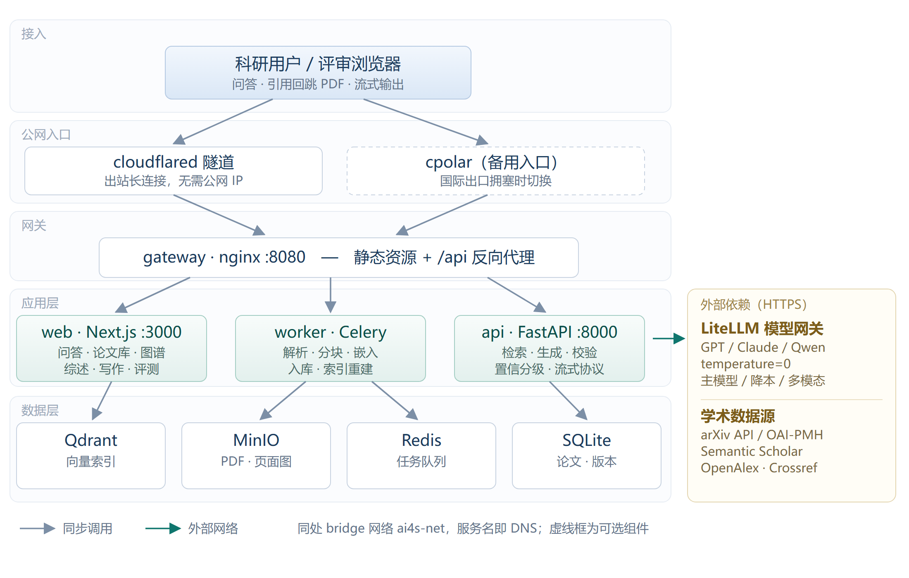

# AI4S 学术研究 Agent

> 面向科研人员的**可验证、可复现、可溯源** AI4S 学术研究 Agent。
> 每一句结论都能回跳到 PDF 的精确位置，每一次评测都能用哈希证明结果一致。

<p>
  
  
  
  
  
</p>

---

## 它解决什么问题

科研人员读论文，真正花时间的不是「读得慢」，而是三件事：定位某个具体事实、判断某句话的出处、在多篇论文之间对齐口径。

把大模型直接接上去会立刻遇到两个问题：**幻觉引用**（给出格式完美但不存在的出处）和**不可复现**（同一问题三次三个答案）。在科研场景里，这两点的危害远大于「不知道」。

本项目的做法不是「做一个能聊论文的机器人」，而是**把大模型放进一个有证据边界、有校验环节、有量化指标的流程里**。

## 功能一览

| 页面 | 能力 | 关键设计 |
|---|---|---|
| `/library` 论文库 | PDF 上传、arXiv 导入、去重、状态、删除 | 三层去重；清单以 SQLite 为准，解析中的论文不会「消失」 |
| `/qa` 问答 | 可溯源问答、流式输出、引用回跳 PDF 原位 | 强制 `[引#N]` + 程序校验；三档置信（已验证 / 需核对 / 无法回答） |
| `/qa` 库外补货 | 库内答不了时检索 arXiv 并推荐 | 给出命中词与摘要原句，可核对；支持一键入库后重问 |
| `/graph` 图谱 | 引用图谱、影响力渲染、点跳原文 | 引用含金量 = `log1p(influentialCitationCount)`，过滤应付式引用 |
| `/review` 综述 | 论断抽取 → 观点聚类 → 冲突标注 → 分簇撰写 | 极性进簇键，从结构上杜绝「各有优势」式综述 |
| `/writing` 写作绘图 | 大纲生成、matplotlib / mermaid 图表 | 代码生成替代文生图，同输入同输出 |
| `/eval` 评测 | 48 题评测、五组基线、报告对比 | `output_hash` + 索引签名，两次运行 diff=0 |

## 技术架构



| 容器 | 端口 | 职责 |
|---|---|---|
| `web` | 3000 | Next.js 前端 |
| `api` | 8000 | FastAPI：检索、生成、引用校验、置信分级、SSE |
| `worker` | — | Celery：解析、分块、嵌入、入库、索引重建 |
| `qdrant` | 6333 | 向量库（dense + sparse named vectors） |
| `minio` | 9000 | 原始 PDF、页面图、provenance 日志 |
| `redis` | 6379 | 任务队列与结果后端 |
| `gateway` | **8080** | nginx：静态资源 + `/api` 反向代理（对外只暴露这一个端口） |
| `tunnel` | — | cloudflared 出站隧道，无公网 IP 也能对外提供 HTTPS |

**关键设计决策**

- **`api` 与 `worker` 共用同一镜像**，只在启动命令上区分。解析与检索共用同一套 embedding 实现，版本漂移会导致入库向量与查询向量不在同一空间，这类问题极难排查。
- **论文清单以 SQLite 为准，不以 Qdrant 为准。** 正在解析、解析失败的论文在向量库里还没有点，但它们确实已在库中；读向量库会让用户看到「刚传的论文消失了」。
- **索引版本化的单位是 collection。** Qdrant 的 named vector 维度是集合级的，换模型没法用 payload 区分版本。命名规则 `ai4s_papers__<version>-<signature>`，签名只含会改变向量的因素（模型名、维度、分块大小、`embed_max_chars`）。重建不停服：后台建新集合 → 从 SQLite 重放 → 校验 → 切路由 → 旧集合留待回滚。
- **检索用双路 + RRF（k=60），不学权重。** 无训练、无黑盒参数，结果完全确定，天然满足复现要求。实测融合的价值不在 Recall（0.7500 vs 纯 BM25 的 0.8056），而在**可分性**——AUC 从 0.5000 提升到 0.7766，这时讨论阈值与拒答才有意义。

## 快速开始

```bash
# 1. 准备环境变量（至少填一个 LLM API key）
cp .env.example .env

# 2. 构建并启动（首次约 5~10 分钟，含 embedding 模型下载）
docker compose up -d --build

# 3. 自检（容器 / 服务 / 索引 / 入口 / 可选真实问答）
bash deploy/demo-check.sh --with-qa

# 4. 打开
#    http://localhost:8080        经网关（推荐）
#    http://localhost:3000        前端直连
#    http://localhost:8000/docs   接口文档
```

导入语料：

```bash
docker compose exec api python /app/scripts/ingest.py --arxiv 1706.03762 1810.04805
# 或在网页 /library 页面直接上传 PDF / 填 arXiv ID
```

常用命令：

```bash
make up      # 构建并启动
make down    # 停止并移除
make logs    # 查看日志
make eval    # 一键评测
bash deploy/demo-check.sh   # 上台前 30 秒自检
```

## 环境变量

完整模板见 [`.env.example`](.env.example)（13 组，全部有可用默认值）。必填项只有 LLM 的 key（`OPENAI_API_KEY` / `ANTHROPIC_API_KEY` / `DASHSCOPE_API_KEY` 之一）。

| 变量 | 说明 | 默认值 |
|---|---|---|
| `LITELLM_MODEL` | 主模型（问答、综述、推理） | `openai/gpt-4o-mini` |
| `LITELLM_CHEAP_MODEL` | 降本模型（章节树、参考文献拆条） | 同主模型 |
| `LITELLM_VISION_MODEL` | 多模态（公式转 LaTeX、图表描述） | 同主模型 |
| `EMBED_THREADS` | 嵌入线程数（8 为实测最优） | `8` |
| `RERANK_ENABLED` | 精排开关（可一键 A/B） | `true` |
| `CONFIDENCE_VERIFIED_SCORE` | 判「已验证」的证据覆盖率线 | `0.55` |
| `PIPELINE_VERSION` | 索引 pipeline 版本 | `v1.0.0` |
| `JUDGE_USERNAME` / `JUDGE_PASSWORD` | 评审账号（公网演示用） | `judge` / `ai4s2024` |
| `CLOUDFLARE_TUNNEL_TOKEN` | 隧道 token（留空则不启动 tunnel） | 空 |

> **密钥安全**：`.env` 已在 `.gitignore` 中，代码里没有任何硬编码 key，全部经环境变量注入。

## 项目结构

```text
.
├── docker-compose.yml           # 8 容器编排
├── .env.example                 # 环境变量模板
├── Makefile                     # up / down / logs / eval
├── backend/
│   ├── app/
│   │   ├── api/v1/endpoints/    # papers / qa / review / graph / ingest / library / recommend …
│   │   ├── services/            # 解析、检索、生成、校验、索引版本、外部检索
│   │   ├── tasks/               # Celery 任务与定时调度
│   │   └── core/config.py       # 全部可调参数集中于此
│   └── eval/                    # golden QA 与历史评测报告
├── frontend/src/
│   ├── app/                     # 首页 / 论文库 / 问答 / 图谱 / 综述 / 写作 / 评测
│   └── components/              # answer / ingest / graph
├── deploy/
│   ├── nginx.conf               # 网关配置
│   ├── demo-check.sh            # 一键自检
│   └── 云服务器迁移清单.md       # 迁移步骤
├── scripts/build_tech_pdf.py    # 技术文档 → PDF
└── docs/                        # 技术文档、架构说明、各模块设计记录
```

## 评测结果

语料：4 篇赛题 PDF（Attention / BERT / ViT / LoRA），209 段、279 索引点；48 题评测集，5 组配置跑同一条链路。

| 配置 | Recall@5 | MRR@5 | nDCG@5 | 可分性 AUC |
|---|---|---|---|---|
| 纯向量（dense only） | 0.7500 | 0.5764 | 0.5694 | 0.5000 |
| 纯 BM25（sparse only） | 0.8056 | 0.6366 | 0.5878 | 0.5000 |
| 混合（RRF） | 0.7500 | 0.5787 | 0.5663 | 0.7766 |
| 混合 + 精排 | **0.8333** | 0.5875 | 0.5766 | 0.7812 |
| 本系统（分流 + 规则 + 精排） | 0.8056 | **0.6005** | **0.6062** | 0.6300 |

- **引用严格准确率 76.47%**（人工抽检 17 条可判引用）；越界引用 100% 被标记为 `[无依据]`
- **检索确定性**：48 题重放 240 次，逐题排序一致；两次 `make eval` 的 `output_hash` 一致
- **性能**：2 页 7.3s / 15 页 39s / 541 页 8 分 46 秒入库；重复上传 28~37ms；综述 54~85s

> 短板的记录：compare 题型召回偏弱（0.5 一带）、引用粒度只到页而非句、库外推荐只有词面相关性。这些写在评测报告里，作为下一阶段输入。

## 在线演示

- **地址**：**https://demo.mabokai.site**（Cloudflare 命名隧道 + 自有域名，固定不变）
- **备用入口**：`http://localhost:8080`（本机）、`http://10.110.32.40:8080`（同一局域网）
- **说明**：公网入口受国内到 Cloudflare 的国际链路影响，实测约 1/3 的请求失败、成功时 1.5–2.1s 返回；现场演示请用本地或局域网入口
- **评审账号**：若开启登录，用 `.env` 中的 `JUDGE_USERNAME` / `JUDGE_PASSWORD`
- **可用性自检**：`bash deploy/demo-check.sh`（六项检查，输出「可以演示 / 有 N 项注意 / N 项不通过」）

## 文档

| 文档 | 内容 |
|---|---|
| [`docs/AI4S学术研究Agent-技术文档.pdf`](docs/AI4S学术研究Agent-技术文档.pdf) | **提交用技术文档（21 页）**，含架构、AI 方案、实现、评测、创新点 |
| [`docs/技术文档.md`](docs/技术文档.md) | 上文的 Markdown 源 |
| [`docs/ARCHITECTURE.md`](docs/ARCHITECTURE.md) | 模块架构与 Prompt 版本记录 |
| [`docs/DEMO_SCRIPT.md`](docs/DEMO_SCRIPT.md) | 5~8 分钟答辩演示脚本 |
| [`docs/SUBMISSION_CHECKLIST.md`](docs/SUBMISSION_CHECKLIST.md) | 提交材料清单与状态 |
| [`docs/2.x-*.md`](docs/) | 各模块设计记录（检索、置信、索引、综述、保活等 20+ 篇） |

重新生成技术文档 PDF（需 `npm i puppeteer-core` + 本机 Edge/Chrome）：

```bash
python scripts/build_tech_pdf.py     # Markdown → HTML
node scripts/print_tech_pdf.js       # HTML → PDF（A4，带页码）
```

## 团队信息

- **作者**：马博凯
- **联系方式**：18734600277
- **仓库**：https://github.com/mbk200779/ai4s-agent
- **技术栈**：Python / FastAPI · Next.js 14 · Qdrant · MinIO · Redis + Celery · SQLite · LiteLLM

## License

MIT
