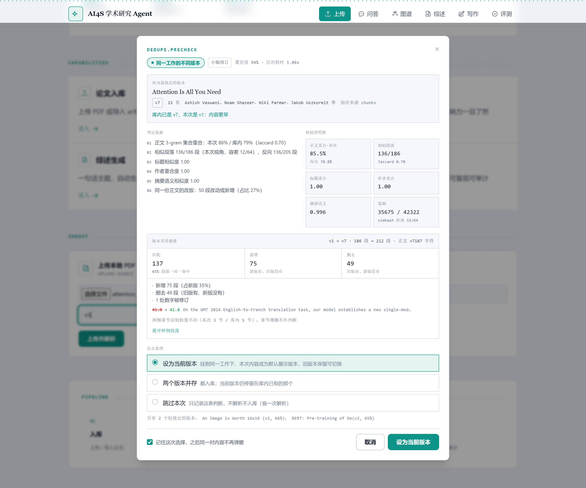
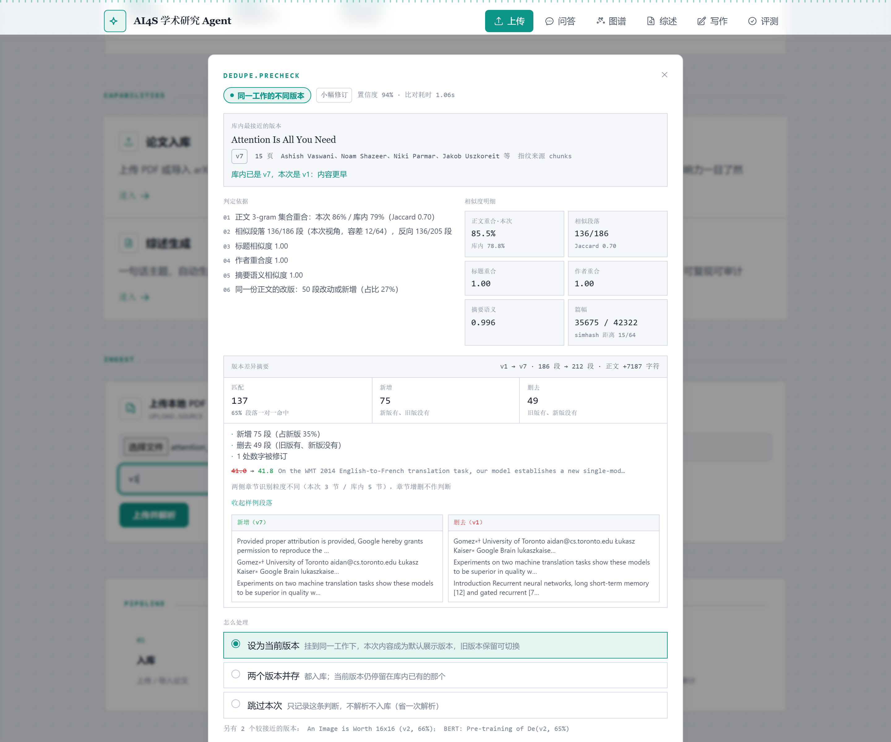
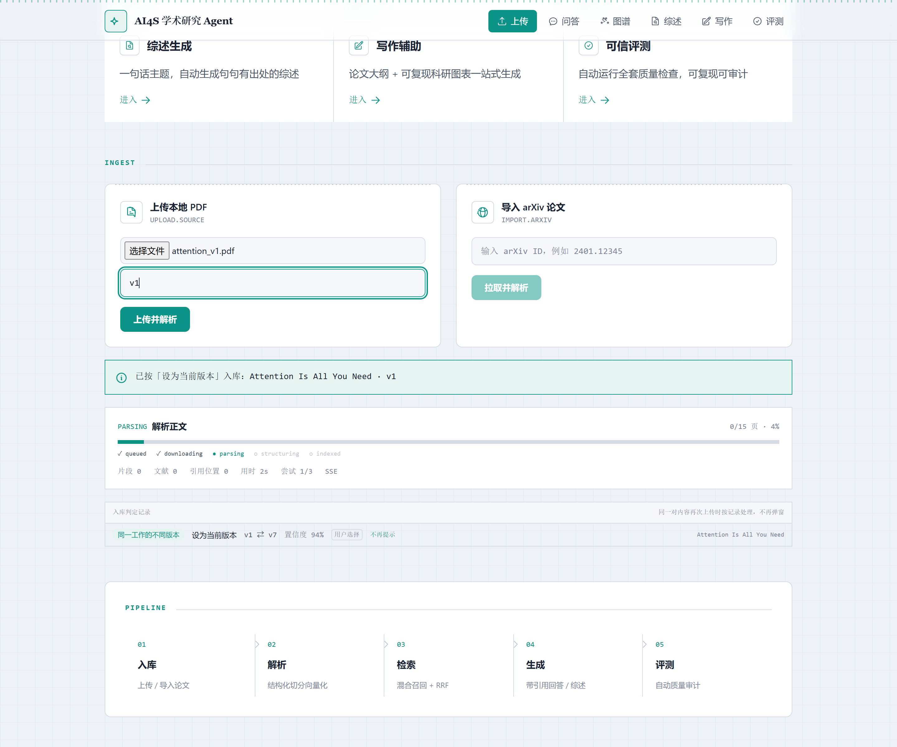
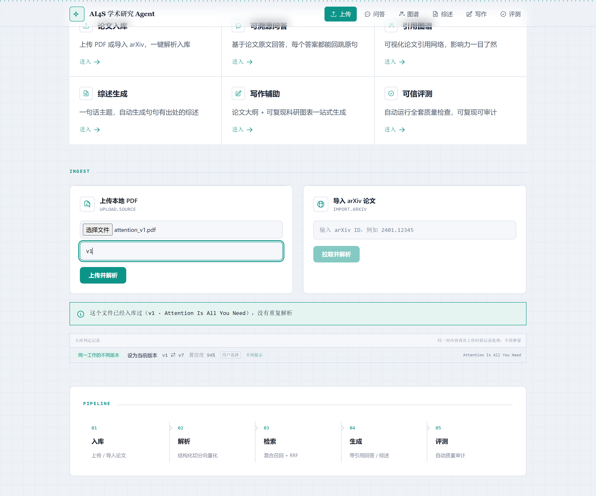

# 2.14 去重：先判「是什么关系」，再决定提示什么

> 目标：高相似不等于重复。系统要能说清这次上传与库里那一篇**是什么关系**，再据此给不同的提示与操作。

## 1. 问题：相似度阈值能回答的问题，和它回答不了的问题

上一版判重只有一句话：`body_similarity > 0.9 → 视为重复，直接覆盖`。它把三件完全不同的事压成了一个数：

| 真实情况 | 阈值看到的是 | 系统当时的行为 | 应该的行为 |
|---|---|---|---|
| 同一篇论文的 v1 与 v7（同一工作的两个版本） | 相似度 0.86 | 「重复」，覆盖旧版 | 问：设新版为当前版本，还是并存 |
| 两篇不同论文用了同一套实验章节模板 | 相似度 0.72 | 「不像」，各存一份 | 正常并存，可能只需标注"相关" |
| 同一个 PDF 被重命名后又传了一次 | 相似度 1.00 | 「重复」，覆盖 | 直接命中，不打扰 |
| 综述文章大量引用同一篇论文的原文段落 | 相似度 0.55 | 不触发 | 不触发（正确，但不是因为阈值对） |

第一行和第三行的相似度几乎一样高，但用户的意愿完全相反：一个是"我要保留两版"，一个是"别问了"。**用同一个阈值去拦这两种情况，必然有一边是错的。** 所以这一版加的不是更细的阈值，而是一层关系判定：先分类，再决定说不说话、说什么话。

## 2. 两层判定：正文层 × 工作层

判定的两个轴是独立的：

- **正文层**：两份稿子是不是同一份文字？（重合率、相似段落数）
- **工作层**：这两篇是不是同一项研究？（标题、作者、摘要、首段）

四个象限刚好对应要输出的三种关系：

```
                     工作层：同一项研究
                     是 ──────────────── 否
          是   ┌──────────────────┬──────────────────┐
      正   │  version_of      │ possible_duplicate │  ← 正文几乎一样，
      文   │  同一工作的不同版本   │ 不同工作的高重合      │    但元数据对不上
      层   ├──────────────────┼──────────────────┤
      是   │  possible_duplicate │ related            │
           │  （元数据缺失时退化） │  同主题相关          │
      同   ├──────────────────┼──────────────────┤
           │  version_of      │  distinct（不提示）   │
           └──────────────────┴──────────────────┘
                     否
```

关键在右下角那格：**正文不同、工作也不同 → 不提示**。反过来左下角（正文部分重合、工作同一）之所以也归 `version_of`，是因为改版少的稿子第 5 章可能一字不动、第 6 章全改了——重合率掉到 0.3 不代表不是同一篇。

## 3. 指纹怎么算：主判据、旁证、以及为什么文件名不参与

每个版本入库后落一行 `paper_fingerprints`：

| 字段 | 用途 | 为什么是它 |
|---|---|---|
| `minhash` (k=128) | **主判据**：估算 3-gram 集合的 Jaccard | 能直接反推"重合了多少"，与长度无关 |
| `simhash` (64bit) | 旁证：粗粒度距离 | 只作参考，见下 |
| `para_hashes` | 相似段落数（界面上的 136/186 出自这里） | 用户能理解"多少段一样" |
| `abstract_emb` / `lead_emb` (1024d) | 语义重合（改写、换词后的同一段） | 字符层重合算不出来 |
| `section_count` / `body_chars` | 篇幅与结构旁证 | 用来解释"为什么是改版" |

三个刻意的决定：

1. **文件名不参与判定。** 上传时标题从 PDF 首页抽（`extract_meta_from_pdf`），抽不出来才退回文件名。本地上传的论文原来拿 `A.pdf` 当标题，于是同一个文件改个名字就变成"两篇无关论文"，标题重合度这一票永远投不出来。`/dedupe/precheck` 的 `title` 参数默认不传，就是不让"命名"决定结论。
2. **整篇 simhash 只作旁证。** v1 与 v7 的 simhash 距离是 15/64（相似度 0.77），看着"不太像"——它对长度敏感，一篇加了 7000 字就会掉下来。而正文 3-gram 重合是 86%/79%。两个数打架时，信 MinHash。
3. **MinHash 用 KMV 草图，一条哈希取最小 128 个值。** 5500 个 shingle × 128 个哈希 = 70 万次 md5，实测把单次预检拖到秒级；KMV 只算一轮 64 位哈希、维护前 128 小，结果同等精度。

段落级 simhash 的容差是 `PARA_HAMMING_MAX = 12/64`，扫描实测：≤6 → 命中 61.8%，≤8 → 67.7%，≤10 → 73.7%，**≤12 → 79.0%**，≤14 → 84.4%。取 12 是因为再放宽就开始把"同一节的不同段落"配成一对。

## 4. 阈值不是拍的：从两组分布中间取点

标定用的是真实语料：Attention v1 / v7 两个 PDF，负样本是库里的 BERT / LoRA / ViT。

| 对照 | 正文重合（本次/库内） | 相似段落 | Jaccard |
|---|---|---|---|
| v1 vs v7（真·同一工作） | 83.9% / 89.2% | 79.0% | 0.762 |
| Attention vs BERT | 2.6% / 2.1% | 0.5% | 0.02 |
| Attention vs LoRA | 1.9% / 1.4% | 0.2% | 0.01 |
| Attention vs ViT | 1.0% / 0.9% | 0% | 0.00 |

正样本 ≥ 0.84，负样本 ≤ 0.03，中间空了两个数量级。阈值就取在这个空档里：

```python
BODY_SAME      = 0.55   # 正文层：同一份稿子
BODY_PARTIAL   = 0.25   # 正文层：有实质重合
WORK_SAME      = 0.55   # 工作层：同一项研究
WORK_STRONG    = 0.70   # 工作层：强证据
ABS_RELATED    = 0.82   # 摘要语义：强相关
LEAD_RELATED   = 0.85   # 首段语义：强相关
```

工作层评分按可用项重新归一化：标题 0.40 / 作者 0.25 / 摘要 0.25 / 首段 0.10。**缺哪项就从分母里去掉，不补 0**——老论文没有作者字段，不应该因此被判成"不同工作"。

## 5. 判定结果：置信度与依据必须能被读

每个候选返回 `relation / kind / confidence / reasons[] / caveats[]`。`kind` 是更细的说法（`retypeset` 只重排版、`revision` 小幅修订、`major_revision` 大幅改版、`same_body_other_meta` 正文相同元数据不同）。

实测输出（v1 上传，库里已有 v7）：

```json
{
  "relation": "version_of", "kind": "revision", "confidence": 0.9403,
  "reasons": [
    "正文 3-gram 集合重合：本次 86% / 库内 79%（Jaccard 0.70）",
    "相似段落 136/186 段（本次视角，容差 12/64），反向 136/205 段",
    "标题相似度 1.00",
    "作者重合度 1.00",
    "摘要语义相似度 1.00",
    "同一份正文的改版：50 段改动或新增（占比 27%）"
  ],
  "caveats": [],
  "hint": "库内已是 v7，本次是 v1：内容更早"
}
```

置信度不是一个"感觉分"，是正文重合、工作层评分与元数据一致性的加权结果；`reasons` 里每一条都对应用户能在界面上核对的东西（重合率、段落数、标题、作者）。

**版本方向只按用户声明的版本号给，不猜。** `hint` 里那句「库内已是 v7，本次是 v1：内容更早」来自 `version_label` 的比较，比不出来就不说。方向猜错的代价不是文案难看，而是"哪个版本成为当前版本"跟着错。

同一批里还会带出 `related` 候选（实测 ViT 0.657、BERT 0.651），但排序永远是 `version_of` 优先：先解决"要不要合并"，再谈"谁跟谁相关"。

## 6. 三类提示，三套文案

弹出的不是"疑似重复，是否继续？"这种二选一，而是按关系给不同动作——**同一个 `keep_new`，在三种关系下是三件不同的事**：

| 关系 | 提示语气 | 动作 |
|---|---|---|
| `version_of` | 主信号青，「同一工作的不同版本」 | 设为当前版本 / 两个版本并存 / 跳过本次（不解析） |
| `possible_duplicate` | 警示橙，「可能是重复入库」 | 作为两篇并存（默认，最安全）/ 合并为同一工作（标风险）/ 仅标注关联 |
| `related` | 中性灰，「同主题相关」 | 正常入库 / 入库并标注关联 |

交互上几条硬规矩：

- **弹窗里必须能看到依据**，不能只有一个进度条。界面同时给出：库内最接近版本的标题与作者、6 个相似度指标、判定依据列表、版本差异摘要。
- **`possible_duplicate` 的"合并"不是默认项**，且按钮旁写着"只在确认是同一份研究时选"。不可逆的动作不能是第一个按钮。
- **判定挡在解析前**。`/dedupe/precheck` 只读、零写入（临时文件用完立刻删），用户犹豫、改主意、关掉页面，库里不会留下半条记录。解析要几十秒，等它跑完再问"要不要保留"等于让用户白等一遍。
- **`link_only` 在 `version_of` 下真的不解析**：`/papers/upload` 直接返回 `stage="skipped"`。既然用户已经有一版，没必要再花 40 秒解一遍。

## 7. 选择记录：键跟着内容走，不跟着 version_id 走

`dedupe_decisions` 的唯一键是 `pair_key`：

```python
def pair_key(a: str, b: str) -> str:
    lo, hi = (a, b) if a <= b else (b, a)
    return f"{lo}:{hi}"      # 两个 simhash 的无序对
```

用 simhash 而不是 `(new_version_id, peer_version_id)`，因为**重新上传同一份文件会产生新的 version_id，但内容没变**——键跟着内容走，选择才记得住。无序对保证"先传 v1 再传 v7"和"先传 v7 再传 v1"命中同一条记录。

记录里存 `relation / action / confidence / evidence(依据快照) / decided_by(user|remembered) / suppress`。`suppress=1` 时，下次同一对内容再上传，`precheck` 返回 `ask=false, suppressed=true` + `memorized` 字段，前端不再弹窗，直接按历史选择走。界面上留了一个「入库判定记录」面板，把这条链路显性化：判定成什么关系、当时选了什么、以后还问不问、这条是用户选的还是按记录自动套用的。

另外有两条"根本不问"的短路，按代价从低到高排列：

| 顺序 | 条件 | 代价 | 行为 |
|---|---|---|---|
| 1 | `file_hash` 命中（字节相同） | ~30ms，不算指纹 | 直接说「这个文件已经入库过」，不解析 |
| 2 | `pair_key` 有 `suppress` 记录 | 算完指纹才知道 | 按记忆的动作处理，不弹窗 |
| 3 | 其它 | 1~2s | 关系判定 → 弹窗 |

第 1 条单独存在是有必要的：字节相同意味着连"是不是同一份"都不用判，
让用户在这里回答一个答案是已知的问题，纯属浪费。第 2 条才是"选择被记住"的路径，
它管的是**内容相同、字节不同**的情况（重新导出、重新压缩过的 PDF）。

命中第 2 条时要注意一个坑：库里可能同时存在"刚入库的那份"和"更早的版本"，
排序后 primary 不一定是当初记录里的那个 peer。所以实现上找的是**任意一个**候选的
旧记录，而不是只看排第一的那个——只认 primary 会让系统把已经答过的问题再问一遍。

## 8. 版本差异摘要：不做行级 diff

PDF 抽出来的文本换行、断词、连字符都是噪声，行级 diff 会给出"改了 800 行"这种没法读的结论。做的是三件事：

1. **段落级一对一匹配**：两侧段落各算 simhash，贪心配对（用过的 b 不参与，否则 30 段对 5 段会算出"30 段全命中"）。
2. **数字修订**：只在配对的段落内部比数字，且要求"旧有新无 + 新有旧无"同时成立、各不超过 4 个。整篇数字对不上时不报，避免噪声。
3. **章节增删——以及一个"不判"的分支**：两侧章节来源不同（本次是按字号识别的标题，库内是 chunk 归到的顶层段落），粒度可以差一倍。实测出现"库内 5 节全被判为新增"这种一眼假的结论，于是加了可比性判定：任一侧的增删超过 60% 就标 `comparable=false`，只给一句「两侧章节识别粒度不同（本次 3 节 / 库内 5 节），章节增删不作判断」。**宁可说这次不判，也不给一个看起来像结论的错结论。**

实测 v1 → v7：

| 指标 | 值 |
|---|---|
| 段落 | 137 段一对一匹配（占新版 65%），新增 75 段，删去 49 段 |
| 正文字符 | 29,313 → 36,500（+7,187） |
| 数字修订 | `41.0 → 41.8`（WMT14 EN-FR BLEU） |
| 章节 | 不判（粒度不同） |

版本解析完成后，两个版本之间的差异也可以单独查（`GET /dedupe/versions/{a}/diff/{b}`），
这一份是 v1 与 v7 都入库后算出来的，两侧都来自 chunk，段落匹配率升到 75%、章节也可比了：

```text
### 版本差异：v1 → v7
- 页数：15 → 15
- 段落：196 → 212（配对 160，新增 52，删去 36）
- 正文字符：34072 → 36500（+2428）
- 章节：保留 4，新增 1，删去 0     ← 新增：Abstract
| 41.0 | 41.8 | On the WMT 2014 English-to-French translation task... |
```

完整文件见 [`assets/dedupe/version_diff_v1_to_v7.md`](./assets/dedupe/version_diff_v1_to_v7.md)。
两次算出来的段落数不同（186/205 vs 196/212）是因为来源不同：上传前比的是 PDF 文本层，
入库后比的是 chunk——同一份稿子，两套切分。

## 9. 实测：v7 先入、v1 后入

**前提**：库里已有 5 篇其他论文（BERT / ViT / LoRA / soliton），Attention 只有 v7。

**第 1 步，上传 v1（版本标签填 `v1`）**：预检扫 5 个 peer，1.36 秒给出结论。



判定 `version_of / revision / 置信度 94%`，方向提示「库内已是 v7，本次是 v1：内容更早」。右侧 6 个指标分别是：正文重合 85.5%（库内 78.8%）、相似段落 136/186、标题 1.00、作者 1.00、摘要语义 0.996、simhash 距离 15/64。下方两个 `related` 候选（ViT 66%、BERT 65%）只作为旁注，不抢主结论。



差异摘要直接嵌在弹窗里：段落匹配 137 / 新增 75 / 删去 49、正文字符 +7187、`41.0 → 41.8` 这处 BLEU 修订，以及章节"不判"的说明。样例段落可以展开成两栏，左看新版多出来的句子、右看旧版被删掉的句子——上图的"新增"里第一条就是 v7 才有的 Google 授权声明段落。

**第 2 步，选「设为当前版本」**：本次挂到 v7 所属的那个**工作**下（不是新建一篇论文），走的是 `keep_new + version_of` 分支；判定记录同时落库。



**第 3 步，把同一份文件再传一次**：`file_hash` 命中，`precheck` 在 30ms 内返回 `ask=false`，**不弹窗、不解析**，直接告诉用户"已经入库过"。上一轮的判定记录还留在面板里，可以核对当时选的是什么。



如果把 v1 重新存一遍（字节变了、正文没变）再上传，走的是另一条短路：`file_hash` 不命中，但 `pair_key` 命中上一轮的记录，`precheck` 返回 `suppressed=true` + `memorized{action: keep_new}`，同样不弹窗，直接按"设为当前版本"处理——这一条正是"选择被记住"要证明的东西。

## 10. 边界与已知问题

1. **版本方向依赖用户声明的版本号。** 不填版本标签，系统只会说"内容更早/更晚"或干脆不说，不会替你决定谁是当前版本。
2. **章节增删经常"不判"**（见 §8 第 3 条）。这是刻意的止损，不是缺失。
3. **跨课题比对默认关闭。** `include_other_projects=False` 时只看当前课题；打开后候选里会标 `other_project`，因为"别的课题里的同一篇论文"往往不是重复，而是复用。
4. **Qdrant 1.11.0 的稀疏索引 bug**（本任务期间踩到并规避）：稀疏倒排索引在"某个 token 的 posting list 被删空"时会 panic（`inverted_index_ram.rs:63` 越界），panic 发生在写入线程里，之后所有 upsert/delete 都返回 `channel closed`，只能重启进程。规避方式是最小改动：`delete_chunks` 先 count，命中 0 就不发 delete（首次入库走的就是这条短路分支）。同时把那次受损的集合从导出→重建→回灌修了回来（285 个点，含向量原样保留）。
5. **同一内容重存后再传，按记住的动作会再建一个 `-b` 版本。** 因为字节不同，`file_hash` 拦不住；而记忆里存的是"设为当前版本"，于是又挂了一个版本上去（标签冲突时自动改名 `v1-b`）。想避免就选「跳过本次」，或者在弹窗里勾掉"不再提示"。
6. **指纹是入库的副产品。** 解析完成后异步落，失败只 warning 不回滚——没有指纹的老版本不参与比对，所以升级后要对历史库跑一次 `POST /dedupe/backfill`。

## 11. 代码与接口

```
backend/app/services/dedupe/
  fingerprint.py   指纹：normalize/shingles/simhash/minhash/段落哈希/embedding/PDF 元数据
  similarity.py    两两比对：正文重合、段落命中、标题/作者、语义、版本方向
  relation.py      关系判定：四象限 + 置信度 + 依据 + 三类动作文案
  store.py         peers 查询、指纹 UPSERT、判定记录（pair_key）
  diff.py          版本差异：段落匹配 + 数字修订 + 章节可比性
  service.py       编排：precheck / decide / decisions / index_version / version_diff
backend/app/api/v1/endpoints/dedupe.py
  POST /dedupe/precheck          上传前只读预检（含差异摘要）
  POST /dedupe/decide            记录选择（UPSERT，返回 pair_key）
  GET  /dedupe/decisions         回看判定记录
  GET  /dedupe/versions/{a}/diff/{b}   两个已解析版本的差异
  POST /dedupe/backfill          历史版本补指纹
frontend/src/components/ingest/DedupePrompt.tsx    三类提示的弹窗 + runPrecheck/recordDecision
frontend/src/components/ingest/DecisionsPanel.tsx  判定记录面板
```

上传接口新增三个表单字段（`dedupe_action / dedupe_relation / peer_version_id`），不传则按 `keep_both` 处理——**宁可并存，不可静默合并**。
