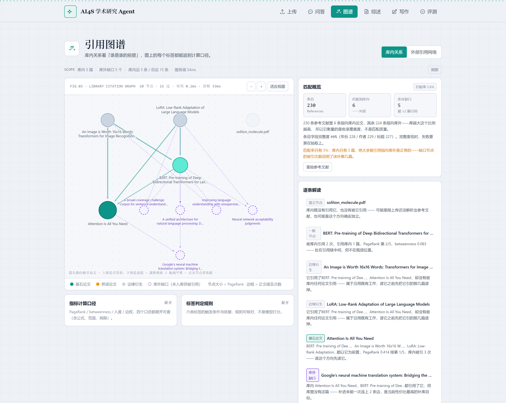
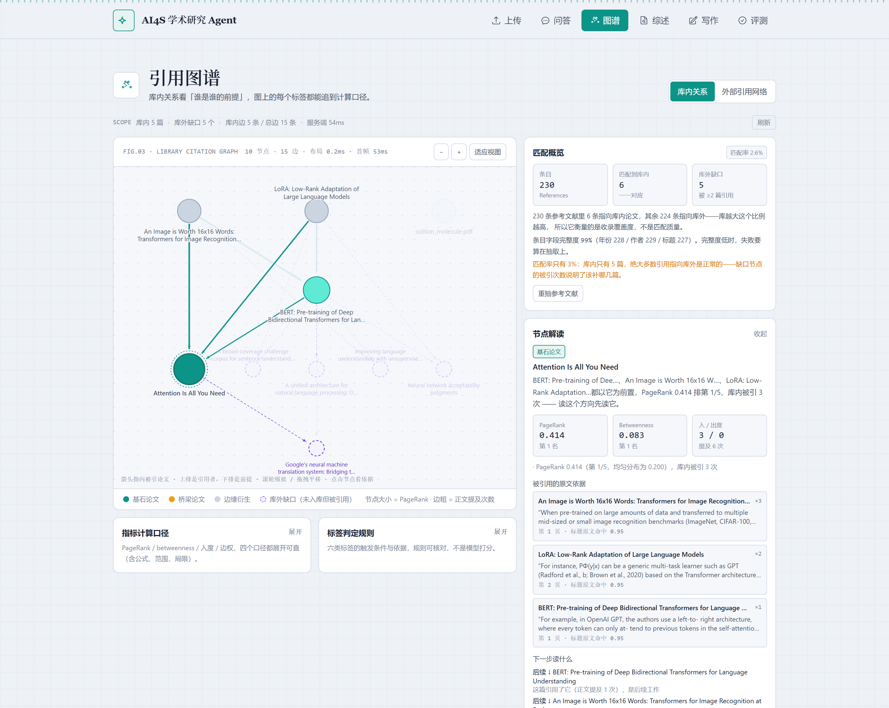
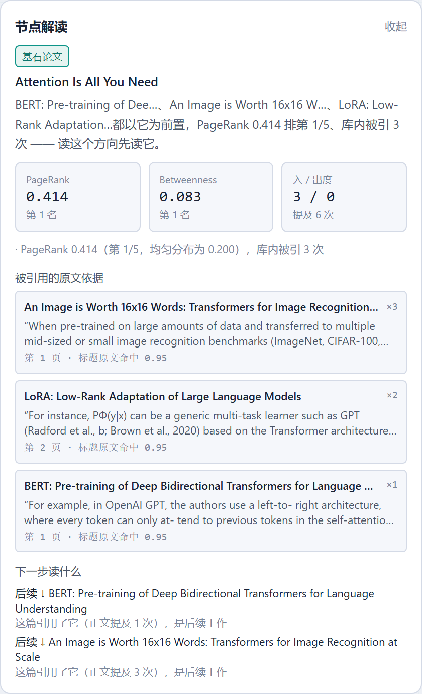
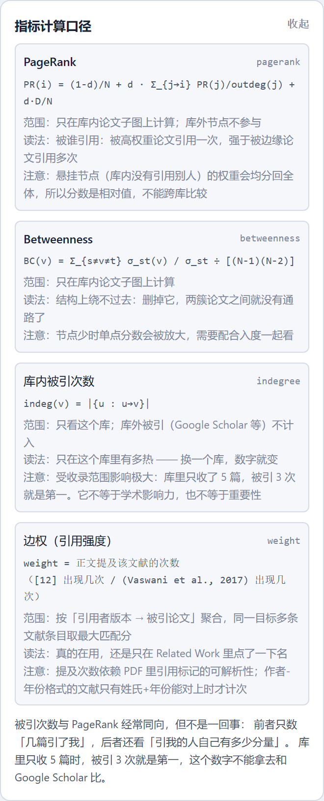
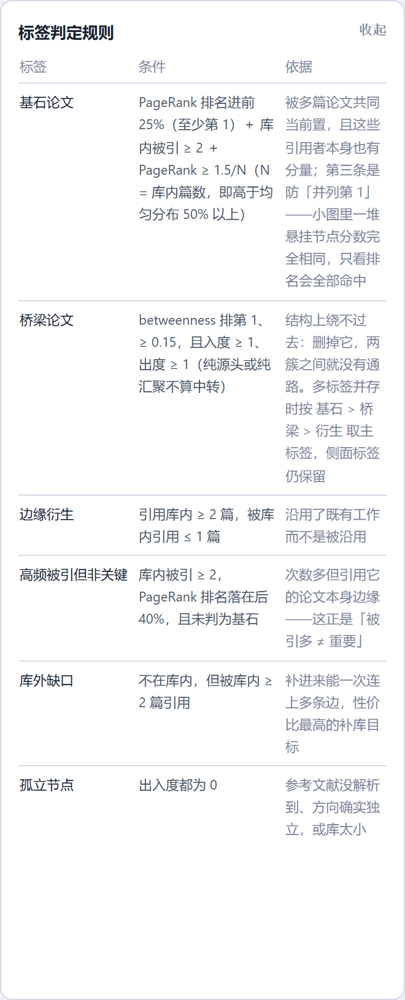
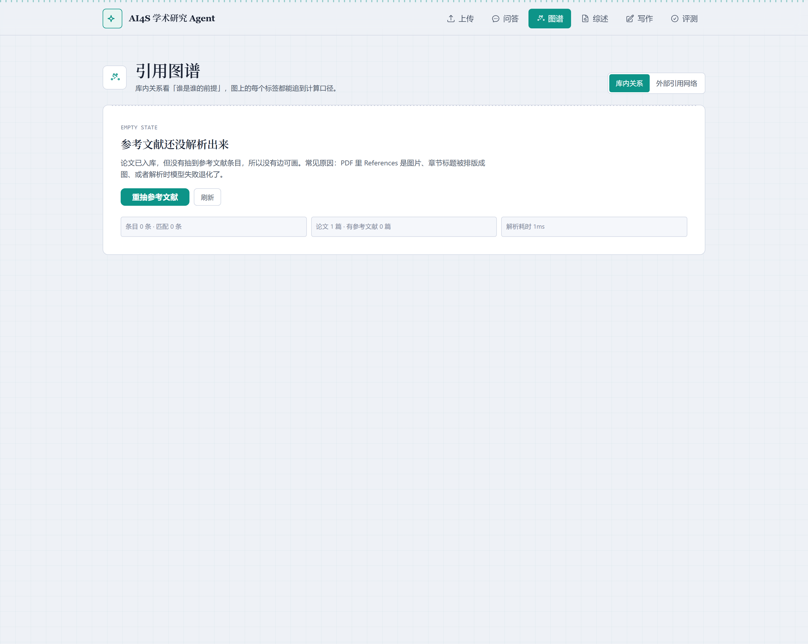

# 2.15 引用图谱：先抽干净参考文献，再谈「谁是谁的前提」

> 目标：图不只是好看，要给出「所以呢」。每条边能追到 PDF 里的那一句原文，每个标签能追到一个公式。

## 1. 先说一个坏消息：原来的参考文献是假的

图谱的边来自「一篇论文的参考文献条目 → 库内另一篇论文」。这条链上，条目错一条，边就错一条，PageRank 跟着全歪。所以动手画图之前，先抽查了库里已有的 `references_raw`：

| 论文（版本） | 抽到的条目 | 实际内容 |
|---|---|---|
| ViT v2 | 25 条 | 混进 `2`、`3`、`500`、`525`——这是附录里图注的坐标轴刻度 |
| LoRA v2 | 21 条 | 混进 `0`、`2`、`4`，同样是图注数字 |
| BERT v2 | 3 条 | 一整页文献被 LLM 合并成「第 1 条」 |
| Attention v7 | 36 条 | 条数对，但 `authors` 全空 |

两个根因：

1. **解析器进了「参考文献区」就再也没出来。** `pdf_parser` 用一个 `in_references` 标志剪切，标志置上之后没有退出条件，于是附录里的图注、表格备注全被并进 `references_raw`。ViT 的那些 `500`、`525` 就是附录图里的刻度。
2. **切条按行首数字做。** `_fallback_refs` 认为「行首是数字 → 这是一条新文献」，图注里的数字于是成了条目编号，后面半行图注就成了「文献」。

这两个问题都不是调参能解决的，所以这一版**另写了一套不依赖 LLM 的抽取**（`services/graph/refparse.py`），LLM 只保留在摘要/综述那些容错高的位置。

## 2. block 级切条：为什么既不用 LLM，也不按行切

PyMuPDF 的 `get_text("dict")` 按「排版块」返回文本。试了四个 PDF 之后确认：**在 ICLR / ACL 的参考文献排版里，1 个 block ≈ 1 条文献**。理由很实在——悬挂缩进让每条文献自成一个缩进块，而换行折行都在块内。

于是切条变成三件事：

| 步骤 | 做法 | 对应的坑 |
|---|---|---|
| 找起点 | 按**去空白后的前缀**匹配 `references` / `bibliography` / `参考文献`，取最后一个命中页 | ICLR 的小型大写把标题渲染成 `R EFERENCES`，直接字符串比对认不出 |
| 找终点 | 参考文献区的右边界 = **下一个同级标题**（字号 ≥ 正文且不是文献起始样式） | 比逐个匹配 "Appendix" 可靠：LoRA 的附录标题是 `A L ARGE ...`，压根不含 Appendix |
| 切条 | 遇到「新条目起始特征」才 flush，字符数 < 24 的碎片丢弃、> 900 的强制切断 | 单字符中间名（`Mitchell P Marcus`）会被误判成新条目，这一类放弃 |

「新条目起始特征」是一条正则，认这几种开头：`姓, 名`、`姓 名`、`[12]` / `12.` 编号、`van / von / de` 前缀、`A.` 缩写、以及姓氏后跟 `, & and`。

三个必须单独处理的细节：

1. **编号式文献保留原编号。** Attention 的参考文献是 `[1]…[40]`，正文里写「as shown in [37]」。如果按顺序重新编号，正文的 `[37]` 就会指到另一条文献。所以 `parse_entry` 把 `[37]` 里的 `37` 存成 `ref_index`，并置 `numbered=True`。
2. **arXiv 编号不能当年份。** `arXiv:2012.13255` 里的 `2012` 会被年份正则抓走，LoRA 的条目因此变成「2012 年」。修法是先把**裸编号**（`\d{4}\.\d{4,5}`，不带 `arXiv:` 前缀也算）挖掉，再找 19xx/20xx，且取最后一个（`Last, First. Title. Venue, 2019.` 里年份在末尾）。
3. **`Quoc V. Le.` 不是标题。** `Authors. Title.` 这种格式按句点切，`Le.` 会单独成段。`_split_authors` 里加了一条：短、以大写开头、以句点结尾的尾段视为人名残留，不算标题。

回填后（`POST /graph/refs/rebuild?force=true`）的实测：

| 论文 | 回填前 | 回填后 | 有年份 | 有作者 | 有标题 | 完整度 |
|---|---|---|---|---|---|---|
| Attention v7 | 36（authors 全空） | 36 | 36 | 36 | 35 | 0.9907 |
| BERT v2 | 3 | 56 | 56 | 56 | 56 | 1.0000 |
| ViT v2 | 25 | 58 | 58 | 58 | 56 | 0.9885 |
| LoRA v2 | 21 | 61 | 59 | 60 | 61 | 0.9836 |
| soliton_molecule.pdf | 19 | 19（重抽 0 条，**跳过不覆盖**） | 19 | 19 | 19 | 1.0000 |

合计 230 条，完整度 0.9913（年份 228 / 作者 229 / 标题 227）。Attention 缺的那 1 条是 `Mitchell P Marcus`，单字符中间名不认，1/40 的漏抽率接受。

`force=false` 时只处理「没有条目」或「完整度 < 0.6」的版本；重抽结果少于 3 条、或完整度低于 `min_score` 就不覆盖原数据——soliton 那篇就是这么被保护下来的（它是一篇非 CS 排版，block 规则不成立，重抽 0 条）。

## 3. 匹配：六级证据，而不是一个阈值

条目有了，下一步是把每条文献指向库内论文。这里的困难是**同一篇论文在不同 PDF 里写法不同**：`Attention Is All You Need` 可能写成 `Vaswani et al., Attention is all you need, NIPS 2017`。

一刀切阈值会有两个方向的错：定太低，`Language Models are Few-Shot Learners` 和 `Language Models are Unsupervised Multitask Learners` 会互相匹配（这两条在 ViT 和 BERT 的文献表里都出现过）；定太高，库里那篇标题被截断过的就对不上。

所以用**分级证据**，越硬的证据给越高的分：

| 证据 | 分数 | 条件 |
|---|---|---|
| arXiv ID 命中 | 0.99 | 条目里挖出的编号与库内论文的 arXiv ID 相同 |
| 库内标题整段出现在条目原文里（≥18 字符） | 0.95 | 前提是作者也对得上；作者对不上降到 0.74（多半是综述标题里的引用） |
| 标题归一化后相等 | 0.93 | 去掉连字、标点、空格、大小写后完全相同 |
| 标题 Dice ≥ 0.78 | 0.78–0.93 | 按比例给分 |
| 标题 Dice ≥ 0.55 且作者姓氏命中 | 0.70–0.90 | |
| 标题 Dice ≥ 0.50 且作者 + 年份都对 | 0.70–0.88 | |

`MATCH_MIN = 0.70`，低于它记为 `unmatched`，**但一定要带出「最接近的候选 + 分数」**——用户看到「0.28，最接近 BERT」和看到「未匹配」是两件事，前者能判断是抽取问题还是真的不在库里。

用 Dice 而不是 Jaccard：短标题被一个多余词打掉一半的代价太大，Dice 的分母是两边之和，对长度差更宽容。

实测（5 篇论文库，230 条文献）：

| 匹配方法 | 条数 | 占比 |
|---|---|---|
| `title_in_raw` | 5 | 2.2% |
| `arxiv_id` | 1 | 0.4% |
| `unmatched` | 224 | 97.4% |

**匹配率 2.61% 这个数字必须解释清楚，否则会被当成算法失败。** 它衡量的是**收录覆盖度**，不是匹配质量：库里只有 5 篇论文，而这 5 篇的参考文献合起来有 230 条，其中 224 条指向的论文根本不在库里——它们不可能被匹配到，也不该被匹配到。库里收到 200 篇时这个比例自然上去。

真正该看的是另一组数：**正文引用标记的解析率 123/130 = 94.6%**。这才是「抽取 + 匹配」这条链的健康度。

匹配失败的 top 样例（带最接近候选）：

| 引用者 | 条目 | 最接近 | 分数 |
|---|---|---|---|
| LoRA | Improving Language Understanding by Generative Pre-Training (GPT-1) | BERT | 0.282 |
| BERT | Class-based n-gram models of natural language | LoRA | 0.225 |
| ViT | Language models are few-shot learners (GPT-3) | LoRA | 0.171 |

GPT-1、GPT-3、Collobert 2008 这几条不在库里，分数自然低。0.28 和 0.17 的差别说明「最近的候选也不像」——这两个数字放在界面上，用户就知道该补库，而不是怀疑匹配坏了。

## 4. 构图：节点按论文，边权按提及次数

图的数据结构只有两类东西：

**节点 = 库内论文**（不是版本）。一篇论文有 v2、v7 时只出一个节点，取 `is_current DESC, finished_at DESC` 的那个版本作为引用者——否则同一篇论文会被拆成两个点，PageRank 被摊薄。

**边 = 有向边 `(引用者 → 被引论文)`**，权重是**正文提及次数**而不是 0/1：

- 引言里点一次名，和整节拿它做对照实验，是两种强度。
- 编号式直接映射（`[12]` → 第 12 条）；作者-年份式 `(Vaswani et al., 2017)` 按 `(姓氏, 年份 ± 1)` 反查。
- 标记解析不出来时权重记 1，并标 `weight_source=ref_only`——宁可低估强度，也不要丢边。

同一对 `(source, target)` 可能命中多条文献条目（同一篇论文被重复列了两次），聚合时权重累加、取最高匹配分、留 3 条原文依据。

## 5. 指标：三个口径都要能读，也要能说清边界

### PageRank：被谁引用

```
PR(i) = (1-d)/N + d · Σ_{j→i} PR(j)/outdeg(j) + d·D/N
d = 0.85，收敛阈值 1e-10，最多 200 次迭代
```

公式最后那项 `d·D/N` 是**悬挂节点**的处理，这一项不加会出事：引用图里最常见的形态就是「被引很多、自己不引库内任何论文」的节点（库太小的时候几乎全是这种）。它的 `outdeg = 0`，权重传不出去，迭代几轮之后总权重越来越小、分数全塌到接近 0。把悬挂节点的权重均分回全体，图才稳定。

代价是：**PageRank 是相对值，不能跨库比较**。5 篇的库里 0.41 是第一，200 篇的库里 0.41 是巨无霸。界面上不写「影响力」，只写「在本库中的相对分量」。

### Betweenness：结构上绕不过去

```
BC(v) = Σ_{s≠v≠t} σ_st(v)/σ_st ÷ [(N-1)(N-2)]
算法：Brandes，图**无向化**
```

无向化是刻意的：引用图是 DAG，直接算有向最短路的话，大量节点对之间根本不可达，BC 会大面积归零。而我们要回答的问题是「删掉它，两簇论文之间还有没有通路」——这个问题跟边的方向无关。

归一化因子是 `2/((N-1)(N-2))` 而不是 `1/((N-1)(N-2))`：Brandes 的实现里 `cb` 已经把 `(s,t)` 和 `(t,s)` 各数了一次，再除一次 2 就少了一半（这个 bug 让 5 节点图的 BERT 算出 0.0417，正确值是 0.0833）。

### 库内被引次数：只是「在这个库里有几篇引了我」

按引用者去重，不按提及次数。它的口径最容易解释，也最容易被误读——见下一节。

### 实测：5 篇论文的库

| 论文 | PageRank | 排名 | 入度 | 出度 | Betweenness | 标签 |
|---|---|---|---|---|---|---|
| Attention Is All You Need | 0.4137 | 1/5 | 3 | 0 | 0.0833 | 基石论文 |
| BERT | 0.2236 | 2/5 | 2 | 1 | 0.0833 | 一般节点 |
| ViT | 0.1209 | 3/5 | 0 | 2 | 0 | 边缘衍生 |
| LoRA | 0.1209 | 3/5 | 0 | 2 | 0 | 边缘衍生 |
| soliton_molecule | 0.1209 | 3/5 | 0 | 0 | 0 | 孤立节点 |

后三名分数完全一样（0.1209），这不是 bug：它们都是悬挂节点，权重被均分回全体，数值自然相同。`rank_desc` 对同分节点给同一个名次，所以三个都是「第 3/5」。

## 6. 「被引次数多」不等于「重要」

这是任务里点名要说明的一条，光在文档里写不够，得有一个能跑的反例。`eval/graph/check_graph.py` 里第四个场景就是这个：

| 节点 | 入度 | PageRank | 标签 |
|---|---|---|---|
| A（被 B、C 两篇引用，B 自己很有分量） | 2 | **0.2715** | **基石论文** |
| X（被 D、E、F 三篇引用，这三篇互相不引、自己也很边缘） | **3** | 0.1022 | 一般节点 |

断言：`PR(X) < PR(A)` 且 `X != cornerstone`。差别不在「被引了几次」，在「被谁引」——B 把 A 的分量带给了 A，而 D/E/F 三篇把各自那点分量摊给了 X。

第一版反例写错了，值得记一笔：最初让 D/E/F 各自多引 5 篇其它文献，结果 H 的 PR 反而高于 Q。原因是被引者越多、权重被摊得越薄，那个"反例"其实在证明相反的事。换成「两篇重量级 vs 三篇轻量级」才是正确的最小反例。

## 7. 标签规则：三处必须加约束的地方

规则表是直接返给前端展示的（`RULES`），不是黑盒打分。写规则时踩了三个坑，每一个都改成了显式条件：

### 坑一：小图上的「前 25%」会被并列第 1 骗过去

10 节点的图里有 6 个悬挂节点，PageRank 完全相同、并列第 1，全都满足「排名进前 25%」。于是加了一条**绝对量约束**：

```python
cornerstone_cut = max(1, int(round(total * 0.25)))
dominant = pr >= 1.5 / total          # 至少是均匀分布 1/N 的 1.5 倍
if pr_rank <= cornerstone_cut and node.in_degree >= 2 and dominant:
    tags.append("cornerstone")
```

「排名靠前」说它相对不差，「高于均匀分布 50%」才说分数集中在它身上。

### 坑二：桥梁必须是「中间」节点

第一版只看 `bc_rank == 1 and bc >= 0.15`，于是纯汇聚点（只有入边、没有出边）被标成了桥梁。但汇聚点不是中转——它下面没东西了。加了 `in_degree >= 1 and out_degree >= 1`。

对应的 `sentence()` 也分两种句式：有上游有下游时说「它是 A 与 B 之间的中转」，只有上游时说「它把多篇论文串在同一条上游上」——避免出现「与下游之间的中转」这种空话。

### 坑三：多标签并存时，主标签按优先级取，其它保留

一篇论文既可以是基石也是桥梁。`classify` 返回 `(primary, tags, reasons)`，`tags` 全留着，`primary` 按 `基石 > 桥梁 > 衍生 > 高频被引` 取。只报一个会丢信息，报全部又没法配色。

最终六条规则（与 `insight.py` 里的 `RULES` 逐字一致）：

| 标签 | 条件 | 依据 |
|---|---|---|
| 基石论文 | PageRank 进前 25%（至少第 1）＋ 库内被引 ≥ 2 ＋ PageRank ≥ 1.5/N | 被多篇共同当前置，且引用者本身有分量；第三条防并列第 1 |
| 桥梁论文 | betweenness 排第 1、≥ 0.15，且入度 ≥ 1、出度 ≥ 1 | 删掉它两簇之间没有通路 |
| 边缘衍生 | 引用库内 ≥ 2 篇，被库内引用 ≤ 1 篇 | 沿用既有工作，不是被沿用 |
| 高频被引但非关键 | 库内被引 ≥ 2，PageRank 落在后 40%，且未判基石 | 次数多但引用者边缘——正是「被引多 ≠ 重要」 |
| 库外缺口 | 不在库内，但被库内 ≥ 2 篇引用 | 补进来能一次连上多条边 |
| 孤立节点 | 出入度都为 0 | 参考文献没解析到、方向独立，或库太小 |

实测里 BERT 的 betweenness 是 0.0833、排第 1，但没被标成桥梁——因为 `bc >= 0.15` 这条没过。5 个节点的图里 0.0833 只说明「它在中途」，说「绕不过去」还差得远。这就是阈值存在的意义：**排名第 1 和「占主导」是两件事**。

## 8. 一句式解读的生成规则

每个节点一句，句式固定、必须带数字、必须能落到动作上。规则就是「标签 → 模板」，模板里只填三样东西：引用者名字（最多 3 个）、指标值、动作。

| 标签 | 句式 | 动作 |
|---|---|---|
| 基石 | `{引用者}都以它为前置，PageRank {PR} 排第 {r}/{N}、库内被引 {k} 次 —— 读这个方向先读它。` | 先读它 |
| 桥梁 | `它是 {上游} 与 {下游} 之间的中转，betweenness {BC} 排第 1（PageRank 第 {r}/{N}）—— 跳过它会漏掉两条引用链的交汇。` | 别跳过 |
| 边缘衍生 | `它引用了{前置}、却没有被库内任何论文引用 —— 属于沿用既有工作，读它之前先把它引的那几篇读掉。` | 先读前置 |
| 高频被引但非关键 | `库内被引 {k} 次看着不少，但引用它的是{引用者}，PageRank 只排第 {r}/{N} —— 次数多不等于关键。` | 别只看次数 |
| 库外缺口 | `库内 {引用者}都引用了它，但库里没有这篇 —— 补进来能一次连上 {k} 条边，是当前性价比最高的补库目标。` | 补库 |
| 孤立 | `库内既没有引用它、也没有被它引用 —— 可能是刚上传还没解析出参考文献，也可能是这个方向确实独立。` | 查解析 |
| 上游起点 | `它引用了库内 {m} 篇、没有被库内引用，PageRank 第 {r}/{N} —— 库内的上游输入，位于引用链的起点。` | 往库外找 |
| 汇聚点 | `它被库内 {k} 篇引用、自己不引用库内论文，PageRank 第 {r}/{N}（均匀分布为 {1/N}）—— 是汇聚点，但集中度还不足以称基石。` | 看集中度 |

实测输出（基石）：

```
BERT: Pre-training of Dee…、An Image is Worth 16x16 W…、LoRA: Low-Rank Adaptation…
都以它为前置，PageRank 0.414 排第 1/5、库内被引 3 次 —— 读这个方向先读它。
```

括号里的「均匀分布为 0.077」这类补充不是装饰：它让「0.414 算高吗」这个问题当场可答。

**一跳推荐**的规则更简单：先给 `cites`（本节点的前置），不够再给 `cited_by`（后续），各按对方 PageRank 排序，最多 2 条，每条带一句为什么：

```
前置 ↑ Attention Is All You Need      它引用了这篇（正文提及 2 次），是本节点的前置
后续 ↓ An Image is Worth 16x16 Words…  这篇引用了它（正文提及 3 次），是后续工作
```

先给前置是有意的：读者在一篇论文上停住时，「读它之前该先读什么」比「谁又引了它」更有用。

## 9. 前端：分层静态布局，不降级也不需要降级

约束里写「20 节点渲染不得超 3s，允许降级为静态布局」。这里的选择是**一开始就用静态分层布局**，压根没有力导向那条路：

- 引用图是 DAG，力导向会把「谁引谁」揉成一团；分层布局把引用者放上排、被引者放下排，读起来就是「往下是前提」。
- 静态布局是确定性的：同一份数据每次渲染坐标一样，截图和文档里的结论才对得上。力导向每次跑出不同的图。
- 成本是 O(V·E) 的松弛 + 两趟排序，20 个节点是毫秒级，没有「慢到需要降级」的场景。

实测：**布局 0.2ms · 首帧 45ms**（`requestAnimationFrame` 量首帧，含 React 渲染与 SVG 绘制）。

三个实现细节：

1. **层号 = 到最上游引用者的最长路径**，不是最短。用最短的话，「A 被 B 和 C 引用、C 又被 B 引用」时 A 会被排到 B 旁边，而不是下面。
2. **层内排序用两趟重心扫描**（Sugiyama）。只做自上而下那趟时，最上层没有父节点、只能按标题字母序排，于是 ViT 和 LoRA 的左右次序与下层的 BERT 对不上，跨整幅图拉一条对角线。加一趟自下而上按子节点重心排序才对消。
3. **标签上下交替，顺序按布局后的 x 从左到右算。** 一行放 5 个节点时标签宽度超过间距，必须错开两条带。第一版按 `nodes` 数组原顺序算行号——那是 payload 顺序，与画出来的左右次序无关，结果相邻两个都在同侧、标签直接叠上（截图里「A unified architecture for…」压着「Improving language…」）。改成按 `positions.x` 排序后消失。

画布高度按**层数**给（`rows * 108 + 104`，限制在 360–580），不按宽度比例拍。固定的 `0.54 × 宽` 在 4 层的图上只有 82px 层距，而一层的标签带就要占掉 60px，必然挤进相邻层。

## 10. 交互：图上点一下，右侧就是这一篇的全部依据

- **点节点**：选中并高亮，非邻居降到 0.25 透明度。右侧「逐条解读」切成「节点解读」，显示标签、指标三卡、判定依据、被引原文依据、一跳推荐。
- **拖拽移动 / 滚轮缩放 / 适应视图**：图上标注了「点击节点看依据」，手感上拖拽和点击要能分开——按下时记住命中的节点，位移超过 3px 就不算点击。
- **被引依据带页码与匹配方法**：每条显示「第 1 页 · 标题原文命中 0.95」，`×3` 是提及次数。这一步是「边能追到原文」的兑现方式。

一个实现坑：`onDown` 里对 `<svg>` 调 `setPointerCapture` 之后，`pointerup`/`click` 会被重定向到 svg，节点自己的 `onClick` 永远不触发——表现就是「点节点没反应」。改成在 `onUp` 里按按下时的命中结果判定，且只有「没拖动」才算点击。



上图 10 个节点、15 条边（5 条库内 + 10 条指向库外缺口）。Attention 在最下排：它是三篇的共同前置。ViT 和 LoRA 并排在上排（同类位置），BERT 在中间。虚线紫圈是库外缺口，箭头指向它们表示「库内有人引了库外的这篇」。



选中基石节点后的整页：图变暗、只看一跳邻居；右栏换成节点解读——PageRank 0.414（第 1/5）、Betweenness 0.083（第 1）、入/出度 3/0、提及 6 次，下面是三条被引原文依据（含页码与匹配方法）和两条后续推荐。



## 11. 侧栏：匹配概览、计算口径、判定规则

四个卡，各回答一个「凭什么」：

| 卡 | 回答的问题 | 关键内容 |
|---|---|---|
| 匹配概览 | 这张图的数据可信吗 | 条目 230 / 匹配到库内 6 / 库外缺口 5；匹配率 2.6% 并**当场解释这个数衡量的是覆盖度不是质量**；完整度 99%；warnings |
| 指标计算口径 | 标签怎么算出来的 | 四个口径各给公式、参数、范围、读法、注意 |
| 标签判定规则 | 为什么它是基石不是别人 | 六条规则的表格，条件与依据 |
| 逐条解读 / 节点解读 | 所以呢 | 每篇一句，点开看全部依据 |

口径卡放在图的正下方而不是右栏末尾：「看完图有疑问，视线往下一挪就能查」，不用先滚过一屏解读。



四个口径都写着**局限**，不是只写公式。入度那一条明写：「受收录范围影响极大：库里只收了 5 篇，被引 3 次就是第一。它不等于学术影响力，也不等于重要性」。



底部还有一句固定的话，把「被引次数与 PageRank 的关系」讲透：

> 被引次数与 PageRank 经常同向，但不是一回事：前者只数「几篇引了我」，后者还看「引我的人自己有多少分量」。库里只收 5 篇时，被引 3 次就是第一，这个数字不能拿去和 Google Scholar 比。

## 12. 空态：三种「没有图」，三种说法

约束里写「无引用数据必须有明确空态，不能画空图」。空态不是一个通用页面，按原因分三类，每类给「原因 + 该做什么」：

| `empty_reason` | 触发 | 文案 | 动作 |
|---|---|---|---|
| `no_papers` | 课题里一篇论文都没有 | 「这个课题还没有论文」+ 边来自参考文献与正文标记 | 去上传 |
| `no_references` | 有论文但条目为 0 | 「参考文献还没解析出来」+ 三个常见原因（References 是图片、章节标题被排成图、解析时模型失效） | 重抽参考文献 |
| `no_edges` | 条目有了但没有一条指向库内 | 「这些论文之间还没有引用关系」+ 提示库太小或方向确实独立 | 刷新 / 补库 |



空态下方保留三个小数字（条目 0 条 · 匹配 0 条 / 论文 1 篇 · 有参考文献 0 篇 / 解析耗时 1ms）。没有这三个数，用户分不清「没数据」和「加载失败」。

## 13. 实测汇总

| 指标 | 值 |
|---|---|
| 服务端构图耗时（5 篇 / 230 条文献） | 36–38ms |
| 节点 / 边 | 10 节点（5 库内 + 5 缺口）· 15 边（5 库内 + 10 缺口） |
| 正文引用标记解析率 | 123/130 = 94.6% |
| 条目字段完整度 | 0.9913 |
| 前端布局耗时 | 0.2ms |
| 首帧（挂载 → 首次绘制） | 45ms |
| 20 节点 / 22 边算指标 | 0.20ms，23 次迭代收敛 |

`eval/graph/check_graph.py` 四个场景的断言：

| 场景 | 断言 | 结果 |
|---|---|---|
| 星形（A 被 4 篇引用） | A 必为 cornerstone | 通过（PR 0.524、BC 1.000） |
| 桥梁（A/C → B → D） | B 必为 bridge，BC = 0.6667 | 通过 |
| 反例（in=2 vs in=3） | `PR(X) < PR(A)` 且 X 不是 cornerstone | 通过（0.1022 < 0.2715） |
| 20 节点 / 22 边 | 指标计算 < 1ms | 通过（0.20ms） |

## 14. 边界与已知问题

1. **匹配率低不是算法问题，是库小。** 2.6% 这个数在 5 篇的库里必然出现，230 条文献里 224 条指向库外。界面上已经明写了这一点，warnings 里也会在低于 30% 时提醒。判断算法好坏要看标记解析率（94.6%）。
2. **抽取覆盖率取决于 PDF 排版。** CS 会议的标准排版（ICLR/ACL）能到 95%+；非 CS 排版（实测的 soliton 那篇）block 规则不成立，重抽 0 条——这种情况下 `force=false` 会跳过，不覆盖原有数据。
3. **作者-年份式的提及次数依赖姓氏 + 年份对上。** `(Vaswani et al., 2017)` 要求姓氏能反查到条目、年份在 ±1 内。对不上时退化为「按条目原文归并」，权重记 1。
4. **缺口节点不参与 PageRank / betweenness。** 它们不在库里，没有出边数据，算进去会污染分母。界面上缺口节点的这两格显示「库外不参与」，而不是 0——0 会被读成「分数很低」。
5. **同分并列是常态，不是异常。** 一堆悬挂节点的 PageRank 完全相同。`rank_desc` 给同分节点同名次，标签规则里靠 `dominant` 区分，不靠排名。
6. **单字符中间名会漏抽。** `Mitchell P Marcus` 这种写法不被 `_ENTRY_START_RE` 认，Attention 40 条里漏 1 条。为这一个特例放宽正则的代价是误切率上升，不划算。
7. **图谱只反映库内 5 篇的关系。** 「基石论文」是**这个库里的**基石，不是这个领域的。换成 200 篇的库重算，标签可能全变。
8. **`/graph/library` 每次请求都重算**，没有缓存。36ms 不值得加缓存，但库到几千篇时需要（那时应该落物化视图，而不是加内存缓存）。

## 15. 代码与接口

```
backend/app/services/graph/
  refparse.py    参考文献抽取：block 切条、标题/作者/年份/编号解析、质量评分
  match.py       条目 → 库内论文：六级证据 + Dice + 最接近候选
  markers.py     正文引用标记：编号式、作者-年份式，落 citations 表并给出提及次数
  metrics.py     PageRank（含悬挂节点）/ betweenness（Brandes，无向化）/ degree / 排名归一化
  insight.py     标签规则（RULES）+ 一句式解读（sentence）+ 一跳推荐（recommend）
  store.py       数据访问：库内论文、文献条目、正文 chunk、citations 读写
  backfill.py    历史版本重抽 + 重建 citations（不覆盖低质量结果）
  service.py     编排：build() 组装节点/边/指标/标签/解读，空态三分类
backend/app/api/v1/endpoints/graph.py
  GET  /graph/library?project_id=&include_gaps=&max_gaps=&min_gap_citers=   只读构图
  POST /graph/library/build?project_id=&persist=                            构图并回写 matched_paper_id
  POST /graph/refs/rebuild?project_id=&force=&dry_run=&max_pages=           重抽参考文献
  POST /graph/build + GET /graph/{arxiv_id}/high-impact                     OpenAlex 外部网络（另一条线）
frontend/src/components/graph/
  libraryTypes.ts    节点/边/指标口径/判定规则/整包的类型
  libraryLayout.ts   分层布局：最长路径定层 + 两趟重心排序 + 半径按 PageRank
  LibraryGraph.tsx   SVG 渲染：缩放/拖拽/选中/邻居高亮/标签交替/图例
  GraphInsight.tsx   侧栏：匹配概览 + 逐条解读 / 节点解读
  GraphMethodCards.tsx  指标计算口径 + 标签判定规则（放图的正下方）
frontend/src/app/graph/page.tsx   两个 Tab：库内关系（默认）/ 外部引用网络
backend/eval/graph/check_graph.py 四个带断言的场景
```

外部引用网络（OpenAlex）与库内图谱是两个数据源，刻意没有合并：外部网络没有库里那 230 条文献的原文依据，混进来会让「边能追到原文」这条承诺失效。两套指标口径也不通用，所以放在两个 Tab 里。
