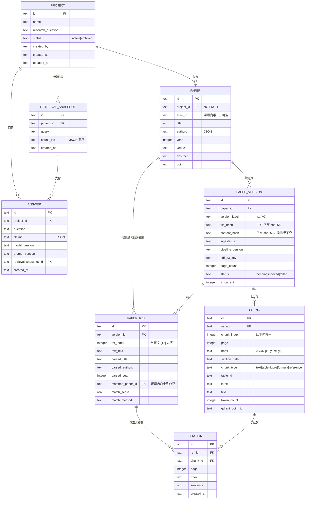

# 2.6 · 课题（Project）级数据模型

> 本步只做数据模型与读写路径，不重构界面。目标是把产品的最小对象从「一篇论文」上移为「一个课题」，
> 并为溯源、图谱、去重预留完整字段。

## 一、为什么要改

改造前，"论文"是个**隐式对象**：`arxiv_id::version` 这个字符串就是主键，
元数据塞在 Qdrant 的 `ai4s_paper_meta` payload 里，正文在 `ai4s_papers` collection 里，
两者靠字符串约定对齐。由此带来四个无法回避的问题：

| 问题 | 表现 |
|---|---|
| 论文没有归属 | 无法回答"这篇论文属于哪个课题"，多课题并存时会串数据 |
| 版本是字符串后缀 | v1 与 v7 共用一份元数据，`paper_meta` 的 `body_hash` 只能记住最后一次入库的那个 |
| 无法定位引用 | 只知道论文 A 引用了论文 B，不知道**在第几页第几句话说**的 |
| 去重靠向量 | `find_similar_by_embedding` 只能靠语义阈值，没有可审计的键 |

一句话：**隐式关系撑不起溯源**。所以补一层关系存储。

## 二、实体关系



**反查链**（自检标准要求的路径）：

```
citation → paper_ref → paper_version → paper → project
   ↓          ↓              ↓
 page/bbox  ref_index    version_label
 sentence
```

这条链路在库里被固化成一个视图 `v_citation_provenance`，调用方一次 `SELECT` 即可，
不用自己 join 五张表。

## 三、约束

| 约束 | 实现方式 |
|---|---|
| 论文必须归属课题 | `papers.project_id NOT NULL` + 外键 `ON DELETE CASCADE` |
| Chunk 必须能反查到 version | `chunks.version_id NOT NULL` + 外键 |
| 同一课题内 arxiv_id 不重复 | `UNIQUE(project_id, arxiv_id)` |
| 同一论文版本号不重复 | `UNIQUE(paper_id, version_label)` |
| 同一论文同一文件不重复入库 | `UNIQUE(paper_id, file_hash)` |
| 引用编号不错位 | `UNIQUE(version_id, ref_index)`，且 ref_index 优先取原文条目自带编号 |
| 删课题不残留 | 全部子表 `ON DELETE CASCADE`；`citations.chunk_id` 用 `SET NULL`（删 chunk 不连带删引用证据） |

## 四、写入路径

```
POST /papers/upload
  ├─ 解析 project_id（未传 → 默认课题；传了不存在 → 404，不静默兜底）
  ├─ PaperRepository.upsert_paper()          → papers 行
  ├─ PaperVersionRepository.create()         → paper_versions 行（status=pending）
  └─ parse_and_index_pdf.delay(project_id, paper_id, version_id)

Celery: parse_and_index_pdf
  ├─ 若没拿到 project_id/paper_id/version_id（定时追新等入口）→ _ensure_version() 现场补齐
  └─ chord 分页解析 → merge_parsed_chunks

Celery: merge_parsed_chunks
  ├─ index_fragments()                       → Qdrant（原有路径不变）
  ├─ upsert_paper_meta()                     → Qdrant（原有路径不变）
  ├─ ChunkRepository.bulk_create()           → chunks
  ├─ ReferenceRepository.bulk_create()       → paper_refs
  ├─ extract_from_chunks() → bulk_create()   → citations
  ├─ ReferenceRepository.match_to_project()  → 回填 matched_paper_id
  └─ PaperVersionRepository.mark_indexed()   → status=indexed
```

**关键设计**：结构化落库失败**不回滚**向量索引。向量已经可检索，结构可以靠迁移脚本补；
反过来（结构写成功、向量失败）才是不可接受的。

`chunk.qdrant_point_id` 与 `VectorStoreService.index_fragments` 的点 ID 算法一致
（`md5("frag::{arxiv_id}::{version}::{kind}::{idx}")`），检索命中后可以 point → chunk → page/bbox 直接反查。

## 五、迁移

```bash
# 默认 dry-run，只输出影响面与异常行
python scripts/migrate_to_projects.py

# 真正写入（幂等，重复跑不会产生重复行）
python scripts/migrate_to_projects.py --apply

# 指定课题名 / 保存报告 / 关闭引用补抽
python scripts/migrate_to_projects.py --project "我的课题" --report /tmp/r.txt --no-derive-citations
```

**dry-run 报告实测**（2026-11-09，2 篇旧论文）：

```
目标课题           : 默认课题
扫描论文版本       : 2
计划写入 chunk     : 106
计划写入参考文献   : 59
可抽取引用位置     : 73  （由 chunk 文本现场抽取）
异常行             : 0
```

apply 后实际写入：论文 2 / 版本 2 / chunk 106 / 参考文献 59 / 引用位置 73。

**异常行类型**（脚本会分类统计 + 抽样展示前 30 条）：

| 类型 | 含义 | 处理 |
|---|---|---|
| `meta_missing_arxiv_id` | 元数据没有 arxiv_id | 跳过，无法归属 |
| `meta_missing_title` | 没有标题 | 用 arxiv_id 顶替并记录 |
| `duplicate_meta_key` | 同一 (arxiv_id, version) 出现两次 | 保留第一条 |
| `orphan_chunk` | 有正文但找不到对应元数据 | 跳过，否则不知道属于哪篇 |
| `chunk_empty_text` | 空文本块 | 跳过 |
| `ref_missing_content` | 参考文献条目既无标题也无原文 | 记录，仍写入（保留序号占位） |

## 六、自检结果

```bash
python scripts/verify_provenance.py
```

```
[2] 同一篇论文的 v1 与 v7
  ✅ PASS  v1 与 v7 属于同一 paper
  ✅ PASS  新版本成为 current，旧版本保留

[6] 从一条引用反查：论文 / 版本 / 页码 / 句子
  │ 课题      : 自检课题 · Attention 溯源
  │ 论文      : Attention Is All You Need  (arXiv:1706.03762)
  │ 版本      : v7   入库于 2026-11-09T10:43:31Z
  │ 页码      : p.2
  │ 位置框    : [72.0, 176.2, 523.1, 210.4]
  │ 参考文献  : [1] Hochreiter, S. and Schmidhuber, J. Long Short-Term Memor...
  │ 所在句子  : We propose the Transformer, a model architecture eschewing recurre...
  ✅ PASS  反查到论文 / 版本 v7 / 页码 p.2 / 句子 / 课题

[7] 版本隔离：v1 查不到 v7 的引用     ✅ PASS
[8] 约束：外键拦截无课题论文          ✅ PASS
总结论：✅ PASS
```

在**真实迁移数据**上同一条查询（引用次数最多的那条）：

```
课题      : 默认课题
论文      : Attention is All You Need论文.pdf (arXiv:1706.03762)
版本      : v1
页码      : p.2
位置框    : [108.0, 70.49, 190.81, 86.04]
引用      : [38] Yonghui Wu, Mike Schuster, Zhifeng Chen, ...
句子      : Numerous efforts have since continued to push the boundaries of recurrent language models...
被引次数  : 7 处
```

## 七、已知偏差与后续

| 项 | 现状 | 后续 |
|---|---|---|
| `file_hash` | 迁移时用 `content_hash` 顶替（旧数据没有 PDF 字节 hash） | 需要按文件字节去重时，用原 PDF 重算 |
| `citations.bbox` | 段落级框，不是句子级 | 解析阶段已有 page 对象，可用 `page.search_for(sentence)` 提升精度，表结构不用改 |
| `section_path` | 目前只有一级（如 `1 Introduction`），取自解析器的 `current_section` | 章节树 `chapter_tree` 已存在，可升级为 `3 Method > 3.2 Attention` |
| `chunk_type` | 解析器的 kind 是 paragraph/chapter/table/figure/formula/reference/reference | 已映射为 text/table/figure/formula/reference |
| `token_count` | 按字符数粗估（CJK 1.6 字符/token，英文 4 字符/token） | 只用于预算，不参与计费；需要精确值时接 tiktoken |
| `answers.claims` | 表结构就绪，写入路径未接（本步不做界面/QA 重构） | QA 服务改造时按 `claims[].citations` 存 Citation.id |
| 存储引擎 | SQLite（WAL），api 与 worker 共享一个卷 | 数据量上来后可平移到 Postgres，Repository 接口不变 |

## 八、新增/改动文件

```
backend/app/db/schema.sql               ← 8 张表 + 反查视图 + 12 个索引
backend/app/db/connection.py            ← WAL / 外键 / busy_timeout / 事务原语
backend/app/models/entities.py          ← 7 个 dataclass（与表一一对应）
backend/app/repositories/*.py           ← 5 个 Repository + base
backend/app/services/citation_extractor.py  ← [12] / (Author, 2017) 抽取
backend/app/core/config.py              ← db_path / default_project_name / pipeline_version
backend/app/main.py                     ← 启动时 init_db()
backend/app/api/v1/endpoints/papers.py  ← 上传/导入兼容写入，响应字段向后兼容
backend/app/tasks/tasks.py              ← 解析后回填 chunks / refs / citations
backend/scripts/migrate_to_projects.py  ← 迁移 + dry-run
backend/scripts/verify_provenance.py    ← 自检
frontend/src/types/document.ts          ← 前端类型契约
docker-compose.yml                      ← app_data 卷 + DB_PATH
```

对外接口路径**未改动**：`/api/v1/papers/upload`、`/api/v1/papers/arxiv/import` 的 URL 与原有响应字段全部保留，
只新增了可选的 `project_id` 入参和 `project_id / paper_uuid / version_id` 出参。
