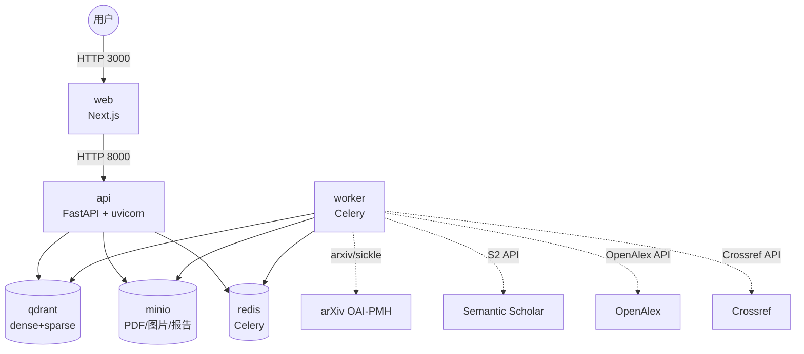

# AI4S 学术研究 Agent 架构说明

> 本文档面向答辩评审，说明“为什么这么选”：每一级设计决策都服务于**可验证、可复现、可溯源**的核心目标。

## 1. 总体架构

**关键设计决策**：6 个服务挂在一个 bridge 网络 `ai4s-net` 上，服务名即 DNS；单镜像同时承载 API 与 Celery Worker，避免依赖版本漂移；所有对象存储 bucket 在容器启动脚本中初始化，保证 `docker compose up` 后正好 6 个服务。

## 2. 模块架构与决策

### 2.1 数据接入与入库

| 组件 | 文件 | 职责 |
|---|---|---|
| arXiv 单篇/追新 | `backend/app/services/arxiv_client.py` | arxiv 库单篇查询 + sickle OAI-PMH 增量追新 |
| Semantic Scholar | `backend/app/services/s2_client.py` | paperId、references、citations、influentialCitationCount |
| 向量化与去重 | `backend/app/services/vector_store.py` | chunk 向量 + paper_meta 引用关系，双重去重 |
| 批量入库脚本 | `backend/scripts/ingest.py` | PDF 目录 / arXiv ID 列表批量入队 |

**关键决策**：唯一键使用 `arxiv_id+version`，叠加 `body_hash` 精确去重 + `bge-m3` 正文 embedding 相似度（阈值 0.96）语义去重。这样既能拒绝重复上传，也能合并不同文件名但内容相同的稿件，还能识别 arXiv 小版本差异。

### 2.2 结构化 PDF 解析

| 组件 | 文件 | 职责 |
|---|---|---|
| 文本/布局解析 | `backend/app/services/pdf_parser.py` | PyMuPDF + pdfplumber，按页范围解析段落、标题、表格 |
| 图表抽取 | `backend/app/services/figure_extractor.py` | 提取内嵌图像，就近匹配 caption，vision 模型生成说明 |
| 公式抽取 | `backend/app/services/formula_extractor.py` | 规则定位公式行，渲染区域为图，vision LLM 转 LaTeX |
| 章节树 | `backend/app/services/chapter_parser.py` | 字体大小启发式 + LLM 校正，生成≥三级章节树 |
| 异步分块 | `backend/app/tasks/tasks.py` | 30 页/子任务 + group/chord 合并 |

**关键决策**：541 页长文档必须拆分并行解析，图片直传 MinIO，子任务只返回轻量元数据，避免单任务超时/OOM。

### 2.3 检索层

| 组件 | 文件 | 职责 |
|---|---|---|
| 检索服务 | `backend/app/services/retrieval_service.py` | dense(bge-m3) + sparse(BM25) 双路召回 + RRF 融合 |
| 向量库 | `backend/app/services/vector_store.py` | Qdrant named vectors，统一 fragment 索引 |

**关键决策**：显式拆分 `dense_search` 与 `sparse_search`，再用无参数 RRF（k=60）融合，不训练、不调权重，结果稳定可复现；返回片段必须携带 `page`/`paragraph`/`bbox`/`kind`，供前端溯源高亮。

### 2.4 可溯源抗幻觉问答

| 组件 | 文件 | 职责 |
|---|---|---|
| QA 服务 | `backend/app/services/qa_service.py` | 强制引用、引用校验、拒答、写 provenance 日志 |
| Provenance schema | `backend/app/schemas/provenance.py` | 日志结构定义 |

**关键决策**：当检索为空或最佳 RRF 分数低于 `MIN_RRF_SCORE=0.03` 时直接拒答，把“拒答率”作为可量化的抗幻觉指标；强制每句话后挂 `[引#N]`，后处理校验 ID 不存在则替换为 `[无依据]`。

### 2.5 跨文献推理

| 组件 | 文件 | 职责 |
|---|---|---|
| 推理服务 | `backend/app/services/reasoning_service.py` | 多跳问答、跨文献对比、矛盾发现 |

**关键决策**：最多 3 跳子问题迭代检索，每跳结论必须 grounding 回原文；矛盾检测作为独立 pass 在综合答案前执行，显式返回 `claim_a`/`claim_b`/`chunk_id` 对，避免生成模型掩盖冲突。

### 2.6 引用图谱 + 综述生成

| 组件 | 文件 | 职责 |
|---|---|---|
| 图谱服务 | `backend/app/services/graph_service.py` | 用 S2/OpenAlex 建图，计算引用含金量 |
| 综述服务 | `backend/app/services/review_service.py` | 强制句句引用、Markdown 导出 |

**关键决策**：引用含金量 = `log1p(influentialCitationCount)` 归一化，低于 0.1 的边标记 `is_perfunctory` 并过滤，从而剔除应付式引用；图谱节点 `source_url` 优先 MinIO presigned，其次回退 arXiv PDF。

### 2.7 写作 / 绘图辅助

| 组件 | 文件 | 职责 |
|---|---|---|
| 绘图服务 | `backend/app/services/drawing_service.py` | 生成 matplotlib / mermaid 代码并渲染 |

**关键决策**：用代码生成替代文生图模型，配合请求哈希缓存与 `temperature=0`，保证同输入同输出、可复现、可溯源；matplotlib 代码在受限环境（AST 白名单 + 安全 builtins）中执行。

### 2.8 前端（Next.js）

| 组件 | 文件 | 职责 |
|---|---|---|
| PDF 高亮组件 | `frontend/src/components/PdfViewer.tsx` | pdf.js 动态导入，按 page/bbox 高亮 |
| 问答页 | `frontend/src/app/qa/page.tsx` | 点击引用回跳 PDF 原位 |
| 图谱页 | `frontend/src/app/graph/page.tsx` | 缩放/平移/点跳 |
| 评测报告页 | `frontend/src/app/eval/page.tsx` | 历史报告列表与详情 |

**关键决策**：页面级状态用 React `useState`，跨页面 PDF 定位通过 URL query / props 传递，不引入全局状态库，降低 SSR/hydration 复杂度。

### 2.9 评测与可复现

| 组件 | 文件 | 职责 |
|---|---|---|
| Golden QA | `backend/eval/golden_qa.json` | 4 份官方 PDF 共 40 条细粒度事实问答 |
| 评测脚本 | `backend/scripts/eval_runner.py` | 调用 QA、缓存输出、生成 Markdown 报告 |

**关键决策**：`temperature=0` 与固定模型保证基本确定性，但为严格兜底 API 非确定性，首次运行后将每条 QA 输出按问题哈希缓存，后续运行直接复用，并生成 `output_hash` 与历史报告对比，确保 diff=0。

## 3. Prompt 版本管理

所有 LLM prompt 集中在 `backend/app/services/llm_client.py` 的 `PROMPTS` 字典中，按 `PROMPT_VERSION`（默认 `v1.0.0`）索引，并在 FastAPI 应用版本号中体现。

| Prompt Key | 用途 | 核心约束 |
|---|---|---|
| `qa_system` | 可溯源问答 | 每句后挂 `[引#N]`，禁止编造引用 |
| `review_system` | 综述生成 | 基于片段，关键论断标注 arXiv ID |
| `drawing_system` | 绘图代码生成 | 只输出代码，可复现、带数据来源标注 |
| `figure_caption` | 图表说明 | 概括核心内容 |
| `formula_latex` | 公式识别 | 只输出 LaTeX |
| `chapter_tree` | 章节树 | 输出≥三级 JSON 树 |
| `references` | 参考文献拆分 | 输出结构化 JSON |

**版本控制原则**：
- 升级 prompt 时必须新增版本号（如 `v1.1.0`），旧版本保留，确保历史 provenance 日志可解释。
- `docker-compose.yml` 中固定 `PROMPT_VERSION=v1.0.0`，任何环境变更都要显式修改，避免“隐式升级导致 diff 不为 0”。

## 4. 数据流总览

1. **上传 / 拉取**：PDF 写入 MinIO `papers` bucket，派发 Celery 任务。
2. **解析**：30 页子任务并行解析 → 合并 → 生成章节树 / 公式 / 图表 / 参考文献。
3. **去重与索引**：三层去重后，fragment 写入 Qdrant `ai4s_papers`，元数据 + 引用关系写入 `ai4s_paper_meta`。
4. **检索**：dense + sparse 双路召回 → RRF（k=60）融合。
5. **生成与溯源**：QA/综述/绘图强制引用，provenance 日志写入 MinIO `provenance` bucket。
6. **评测**：`make eval` 一键生成报告，缓存输出保证 diff=0。
