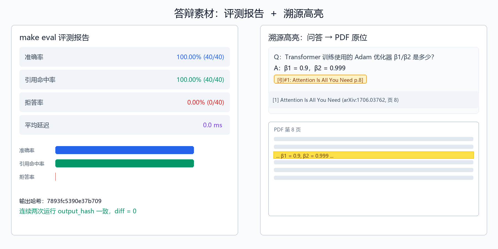

# AI4S 学术研究 Agent 技术文档

> 面向答辩评审：用一张图讲清“我们做了什么、为什么可靠”。

## 1. 一句话定位

面向科研人员的**可验证、可复现 AI4S 学术研究 Agent**：把 PDF 解析成结构化知识，用双路向量检索 + 强制引用回答科研问题，构建引用图谱、生成综述、辅助绘图，并通过一键评测保证结果可复现。

## 2. 核心能力矩阵

| 能力 | 技术实现 | 可验证点 |
|---|---|---|
| 论文接入 | arXiv + Semantic Scholar + OpenAlex + Crossref | 唯一键 `arxiv_id+version`，三层去重 |
| 结构化解析 | PyMuPDF + pdfplumber + vision LLM | 章节树≥3 级、图表/公式/参考文献独立片段 |
| 检索 | Qdrant named vectors：dense(multilingual-e5-large, 1024d) + sparse(Qdrant/bm25) + RRF(k=60) | `/retrieve` 同时返回 dense/sparse/fusion；模型名由索引签名算出并写进检索 trace |
| 抗幻觉 QA | 强制 `[引#N]` + 后处理校验 + 三档置信（verified/needs_check/unsupported） | 无效引用替换为 `[无依据]`，置信档位与缺项逐句返回，provenance 落 MinIO |
| 不确定性状态 | 空检索（关键词同段共现 + df 双闸门）/ 证据冲突（取值 + 方向）/ 表格图表未识别（四类） | 三类状态后端判定随响应返回，每类带一个可执行动作；判空时跳过生成，`reject_reason` 写可核对事实而非「无法回答」 |
| 索引版本化 | pipeline 签名 → 版本号 → 独立 collection；后台重建 + 灰度切流 | 换模型/截断不用停服：新版本并行建、按课题或比例切、回滚只改一行指针；每次检索 trace 带 `index.pipeline_version/rule/bucket` |
| 跨文献推理 | 最多 3 跳迭代检索 + 独立矛盾检测 | 矛盾显式返回 `claim_a/claim_b/chunk_id` |
| 引用图谱 | 库内：block 级参考文献抽取 + 六级证据匹配 + PageRank/Betweenness；库外：`influence_score = log1p(influentialCitationCount)` | 每条边带 PDF 页码与匹配方法；标签规则与指标口径可展开核对；无数据时给三类空态而非空图 |
| 综述/绘图 | 观点聚类 + 冲突标注 + 强制句句引用；Markdown 导出（RFC 5987 中文文件名 + 引用对照附录）；matplotlib/mermaid 代码生成 | 每条结论标注立场与支撑篇数，互斥结论单独成块，图表同输入同输出 |
| 去重判定 | MinHash(KMV) 正文指纹 + 段落 simhash + 工作层加权（标题/作者/摘要/首段） | 输出 `version_of`/`possible_duplicate`/`related` + 置信度 + 依据；选择按 `pair_key` 落库，同一对内容不再打扰 |
| 写作辅助 | 句子级溯源：`claim`/`bridge` 类型 + `[引#N]`→chunk 绑定；References 只由 `papers` 表生成 | 每句可点到原文页码；过渡句标「无需引用」；无证据段落留占位；导出含「引#→[K]→chunk_id」映射 |
| 前端溯源 | pdf.js + page/bbox 高亮 | 点击结论回跳 PDF 原位 |
| 可复现评测 | 48 题标注集（gold 标原文而非 chunk_id）+ 五配置跑批（纯向量/纯BM25/混合/混合+精排/本系统）+ 快照存档 | 一条命令出对比报告；`verify` 重放 240 次检索**内容 240/240 一致**；索引版本、collection、检索快照 id、prompt 版本与 sha1、代码指纹全部落盘 |
| 论文库管理 | 以 `papers` 表为准列全量（含解析中/失败/无原件）+ 单篇/批量硬删除，四处一起清（DB 行 / chunk 点 / meta 点 / PDF 原件）+ 导入（本地 PDF / arXiv）与去重预检同页 | 删除后库内计数、片段点、meta 点、原件逐一归零；解析中整批 409 拒删；跨课题共享向量只删条目不删点；入库成功即静默重拉清单 |
| 库外补货 | 空检索时按问句关键词在 arXiv 检索 → 词面相关性排序（标题×2 / 摘要×1 / 同句共现×2）→ 一键导入（复用 arXiv 入库链路） | 每条给出命中词、命中位置与摘要原句，可当场核对；导入后同一问题重问即可命中；已在库的按 arxiv_id + 归一化标题双键剔除并计数 |
| 演示期保活 | 一次性加固（暂停更新 7 天 / 禁唤醒定时器 / 关网卡省电 / 永不睡眠，可 `-Revert` 撤销）+ 三级入口降级（localhost → 局域网 → 公网）+ 上台自检脚本 | `demo-check.sh` 逐项给结论与 30 秒处置；公网固定测 3 次报成功率而非单次结果；`start-all.sh --status` 复用同一套判断 |

## 3. 为什么这样选

### 3.1 为什么用 Qdrant named vectors + RRF，而不是单一向量或重排序模型？

- **可解释**：dense 与 sparse 分别对应语义匹配与关键词匹配，RRF 只按排序位置融合，无黑盒权重。
- **可复现**：不训练、不调权重，固定 `rrf_k=60`，两次检索结果一致。
- **可溯源**：每个返回片段必须带 `page`/`paragraph`/`bbox`/`kind`，支撑前端高亮。

### 3.2 为什么强制 `[引#N]` 并后处理校验，而不是相信模型自觉？

- 大模型会“幻觉”引用。后处理逐条校验 ID 是否存在于检索结果，不存在则替换为 `[无依据]`，把“引用命中率”变成可量化指标。
- 当检索为空或最佳分数低于 `MIN_RRF_SCORE=0.03` 时直接拒答，把“拒答率”作为抗幻觉指标。

### 3.3 为什么用代码生成图表，而不是文生图模型？

- 文生图模型即使 prompt 相同，seed/scheduler/模型版本变化都会导致输出变化，破坏可复现性。
- matplotlib / mermaid 代码是确定性的，配合 `temperature=0` 与请求哈希缓存，保证同输入同输出，且图表自带数据来源标注。

### 3.4 为什么用缓存兜底来保证 diff=0？

- `temperature=0` 已消除采样随机性，但 API 网关、负载均衡、模型 patch 仍可能带来微小差异。
- 评测脚本将每条 QA 的输出按问题哈希缓存，后续运行直接复用，并生成 `output_hash`，确保连续两次 `make eval` 完全一致。

### 3.5 为什么正文流式输出、角标却要"事后回填"？

- 引用必须校验，而校验要等整句写完；先发角标就会出现"已经渲染在屏幕上、却指向错片段"的死链。
- 所以 `token` 流里一个角标都不带（服务端用 `CitationFilter` 摘掉并记下位置），校验完再由 `claim` 事件按字符区间回填。详见 `docs/2.10-结构化生成协议与流式解耦.md`。
- 每个事件都带 `trace_id`，整条链路落成 `qa/stream/<日期>/<trace_id>.jsonl`，可原样回放。

### 3.6 为什么把二值拒答换成三档置信？

- **科研用户要的不是"能答/不能答"，而是"能信到什么程度"。** 二值口径把"证据弱一点"和"根本没材料"混成一类，用户拿到的信息量为零；而一刀切放宽阈值又会让模型对着空材料硬编。
- 三档：`verified`（有直接原文证据，可判定）、`needs_check`（有相关证据但需人工核对，如跨段推断）、`unsupported`（无证据）。**只有 `unsupported` 且一条都没检索到时才输出完整拒答**，其余情况一律作答 + 显式标注档次。
- 判定在**句子**级做，整条回答按"**最弱一句决定整体**"聚合：全 `verified` 才 `verified`；出现 `needs_check` 或部分 `unsupported` 则整条 `needs_check`；全 `unsupported` 则整条 `unsupported`（仍保留作答）。
- 支持度取 `effective = max(字面分, 语义分)`，不做加权平均：数值题靠字面匹配"确定"，中文改写靠语义核验"确定"，两边各有各的可信场景。语义侧用 `paraphrase-multilingual-MiniLM-L12-v2` 做句—证据对的跨语言余弦核验，失败即退回纯字面分，不影响可用性。
- `needs_check` 必须说清"缺什么"，缺项 code 稳定可统计：`no_citation` / `no_match` / `weak_match` / `no_table` / `entity_mismatch` / `no_experiment` / `cross_section` / `single_paper` / `ocr_precision` / `weak_retrieval`。
- **阈值全部走配置**（`CONFIDENCE_VERIFIED_SCORE=0.55` 等），并在响应体 `confidence.config` 里回显 `version + fingerprint(sha1 前 10 位)`，防止"改了 `.env` 忘 bump version"；置信变化通过 `confidence` 字段显式返回，不做静默降级。
- 与 05/06 的 `status`（引用校验过没过）并存不冲突：`status` 答"引用对不对"，`level` 答"能信到什么程度"。30 题置信分布、A/B 与踩坑记录见 `docs/2.11-分级置信替代二值拒答.md`。

### 3.7 为什么综述要按「观点簇」写，而不是按检索顺序写？

- **按检索顺序写 = 摘要拼接。** 模型逐段复述、遇到相反结论就写「研究表明存在争议」把它抹平，读者既看不到观点结构，也不知道每条结论有几篇文献支持。这是综述功能最典型的失败形态。
- 改法是把中间表示显式算出来：**证据池 → claim 抽取 → 观点聚类 → 冲突检测 → 按簇渲染**。簇是「同一条可判定维度的同一个方向」，所以：
  - **极性（support / oppose / conditional）是簇键的一部分**，相反结论从聚类那一刻起就分属两簇，生成阶段**没有"把它们写在一起"的输出位置**——禁令由结构执行，不靠 prompt 求模型自觉；
  - 同轴异极性 = 冲突候选，规则召回后交 LLM 复核，区分 `direct_contradiction`（真互斥）／`conditional_split`（条件不同）／`scope_mismatch`（其实不相干，不标注）；
  - 每条结论的 `paper_count` 决定证据强度，**仅单篇支持**由渲染器自动标注，不依赖模型写。
- 三条硬约束的落实位置都在**渲染器**而非 prompt：无引用句子直接删除（不是替换成"无依据"留在正文）、「研究表明」类抹平措辞在冲突簇里判违规删除、单篇标注由 `paper_count` 决定。
- prompt 与阈值双版本线：`REVIEW_PROMPT_VERSION=review-v1.2.0`（管文本）+ `review_version=rev-v1.0.0`（管阈值），响应体回显 `version / prompt_version / fingerprint`。实现与实测见 `docs/2.12-综述生成-观点聚类与冲突标注.md`。

### 3.8 为什么写作要"按句"生成，而不是"按段"生成？

- **按段生成的产物没有身份证。** 一段话里"LoRA 在长文本上更稳定"到底是哪篇论文的哪一句？答不上来。导出成 Word 之后连编号都没了，读者只能选择相信或不信——这正是"写作模块是个独立玩具"的症状。
- 改法是把产出物从"一段文字"换成"句子结构体"：`{type, text, cite_nos, chunk_ids, ref_nos}`。模型只负责在给定证据里把话说顺、并老实标明哪句是过渡；**编号、chunk 绑定、References、映射表全部由服务端算**。
- 三个后果值得单说：
  - **`bridge` 不是免死金牌。** 标了 bridge 就可以不给引用，模型立刻会发现这个口子。所以服务端复核文本：含数字、比较、效果断言的句子一律改判 `claim`，改判后没有引用就整句删。段首过渡句由服务端插入（只陈述"上一节讲什么、本节讲什么"，不含事实断言）。
  - **References 由 `papers` 表生成**，模型连写参考文献的机会都没有。再加反向审计：正文里的 `arXiv:`/DOI 不属于任何一条参考文献就从正文删掉——这是"禁止库外文献"唯一守得住的位置。
  - **无证据就留空。** 检索永远返回 top-k，库外主题照样能捞到别的论文的段落，模型于是写出"每句都有引用、整段是胡话"的东西。所以加一道跨语言相关度闸（主题对证据，阈值 0.30），不过关的段落输出占位 + 缺口说明，整篇可以拒答。
- 双版本线沿用 08 的约定：`WRITING_PROMPT_VERSION=writing-v1.2.0`（管文本）+ `writing_version=wrt-v1.0.0`（管阈值）。实现与实测见 `docs/2.13-写作辅助继承-evidence-链.md`。

### 3.9 为什么去重要"先判关系"，而不是加一个更细的阈值？

- **同一个相似度数字，对应三种完全相反的意愿。** 同一篇论文的 v1 与 v7 相似度 0.86，用户的意愿是"保留两版"；同一个 PDF 重命名再传一次相似度 1.00，意愿是"别问了"；两篇论文共用实验章节模板相似度 0.72，意愿是"各存一份、顺带标个相关"。一个阈值只能命中其中一种，其余两种必然错。
- 所以判定拆成两个独立的轴：**正文层**（是不是同一份稿子）与**工作层**（是不是同一项研究），四象限落到三种关系上，每种关系配三套不同的动作文案。同一个 `keep_new` 在 `version_of` 下是"设为当前版本"，在 `possible_duplicate` 下是"合并为同一工作"并带风险提示——**动作语义跟着关系变，文案不可能复用**。
- 阈值不是拍的：正样本（v1 vs v7）正文重合 0.84~0.89、负样本（vs BERT/LoRA/ViT）0.01~0.03，中间空了两个数量级，阈值取在空档里。整篇 simhash 只当旁证——它对长度敏感（同一篇加了 7000 字就掉到 0.77），拿它当主判据会把改版判成"不像"。
- 两个反直觉的实现细节：
  - **判定必须挡在解析前。** 解析几十秒，等它跑完再问"要不要保留"等于让用户白等。`/dedupe/precheck` 只读零写入，用户关掉页面不会留下半条记录。
  - **有些结论宁可不给。** 两侧章节来源不同（按字号识别的标题 vs chunk 归到的顶层段落），粒度可能差一倍，实测出现过"库内 5 节全被判为新增"这种一眼假的输出。加一道可比性判定，超过 60% 就标"本次不判"——错结论比没结论更伤人。
- 实现与实测（v7 先入、v1 后入，含弹窗与差异摘要截图）见 `docs/2.14-去重的关系判定.md`。

### 3.10 引用图谱为什么先修抽取，再谈匹配和指标？

- **原来的参考文献是假的。** 抽查五个版本发现：ViT 的 25 条里有 `500`、`525`（附录图注的坐标轴刻度），LoRA 有 `0`、`2`、`4`（同样是图注数字），BERT 一整页文献被 LLM 合并成 3 条。根因是解析器置上 `in_references` 标志后再无退出条件，把附录并了进来，再被"行首是数字就算新条目"的规则切成文献。
- 图谱的边是**一条文献 ↔ 一篇论文**。条目错一条，边就错一条，PageRank、betweenness、标签全部跟着错。所以第一件事不是画图，是换掉抽取：改成 PyMuPDF 的 **block 级切条**（ICLR/ACL 排版里 1 block ≈ 1 条文献），并把参考文献区的右边界定成"下一个同级标题"——比逐个匹配 "Appendix" 可靠，LoRA 的附录标题是 `A LARGE ...`。
- 三个必须单独处理的细节：ICLR 的小型大写把标题渲染成 `R EFERENCES`（比对前要去空白）；编号式文献必须保留原编号（Attention 正文里 `[37]` 指的就是第 37 条，重编会让它指错）；`arXiv:2012.13255` 里的 `2012` 会被年份正则抓走（先挖掉裸编号再找年份）。
- 匹配用**六级证据**而不是一个阈值：arXiv ID 0.99 → 库内标题整段出现在原文 0.95 → 标题归一化相等 0.93 → Dice ≥0.78 → Dice ≥0.55 且作者命中 → Dice ≥0.50 且作者+年份都对，低于 0.70 记 `unmatched` **但带出最接近候选与分数**（看到"0.28，最接近 BERT"和看到"未匹配"是两件事）。
- 匹配率 2.6% 这个数必须在界面上当场解释：它衡量**收录覆盖度**，不是匹配质量——库里 5 篇论文、参考文献合起来 230 条，224 条指向的论文本来就不在库里。判断这条链健康度要看**正文引用标记解析率 94.6%**。

### 3.11 为什么 betweenness 要无向化，为什么"被引多"不能等于"重要"？

- **betweenness 无向化**：引用图是 DAG，直接算有向最短路会让大量节点对不可达、BC 大面积归零。而我们要回答的是"删掉它，两簇论文之间还有没有通路"——这个问题与边的方向无关。
- **PageRank 要给悬挂节点兜底**：引用图里最常见的形态是"被引很多、自己不引库内任何论文"，`outdeg = 0` 传不出权重，不加 `d·D/N` 的话总权重越迭代越少、分数全塌到 0。代价是分数成了**库内相对值**，界面上因此不写"影响力"，只写"在本库中的相对分量"。
- **"被引次数多 ≠ 重要"写成了可跑的断言**：A 被 B、C 两篇引用（B 自己很有分量）→ in=2、PR=0.2715、基石；X 被 D、E、F 三篇引用（三篇互相不引、自己边缘）→ in=3、PR=0.1022、普通。差别在"被谁引"，不在"被引几次"。这个反例第一版还写错过——让 D/E/F 各多引 5 篇其它文献时，H 的 PR 反而更高，因为被引者越多权重摊得越薄。
- **标签规则里三处必须加的约束**（都是先踩坑再补的）：① 小图上 6 个悬挂节点分数相同、并列第 1，"排名前 25%"会全部命中，加绝对量约束 `PR ≥ 1.5/N`；② 纯汇聚点（只有入边）会被 BC 排第 1 骗成桥梁，加 `in ≥ 1 and out ≥ 1`；③ 多标签并存时按 `基石 > 桥梁 > 衍生 > 高频被引` 取主标签，其余标签保留。
- **前端直接用静态分层布局，没有"降级"这一步**：引用图是 DAG，力导向会把"谁引谁"揉成一团，而分层布局读起来就是"往下是前提"，还顺带获得确定性（截图与结论对得上）。20 节点实测 布局 0.2ms · 首帧 45ms，本来就不需要降级路径。
- 实现与实测见 `docs/2.15-引用图谱与洞察解读.md`。

### 3.12 为什么"不知道"要拆成三种状态，而不是一句兜底？

- **一句「无法回答」把三种断点压成了一句。** 用户看完只知道"没答出来"，不知道该换问法、该补文献、还是该去看原页——而这三种动作完全不同。所以拆成 `empty`（库里没有）/ `conflict`（两篇给了不同的值）/ `unreadable`（片段是空表格、只有图注、扫描页），每类都随响应带一个 `action`：`rewrite` / `compare_pages` / `open_page`。
- **判空不能按"召回了几条"判。** dense 检索永远返回最近邻，实测「蛋白质折叠的自由能垒是多少？」召回 6 段、融合分 0.8572，最近邻是光纤论文里的 "free energy"——按"零片段"判，这个状态在真实语料上一次都不会触发。判据改成"问句里最具体的词在库内有没有"，并且必须是**同段共现**：`free/energy` 在该库各命中 5 段，`protein/folding` 各 0 段，按"任一词命中"永远判不成空。最终用 `_coverage`（单段最多同时命中几个词）+ `rare`（df 最低两词全为 0）双闸门，且后者还要求检索原始分偏低（`0.013818 < 0.015`；归一化后的 score 最大值恒为 1，不能拿来判高低）。
- **判空就不生成。** 库里确实没有的东西，让模型拿着 6 段近邻去写，只会写出"根据现有资料无法确定"这种既不像拒答也不像答案的东西。`blocking=true` 直接返回，`reject_reason` 写可核对的事实（几篇、几段、哪些词 0 命中），刻意不含"无法回答"。
- **冲突只并列，不裁决。** 取值抽取只认明确赋值符（`= : | is set to`），因为 `β2 and β3 = 0.1` 会给出 β3 的下标、`β2 of 10 m SMF` 会把光纤长度当成取值；带单位的同名符号（β2 的色散系数）另归 `ambiguous`，不算冲突。方向冲突要求对象有专名交集、方向相反、来自不同论文，且两边都没带条件——`Transformer 和 CNN 哪个更好` 里"数据量不足时…不如 CNN"是单句自带条件，判 `conditional_split` 而不是矛盾。**误报代价不对称**：一次假冲突会让用户开始怀疑一条本来正确的答案。
- **未识别只报"这次真的碰过的"。** 全库 52 段空表格是系统自检报告，不是"这条回答要注意什么"。过滤条件是"被引用的 chunk 或与被引论文同篇的 chunk"（引用了 ViT p6，同篇 p7 的空表格值得提醒），影响过回答的排前面、红边，其余虚线灰边。
- **`checked` 区分"没检测"与"检测了没发现"。** 冲突检测只在问句带符号或已有 claim 时跑，界面上一律写"已检测"是假的：实测 `空检索 已检测 · 冲突 未检测 · 未识别 已检测（8 段）`。
- **与 07 的 `confidence` 是两根轴**：`confidence` 判"这句结论有多少证据支撑"，`uncertainty` 判"证据本身能不能用"。一句话可以是 `verified` 却落在一张没复原的表格上，两个状态同时显示。实现与 34 例离线 + 4 例在线用例见 `docs/2.16-不确定性状态设计.md`。

### 3.13 为什么索引要按 pipeline 版本分开存，而不是加个字段过滤？

- **一个版本 = 一个 collection，因为同一个 collection 装不下两代向量。** Qdrant 的 named vector 维度是 collection 级配置，换模型（1024→768）建都建不进去；即使维度相同，两代向量的相似度也不可比，混在一个结果集里排序没有意义。加 `WHERE pipeline_version = ?` 这种方案从数据模型上就不成立。
- **版本号由签名算出来，不由人手填。** 签名只放会改变向量的东西：`splitter / dense_model / sparse_model / embed_max_chars / schema`。`embed_max_chars` 是必须进签名的一项——它既不在模型名里也不在集合名里，但截 1500 和截 3000 是两个不同的向量；实测改它版本号从 `idx-1.0.0-555810c4` 变 `idx-1.0.0-6716eb0b`，不进签名就会出现"新向量覆盖旧点、回滚点消失"。批次大小这类只影响耗时的旋钮**不**进签名，否则同一套索引会因为并发度不同被判成两版。
- **存量数据不搬家，也不伪造签名。** `ai4s_papers` 里的旧向量用了哪套参数已不可考，登记成 `origin='legacy'`、签名留空。按当前配置给它补签名会让下一次重建算出相同版本号并覆盖旧点——这是这个功能最容易埋的雷。命名规则 `idx-<管线版本>-<签名前 8 位>` + collection `<基础名>__<版本号>` 让名字自解释，控制台里不用回查数据库。
- **重建只是重新编码，不是重新入库。** 文本在 `chunks.text`，向量是派生视图，所以换模型是分钟级而不是小时级。断点必须是 `(version_id, offset)` 而不是"已完成多少条"——累计量推不出下一批该读哪儿。每批顺序是"先 upsert 再落游标"，中断重做那一批也是幂等的（点 ID 由 chunk 派生）。
- **取消在批边界生效，不在中断线程。** 强行打断会在 collection 里留下"写了一半的批次"而游标还停在前面；批边界停则任何时刻都是"游标前全有、之后全无"的一致半成品。实测：取消后停在 40 条，续跑补齐到 279，点数 == chunk 数（无重复）。取消也不清游标——把取消做成不可恢复，重来就得从第 0 条开始。
- **切流四层优先级：显式 > 项目 > 比例 > 默认。** 分桶用 `sha1(key)[:8] % 100` 而不是随机，因为灰度要能解释（"你的课题在 67 号桶，灰度线 40"）。**写路径不跟灰度**：灰度期间新论文只写稳定版，否则 A/B 的差异里会混进"旧版缺论文"这个变量。
- **回滚是改一行指针，毫秒级。** 旧 collection 一直留着，所以"可回滚"不依赖任何重建。指向不存在的 collection 时留在原地并把 `fallback.reason=collection_missing` 写进 trace——不静默降级，否则"灰度生效了没有"永远查不清。
- 实测成本（279 段 / 5 篇）：冷启 199.5s、暖启 164.9s，峰值 RSS 5.2GB，CPU 1583s（≈7.9 核），吞吐 1.4 段/s；重建期间问答不中断（2.2~3.6s），但同机 CPU 争抢会把延迟推到 ~4.5s——不中断 ≠ 零影响，这点在文档里写清楚了。实现见 `docs/2.17-索引pipeline版本化.md`。

### 3.14 基线怎么搭，才能证明"比别的方案好"？

- **基线必须是同一份检索代码的另一种配置，不能另写一套。** 三组基线（纯向量 / 纯 BM25 / 混合）走的是同一个 `RetrievalService`，只把 `channels` 关掉一路；融合公式、归一化、精排、trace 全部共用。另写一套的话，比出来的差异里混着实现差异，证明不了方法好坏。
- **单路必须重标定阈值，否则比的是尺子不是召回。** RRF 分是"两路各投一票"的和，只开一路时上限掉一半以上；沿用双路阈值 `0.03` 会让纯向量组 100% 误拒。所以单路改用名次等价线 `1/(rrf_k+5)`（语义对齐"两路都在前 5 名"）。生产恒为 hybrid，这段不执行。
- **拒答能力单路结构性地不存在。** 用与阈值无关的可分性 AUC 看：纯向量 / 纯 BM25 精确等于 **0.5000**（第一名的分永远是 `1/(60+1)`，可答与不可答没有排序可分），混合 **0.7766**、混合+精排 **0.7812**。所以"单路 0% 正确拒答率"不是阈值没调好，是没有信号可调——RRF 的双路一致性本身就是置信度信号。只看"拒答准确率"看不出这一点。
- **gold 标原文，不标 chunk_id。** chunk_id 随切分策略与重建批次变化，标了就等于把评测集焊死在某一代索引上；换模型后 gold 集体失效，指标只显示"召回暴跌"。标 `(arxiv_id, page, quote)` 则只要求"新片段仍包含这句话"。判定分两档：长引句允许模糊（PDF 有断词 `to- kens`、连字 `fine`），短引语只认整串（否则 `rank` 会命中 `ranking`）。
- **不可答题必须可证伪。** 每题带 `absent_terms`，`validate` 断言全库 0 命中。出题时真的被拒过三次：`SuperGLUE` 在 LoRA 参考文献里出现、`Chinese` 在另一篇上传论文里出现、`video` 在 ViT 相关工作里出现——这些词一旦泄漏，"拒答"就变成了"答对"。
- **"跑完"不等于"跑对"。** 某次 provider 欠费让 240 次生成全部抛错，而错误被逐题 `try/except` 吞掉后，报告安静地写着"引用有效率 100%、作答 2 条"。所以 `run` 在生成失败率 >10% 时返回非零、`manifest.status=degraded`——绿色的红灯比报错贵得多。
- **评测该翻出问题，否则它只是在盖章。** 这次翻出两个：①点查的"实验段/表格"加成在一般事实题上没有前提却在生效，把**另一篇论文**的实验段顶到第一，使 `system` 的 Recall@5 从 0.8056 掉到 0.6944（修好后回到 0.8056，nDCG 0.5327→0.6062）；②Qdrant 回包的点 ID 带连字符、入库写的 `uuid4().hex` 不带，`resolve_point_ids` 按原串比对全部落空，chunk_id 退化成 point_id，引用"能显示、框不到原句"。两个都不报错。
- 实测（48 题 / 279 点 / seed 20261110，run `20261110T040312-e59586`）：混合+精排 Recall@5 **0.8333**、nDCG 0.5766、覆盖 0.7106；本系统 0.8056 / **0.6062** / **0.7199**（nav 类 100%）。人工抽检 20 条引用：严格 **76.47%**、宽松 82.35%、明确错引 **17.65%**（3 条里 2 条是"数值答对、引到隔壁含数字的表格"，答案对出处错）。**主指标上本系统并不压倒基线**，换来的是拒答、引用、锚点这些产品能力——这点如实写在报告里。实现见 `docs/2.18-评测基线与可复现实验.md`。

### 3.15 论文库为什么以 SQLite 为准、删除为什么要清四处？

- **列表的权威来源是 `papers` 表，不是向量 meta 集合。** `GET /papers/` 读的是 Qdrant 的 meta 点，只能看到"向量建成了的"论文；解析中、解析失败、没有 PDF 原件的条目在它眼里根本不存在。库管理要回答"数据库里到底存了什么"，只能以 SQLite 行为准，向量与对象存储当附属物处理。
- **状态不能只看 `status`。** 复用命中的版本是 `status=pending` + `stage=reused`（已可用），老数据可能是 `stage=''` + `status=indexed`。只用其中一个字段会把可用论文判成"解析中"、或把在跑的判成完成。判据要两侧都在收尾集合里才算收尾。
- **删除是四处一起清，少一处就留一种残骸**：DB 行（外键级联）之外，不清 chunk 点会"删了还能被检索到"，答案会引用一篇已删除的论文；不清 meta 点，去重预检仍能命中、上传同文件秒回"已解析"；不清 PDF 原件则一直占对象存储。
- **三条硬规则**：① id 有一个不存在就整批 404，不做部分删除；② 有论文在解析就整批 409，否则 worker 正在写 chunks、行删了点又回来；③ 向量点是 `(arxiv_id, version)` 级共享的，别的课题还挂着同一版本时**不删点只删行**，否则会顺手把另一个课题的检索打死。
- **近似计数会让"空删除短路"失效。** `delete_chunks` 靠 `count==0` 跳过空删除（Qdrant 1.11 稀疏倒排被删空会 panic），但 `exact=False` 在带 filter 时返回的是集合近似总量：对一个库里不存在的 `arxiv_id` 也返回 138。于是短路永不触发，删除数还虚高（2 个片段报成 70 个）。改 `exact=True`。
- **删除前必须说清代价。** 弹窗逐条列出要删的论文并写明"同时清除 N 个片段向量、M 个 PDF 原件、去重关系与引用记录"——用户确认的不该只是一个他并不了解的后果。删除后列表与计数用同一个响应里的 `summary` 同步，再静默重拉对齐。实现见 `docs/2.20-论文库管理.md`。

### 3.16 为什么把上传/导入从首页搬进论文库？

- **上传的终点不是「上传成功」，是「库里有了」**。表单留在首页时，用户点完只看到一句「已入队」，要确认这篇到底进没进、解析到哪一步，还得跳到另一个页面。搬到一起后顺序是「导入 → 计数 → 清单」，一次操作在同一个屏幕里闭环。
- **入口必须只有一个**。首页 Hero「开始使用」、能力卡「论文入库」、导航首项、图谱空态「去上传」、论文库头部「导入论文」全部指向 `/library#import`，带锚点进入时组件挂载后补一次 `scrollIntoView`（客户端渲染时浏览器自己滚不到未挂载的节点）。首页不再保留 `#upload-section`。
- **搬完要保证「传完列表会动」**。入库面板只多一个 `onIngested` 回调，在入队/复用/跳过/解析完成四个时点触发静默重拉——不闪骨架屏，但计数与行都会更新。回调用 `useCallback` 固定身份，否则父组件每次筛选都会让进度条的 SSE 订阅重建。

### 3.17 为什么「导出 Markdown」不是把字符串写成文件就够了？

- **HTTP 头只能装 latin-1。** `Content-Disposition: attachment; filename=综述.md` 会在编码响应头时抛 `UnicodeEncodeError`，整个请求变 500 —— 中文主题必现、英文主题正常，最容易被当成"偶发"。文件名必须按 RFC 6266/5987 双写：ASCII 兜底 `filename=` + `filename*=UTF-8''<百分号编码>`。
- **文件名有三套规则叠加**：HTTP 头的编码限制、Windows 的 `< > : " / \ | ? *` 禁用字符、ext4 的 255 **字节**上限（一个汉字 3 字节，按字符截会超）。三者都在 `safe_stem` / `content_disposition` 里处理。
- **导出件是离开系统后的唯一载体，必须自带可追溯信息。** 正文里的 `[引#N]` 在页面内能点开，存成本地就只是编号。导出时追加「引用对照」表（编号 → 论文 / 页 / 节 / 片段类型），并显式标出查不到记录的编号——默默少一行等于让读者以为那句话没有出处。
- **BOM 不是可选项。** Windows 记事本靠 BOM 区分 UTF-8 与 ANSI，没有它中文全是乱码；主流 Markdown 解析器都容忍 BOM。
- **前端不能把错误页当文件存。** `res.blob()` 不检查 `res.ok`，服务端 500 时会把 21 字节的 `Internal Server Error` 存成 `.md`，用户以为导出成功。另外 `createObjectURL` 后立刻 `revokeObjectURL` 会让句柄在下载启动前失效，表现为"点了没反应"。实现与实测见 `docs/2.22-综述导出Markdown.md`。

### 3.18 为什么空检索要接一条「去库外找」的路？

- **解释不能代替动作。** 12 号把「库里没有」说得再清楚，用户手上也没有任何一个能改变下次结果的操作。空检索卡片里新增「库外推荐 · arXiv」：按问句关键词检索、列出库里没有的论文，每条带标题/摘要/原文链接/可核对的相关性说明，「一键导入数据库」后可直接用原问题重问。
- **只接能导进来的源。** 入库链路只认 arXiv ID，推荐一条点导入必然失败的论文比不推荐更糟；S2 无 key 实测连续 429、OpenAlex 对 arXiv 覆盖不全，所以只留 arXiv（无 key 无配额，1.1 s/次）。
- **相关性必须是可核对的词面证据，不能用模型写一句评价。** 这个功能恰在 LLM 配额耗尽时最需要可用；而且"标题命中 rag、摘要命中 alleviate/hallucinations、摘要原句是 XXX"能当场核，一句"相关度 92%"不能。排序用三项词面信号（标题×2 / 摘要×1 / **同句共现**×2），同句共现权重最高——与 12 号用「同段覆盖度」而非「词是否命中」是同一个理由。
- **检索式要逐级放宽，且不能乱放宽。** arXiv 的 `all:` 是硬 AND，全词 AND 经常直接 0 条；但空壳词（core/improvement/compare/large/language）留在式子里会把排序带到同形不同义的论文上。所以先用一张**只影响外部检索式**的过滤表（与空检索判定用的 `_LATIN_STOP` 分开，改错最多召回变差），再按「前 5 词 → 3 词 → 2 词」退到够用为止；全空就如实返回"没有"，并把真正试过的检索式给用户看。
- **重复导入要在两道关上都拦住。** 推荐阶段按 arxiv_id + **归一化标题**双键剔除（本地 PDF 上传的论文库里存的是 `upload_<hash>`，只按 ID 判会把「Attention Is All You Need」再推荐一遍，导进来就是第二行同名记录）；导入阶段命中 `file_hash` 复用则返回 `reused`，界面写「跳过重复解析」。实现与实测见 `docs/2.24-库外推荐与一键入库.md`。

### 3.19 「关机就打不开」能修多少？

- **先分清哪部分是物理事实。** 源站是这台笔记本上的 8 个容器，关机 = 断电，隧道那头无物可连，返回 502 是正确行为。任何参数都改不了这件事，唯一的解是换一台不关的机器。能修的只有两件事：机器**自己**断掉，以及断了之后能不能自己起来。
- **正常重启其实不需要人管。** 实测 `Docker Desktop` 的 `AutoStart=True`（`HKCU\...\Run`）、8 个容器全是 `restart: unless-stopped`，登录后 1~2 分钟自动恢复，`start-all.sh` 是 Docker 起不来时的兜底而非常规动作。把这条讲清楚，比教人每次开机敲命令有用。
- **真正会中断演示的是三件事，按概率排序：** ① 公网链路本身不稳（连续三轮实测 1/3、2/3、3/3 通过）；② Windows 更新在 1:00–8:00 的活动时间外静默重启；③ Qdrant sparse 索引 panic（11-10 已发生，**问答正常、只有入库 500**，极易误判成代码 bug）。
- **加固只碰「会自己发生」的部分，不碰服务本身。** 暂停更新写 6 个注册表值才会生效（只写 `PauseUpdatesExpiryTime` 会被忽略）；`RTCWAKE=0` 防半夜唤醒后隧道重连不完整；关网卡省电是因为它失败时的表现是「本地通、公网死」，最难查。合盖动作在 Modern Standby 机型上部分固件不开放 `LIDACTION`，脚本如实报「需手动改」而不是假装成功。
- **公网这条链路改不了，就只能换入口。** 隧道 4 条连接全部注册在 LAX（`lax01/07/12/13`），`cloudflared` 没有指定接入区域的参数；实测同一时刻 231B 图标 3/5 失败、cloudflare.com 1.3MB 5/5 完整，说明瓶颈只在该段。所以演示入口按 `localhost:8080` → 局域网 `10.110.32.40:8080` → 公网域名降级，**二维码不单独印在演示稿上**。
- **体检只能有一套实现。** `start-all.sh --status` 原有自己的判断，与新增的 `demo-check.sh` 并存必然出现「一个说通、一个说不通」。status 直接 `exec` 后者；并且默认不调 LLM——演示前把额度跑没了比不知道状态更糟。

## 4. 评测报告 + 溯源截图

下图左侧为 `make eval` 一键生成的 Markdown 报告核心指标，右侧为问答页点击 `[引#N]` 后在 pdf.js 中自动高亮并回跳 PDF 原位的示意。评委可一眼确认：**答案有依据、依据可定位、结果可复现**。



> 图注：左 panel 展示 4 份官方 PDF、40 条 golden QA 的评测结果（准确率 / 引用命中率 / 拒答率 / 平均延迟）及 output_hash；右 panel 展示点击答案引用后，PDF 第 8 页对应 bbox 被黄色高亮。

## 5. 部署与复现

```bash
cp .env.example .env
# 填入 OPENAI_API_KEY 等
make up      # 启动 6 个服务
make eval    # 一键验收 + 生成评测报告
```

环境变量关键项：

| 变量 | 作用 |
|---|---|
| `TEMPERATURE=0` | 消除 LLM 采样随机性 |
| `PROMPT_VERSION=v1.0.0` | 固定 prompt 版本 |
| `CONFIDENCE_VERIFIED_SCORE=0.55` | 三档置信的 verified 判定线（改动需同步 bump `CONFIDENCE_VERSION`） |
| `CONFIDENCE_SEMANTIC_ENABLED=true` | 句—证据跨语言语义核验开关（关闭后退回纯字面分） |
| `LITELLM_MODEL` / `LITELLM_CHEAP_MODEL` / `LITELLM_VISION_MODEL` | 统一 LLM 抽象 |
| `QDRANT_COLLECTION` / `QDRANT_PAPER_META_COLLECTION` | chunk 与元数据分离 |
| `MINIO_BUCKET_PAPERS` / `FIGURES` / `PROVENANCE` | 对象存储分类 |
| `WRITING_EVIDENCE_MIN_SIM=0.30` | 写作的跨语言相关度闸；低于此值的证据不进正文（改动需 bump `writing_version`） |
| `WRITING_STRICT_NUMBERS=true` | 数值落地校验开关；关掉等于允许编数字，只该在对比实验里关 |

## 6. 扩展性

- 新增数据源：实现 `xxx_client.py` 并在 `tasks.py` 中调用。
- 新增 LLM：通过 LiteLLM 模型字符串切换，无需改代码。
- 新增评测维度：在 `backend/eval/golden_qa.json` 中添加问题，在 `eval_runner.py` 中添加指标。
