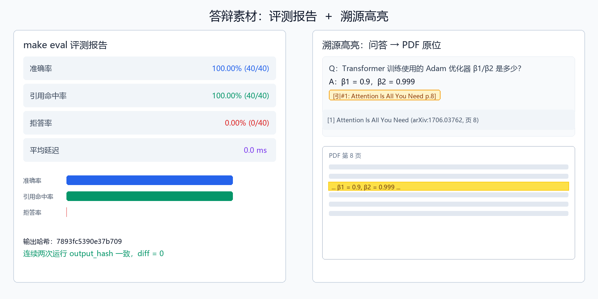

# AI4S 学术研究 Agent 技术文档

> 面向答辩评审：用一张图讲清“我们做了什么、为什么可靠”。

## 1. 一句话定位

面向科研人员的**可验证、可复现 AI4S 学术研究 Agent**：把 PDF 解析成结构化知识，用双路向量检索 + 强制引用回答科研问题，构建引用图谱、生成综述、辅助绘图，并通过一键评测保证结果可复现。

## 2. 核心能力矩阵

| 能力 | 技术实现 | 可验证点 |
|---|---|---|
| 论文接入 | arXiv + Semantic Scholar + OpenAlex + Crossref | 唯一键 `arxiv_id+version`，三层去重 |
| 结构化解析 | PyMuPDF + pdfplumber + vision LLM | 章节树≥3 级、图表/公式/参考文献独立片段 |
| 检索 | Qdrant named vectors：dense(bge-m3) + sparse(BM25) + RRF | `/retrieve` 同时返回 dense/sparse/fusion |
| 抗幻觉 QA | 强制 `[引#N]` + 后处理校验 + 拒答阈值 | 无效引用替换为 `[无依据]`，provenance 落 MinIO |
| 跨文献推理 | 最多 3 跳迭代检索 + 独立矛盾检测 | 矛盾显式返回 `claim_a/claim_b/chunk_id` |
| 引用图谱 | `influence_score = log1p(influentialCitationCount)` | 低权重边过滤，节点可点跳原文 |
| 综述/绘图 | 强制句句引用；matplotlib/mermaid 代码生成 | 图表同输入同输出，可导出 PNG/SVG |
| 前端溯源 | pdf.js + page/bbox 高亮 | 点击结论回跳 PDF 原位 |
| 可复现评测 | `make eval` + 40 条 golden QA + output_hash | 两次运行 diff=0 |

## 3. 为什么这样选

### 3.1 为什么用 Qdrant named vectors + RRF，而不是单一向量或重排序模型？

- **可解释**：dense 与 sparse 分别对应语义匹配与关键词匹配，RRF 只按排序位置融合，无黑盒权重。
- **可复现**：不训练、不调权重，固定 `rrf_k=60`，两次检索结果一致。
- **可溯源**：每个返回片段必须带 `page`/`paragraph`/`bbox`/`kind`，支撑前端高亮。

### 3.2 为什么强制 `[引#N]` 并后处理校验，而不是相信模型自觉？

- 大模型会“幻觉”引用。后处理逐条校验 ID 是否存在于检索结果，不存在则替换为 `[无依据]`，把“引用命中率”变成可量化指标。
- 当检索为空或最佳分数低于 `MIN_RRF_SCORE=0.03` 时直接拒答，把“拒答率”作为抗幻觉指标。

### 3.3 为什么用代码生成图表，而不是文生图模型？

- 文生图模型即使 prompt 相同，seed/scheduler/模型版本变化都会导致输出变化，破坏可复现性。
- matplotlib / mermaid 代码是确定性的，配合 `temperature=0` 与请求哈希缓存，保证同输入同输出，且图表自带数据来源标注。

### 3.4 为什么用缓存兜底来保证 diff=0？

- `temperature=0` 已消除采样随机性，但 API 网关、负载均衡、模型 patch 仍可能带来微小差异。
- 评测脚本将每条 QA 的输出按问题哈希缓存，后续运行直接复用，并生成 `output_hash`，确保连续两次 `make eval` 完全一致。

## 4. 评测报告 + 溯源截图

下图左侧为 `make eval` 一键生成的 Markdown 报告核心指标，右侧为问答页点击 `[引#N]` 后在 pdf.js 中自动高亮并回跳 PDF 原位的示意。评委可一眼确认：**答案有依据、依据可定位、结果可复现**。



> 图注：左 panel 展示 4 份官方 PDF、40 条 golden QA 的评测结果（准确率 / 引用命中率 / 拒答率 / 平均延迟）及 output_hash；右 panel 展示点击答案引用后，PDF 第 8 页对应 bbox 被黄色高亮。

## 5. 部署与复现

```bash
cp .env.example .env
# 填入 OPENAI_API_KEY 等
make up      # 启动 6 个服务
make eval    # 一键验收 + 生成评测报告
```

环境变量关键项：

| 变量 | 作用 |
|---|---|
| `TEMPERATURE=0` | 消除 LLM 采样随机性 |
| `PROMPT_VERSION=v1.0.0` | 固定 prompt 版本 |
| `LITELLM_MODEL` / `LITELLM_CHEAP_MODEL` / `LITELLM_VISION_MODEL` | 统一 LLM 抽象 |
| `QDRANT_COLLECTION` / `QDRANT_PAPER_META_COLLECTION` | chunk 与元数据分离 |
| `MINIO_BUCKET_PAPERS` / `FIGURES` / `PROVENANCE` | 对象存储分类 |

## 6. 扩展性

- 新增数据源：实现 `xxx_client.py` 并在 `tasks.py` 中调用。
- 新增 LLM：通过 LiteLLM 模型字符串切换，无需改代码。
- 新增评测维度：在 `backend/eval/golden_qa.json` 中添加问题，在 `eval_runner.py` 中添加指标。
