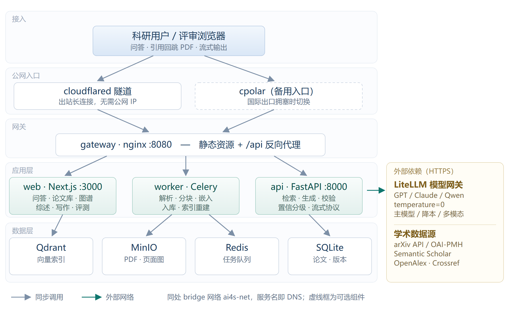
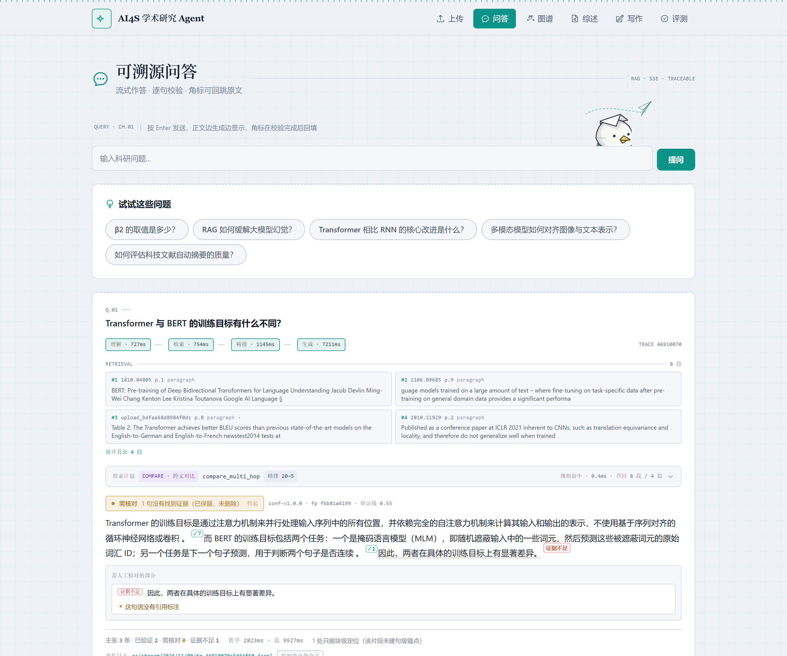
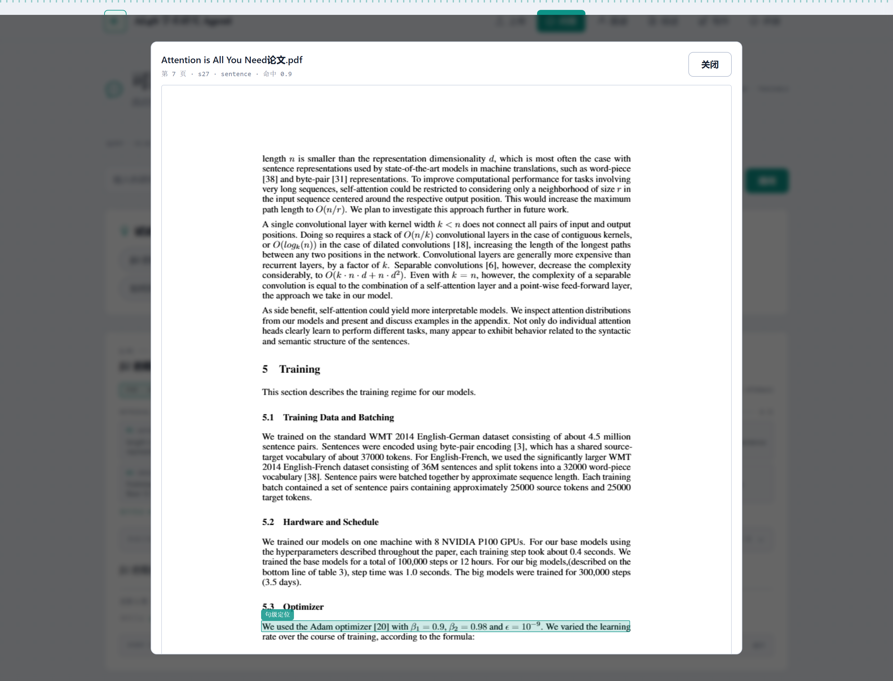
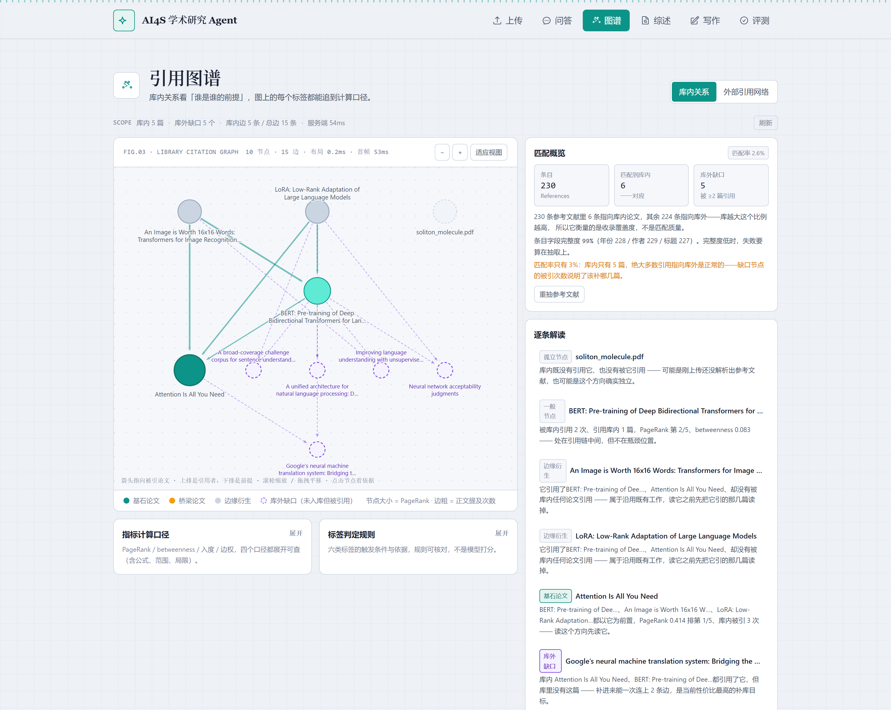
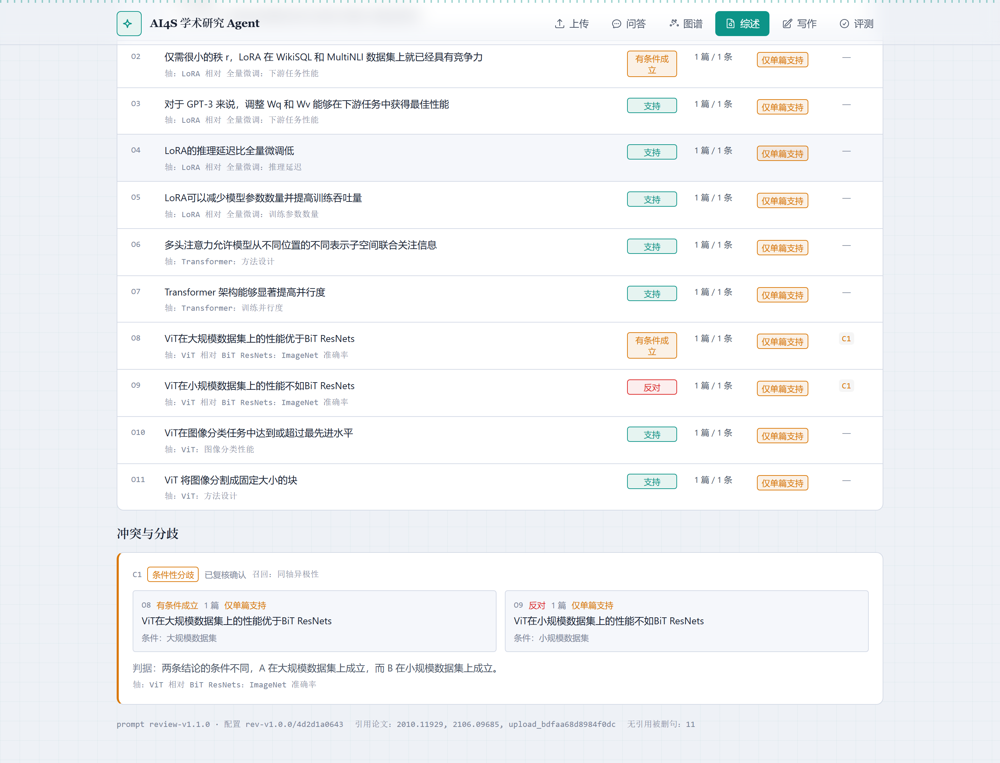
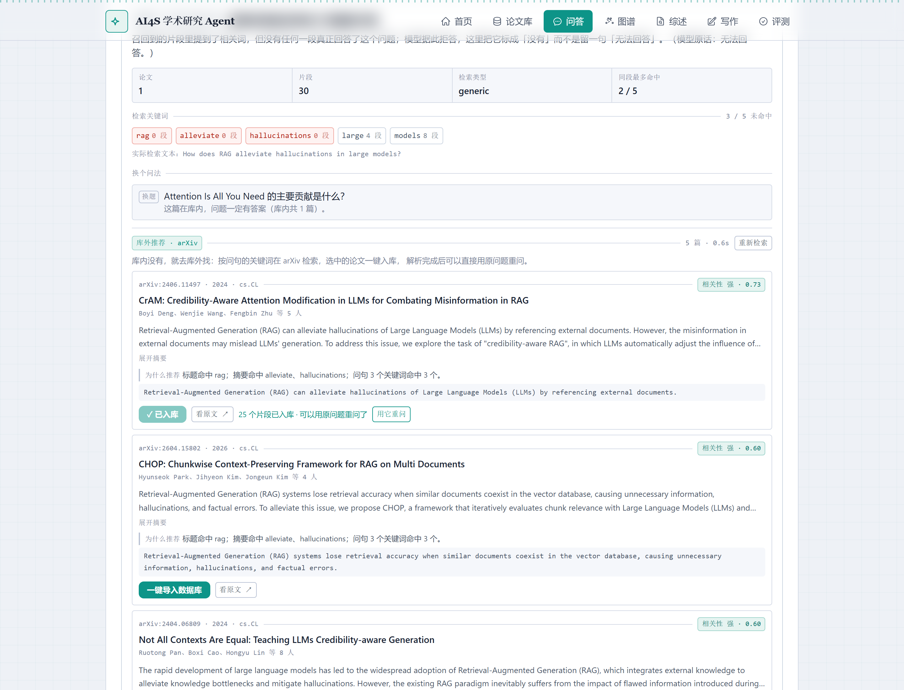
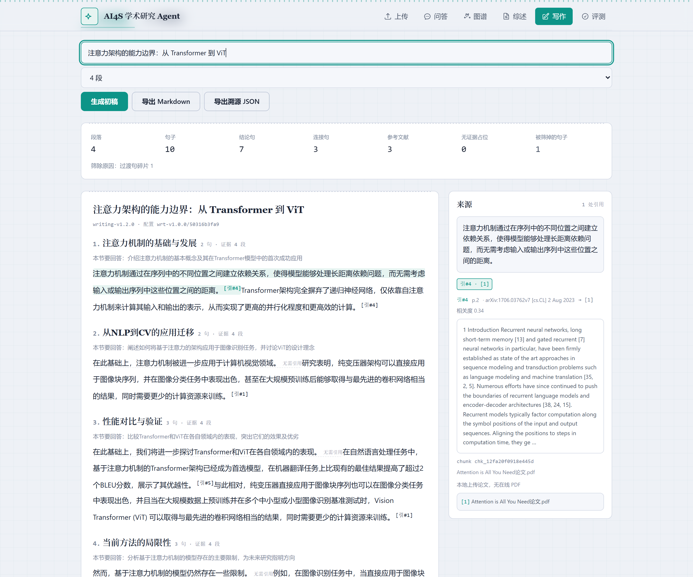
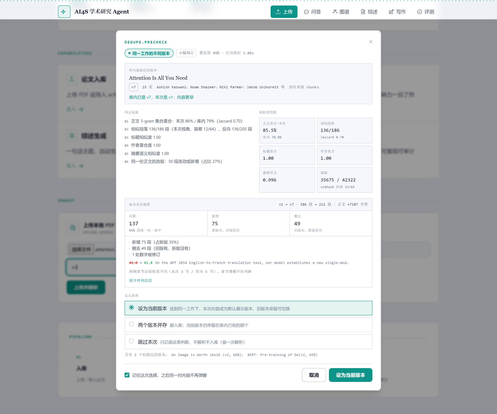
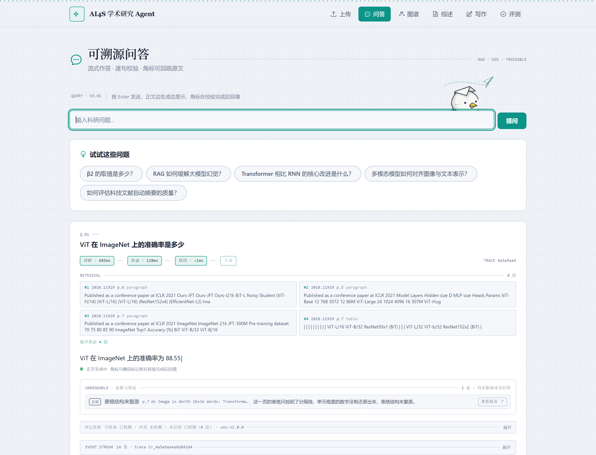

# AI4S 学术研究 Agent 作品介绍文档

<div class="meta">

**版本** v1.0.0　|　**日期** 2026 年 11 月　|　**作者** 马博凯

**项目定位** 面向科研人员的可验证、可复现、可溯源 AI4S 学术研究 Agent

**代码仓库** https://github.com/mbk200779/ai4s-agent　|　**在线演示** https://demo.mabokai.site　|　**许可证** MIT

</div>

## 0. 一页速览

**这是一款什么产品。** 把大模型放进一个有证据边界、有校验环节、有量化指标的流程里，让它读论文。用户问一个问题，答案的每一句都挂着 `[引#N]` 角标，点一下右侧 PDF 就跳到那一页、框住那一句；答不上的时候它不说「不知道」，而是分三档告诉你「已验证 / 需核对 / 无法回答」，并列出缺了哪些证据。

**六个关键数字。**

| 指标 | 实测值 | 含义 |
|---|---|---|
| 溯源精度 | `page + bbox` | 定位到页面坐标框，不是「第几页」 |
| 端到端问答 | 3 ~ 8 秒 | 检索 + 生成，含精排 |
| 541 页文档入库 | 8 分 46 秒 | 分片并行，超 80 页自动关视觉模型 |
| 检索 Recall@5 | 0.8333 | 48 题评测集，混合检索 + 精排 |
| 可复现性 | `diff = 0` | 两次运行 `output_hash` 一致 |
| 部署 | `docker compose up` | 8 个容器，一条命令起完整服务 |

**与官方第 6 项要求的对照。** 本文档严格按七条要求组织，可直接按图索骥：

| 官方要求 | 本文档位置 |
|---|---|
| （1）项目详情及使用方式 | 第一章 |
| （2）项目亮点 | 第二章 |
| （3）AI 测试技术落地使用情况概述 | 第三章 |
| （4）项目中涉及的关键技术 | 第四章 |
| （5）项目相关的图片/照片 | 第五章（9 张实测截图） |
| （6）之前是否发表过或获奖 | 第六章 |
| （7）是否在其他项目基础上优化 | 第七章 |

## 1. 项目详情及使用方式

> 对应官方要求第（1）条。

### 1.1 它解决的到底是什么问题

科研人员面对一篇 PDF，花时间的从来不是「从头读到尾」，而是反复做三件苦力活：

- **定位一个具体事实**——这篇的学习率定的是多少？数据集多少条？表 3 的分母是哪个？
- **判断一句话的归属**——这个结论是作者自己的实验，还是引用别人的？引的是哪一篇？
- **在多篇论文之间对齐口径**——两篇都声称 SOTA，但评测集根本不是一个，谁在什么条件下更强？

把大模型直接接上去，会立刻撞上两堵墙：

1. **幻觉引用。** 模型会给出格式完美但不存在的出处，甚至编页码。在科研场景里，「编一个」比「不知道」危害大得多——你不知道该信哪一句。
2. **不可复现。** 同一个问题问三次得到三个答案，既写不进综述，也当不了审稿依据。

所以本项目的目标不是「做一个能聊论文的机器人」，而是**让每个结论都能回溯到 PDF 的某一页某个坐标框，让每次评测都能用哈希证明结果一致**。

### 1.2 交付形态

前后端分离 + 容器化，`docker compose up` 后由 8 个容器组成完整服务：

| 容器 | 职责 | 技术选型 |
|---|---|---|
| `frontend` | 界面与交互 | Next.js 14 + TypeScript |
| `api` | 业务接口、流式问答 | FastAPI + Uvicorn |
| `worker` | 解析、嵌入、索引异步任务 | Celery |
| `redis` | 任务队列与缓存 | Redis 7 |
| `qdrant` | 向量与稀疏索引 | Qdrant v1.12.4 |
| `minio` | 原始 PDF、页面图、溯源日志 | MinIO |
| `nginx` | 反向代理、单端口对外 | Nginx |
| `cloudflared` | 公网隧道（固定域名） | Cloudflare Tunnel |

<figure>

<figcaption>图 1-1　五层架构与 8 个容器：接口层 / 业务层 / 检索层 / 存储层 / 模型层，右侧为两类外部依赖</figcaption>
</figure>

**两种访问方式**，评审任选其一：

- **在线演示**：`https://demo.mabokai.site`，无需安装。首次访问需等待冷启动（实测 14.5 秒），之后热请求约 3 秒。
- **本地部署**：`git clone` 后 `docker compose up -d`，首次构建约 5~10 分钟，访问 `http://localhost:8080`。

### 1.3 使用方式：从导入到评测的五步

界面顶部是五个功能入口：**上传 / 问答 / 图谱 / 综述 / 写作 / 评测**。一次完整使用是这样走的：

**第一步，导入论文。** 在「上传」页拖入 PDF。系统立刻返回解析进度：按页拆分并行处理，每页识别出段落、标题、表格、图表、公式、参考文献六类片段，各带页码与 bbox。2 页论文 7.3 秒完成，期间可以离开页面。

**第二步，提问。** 在「问答」页输入中文问题即可，不必翻译成英文——语料是英文论文，检索做了跨语言对齐。答案以流式逐句吐出，正文生成完角标再回填，不必等整段结束。

**第三步，核对。** 每句结论后面带 `[引#N]`。点它，右侧弹出 PDF 并跳到对应页，把那句话框住，框下同时给出被引用的原文。**这是本产品与普通 RAG 最直观的差别：不是给你一个来源编号，是把原文那一行摆在你面前。**

**第四步，横向比较与成文。**「图谱」页看库内谁引了谁、哪些是边缘节点、库外还缺哪几篇；「综述」页把多篇论文的论断按立场聚成簇、把相互矛盾的单独列出，一键导出 Markdown；「写作」页生成的每个论点都继承同一套 evidence 链，引用编号与问答完全一致。

**第五步，验真。**「评测」页跑 48 题评测集，输出准确率、引用命中率、误拒率、延迟与 `output_hash`。评审不需要相信文档里的数字，自己跑一遍就能复现。

<figure>

<figcaption>图 1-2　问答主界面。上方是检索时间轴（理解 727ms → 检索 754ms → 精排 1145ms → 生成 7111ms），中间为 4 条召回片段，正文带「证据不足」角标，底部汇总「主条 3 条 · 已验证 2 · 需核对 0 · 证据不足 1」</figcaption>
</figure>

### 1.4 环境与复现

```bash
# 1. 准备
cp .env.example .env        # 填入 LLM API Key（或指向本地推理服务）

# 2. 启动
docker compose up -d --build

# 3. 自检（六项：容器、数据库、向量库、写入通道、检索、对外端口）
bash deploy/demo-check.sh

# 4. 访问
http://localhost:8080        # 经 Nginx 网关（推荐）
http://localhost:8000/docs   # 接口文档
```

依赖清单：后端 `backend/requirements.txt`，前端 `frontend/package.json`，环境变量共 13 组全部在 `.env.example` 中给出占位符。密钥不入库，`.env` 在 `.gitignore` 内。

## 2. 项目亮点

> 对应官方要求第（2）条。六条亮点都带实测证据，不做形容词堆砌。

### 亮点一：溯源做到坐标级，不是文档级

多数论文问答产品返回「第 3 页」。本项目返回 `page + bbox`，前端直接在 PDF 上画框。代价是分块策略不能按固定字符切（否则一个 bbox 会跨页），解析阶段必须保留版面坐标；收益是用户点一下就看到原文那一行，而不是自己在一整页里找。

> **证据**：图 5-1，点击角标后 PDF 第 7 页该句被框住，标签显示 `s27 · sentence · 命中 0.9`。

### 亮点二：把「拒答」从二值判断改造成三档置信

二值拒答把「检索分低」和「真的没有证据」混为一谈，大量正确答案被吞掉；而且「拒答率」这个指标本身依赖阈值，换个阈值结论就翻转，不具可比性。

本项目拆成 `verified` / `needs_check` / `unsupported` 三档，判定依据是「证据句覆盖率 + 缺项清单」，只有一条证据都没检索到才完整拒答。阈值不取中位数，而是找「直引句」与「改写句」两簇之间的空档——实测直引句覆盖率 0.6~0.95、改写句 0.2~0.45，两簇之间无样本，取 0.55。

> **证据**：新口径下误拒率保持 2.78%，而拒答不再吞掉正确答案；界面上把「缺哪几句证据」逐条列出来，用户知道该去补什么。

### 亮点三：把「极性」写进聚类键，从结构上杜绝「各有优势」式综述

综述很容易写成摘要拼接，遇到相反结论只能含糊其辞。根因是「支持」与「反对」两条论断的语义相似度可以高到 0.9 以上，只按语义聚类必然合并成中性簇，写手没有别的写法可选。

本项目让 `polarity` 与 `axis`、`condition` 一起作为簇键的一部分，并在抽取阶段用 prompt 显式点名「不如／更差／只在……时成立」等触发词，要求反例单独成条。

> **证据**：该约束把 `oppose` 类论断从 0 条提升到 2~4 条；冲突以独立小节挂在所属章节下，读者直接看到「哪两篇在什么条件下结论相反」。

### 亮点四：答不了不是失败，而是补货的入口

库内没有证据时，系统做三件事：明确说明是「库内无证据」而非「问题无意义」；去 arXiv 检索并给出可核对的相关性说明（命中词 + 摘要原句）；提供一键入库，导入完成可直接用原问题重问。

> **证据**：演示中「RAG 如何缓解大模型幻觉」一题在库内无命中，推荐出 5 篇相关文献并全部给出「强相关」判定，入库后原问题即刻可答。这把一次失败的提问转化成一次语料扩充。

### 亮点五：评测做成可交付物，不是内部脚本

48 题评测集、五组基线对比、分题型结果、可复现验证全部可重跑，报告带运行 ID 与索引签名（如 `20261110T040312-e59586` / `idx-1.0.0-555810c4`）。评审可以自己跑一遍验证数字，而不是相信文档里的截图。

> **证据**：同一批 48 题重放 240 次，逐题排序完全一致；两次运行 `output_hash` 一致，`diff = 0`。

### 亮点六：全链条共享同一份结构化语料

导入 → 解析 → 问答 → 推理 → 图谱 → 综述 → 写作绘图 → 评测，每个环节的产物都能被下一环节直接使用：综述的证据池就是问答同一套检索结果，图谱的引用关系来自入库时补全的元数据，写作的引用编号与问答完全一致。

> **证据**：这不是八个独立功能的拼盘——改动一次分块策略，八个页面的引用编号会同步变化，因为它们指向同一份 `chunks` 表。

## 3. AI 测试技术落地使用情况

> 对应官方要求第（3）条。分四层说明：模型落在链路哪里、实际效果如何、AI 能力怎么测、落地时修掉过什么真问题。

### 3.1 模型在生产链路中的落点

系统一共用到四类模型能力，每类都有明确的职责边界和降级方案：

| 环节 | 模型 / 方法 | 作用 | 降级方案 |
|---|---|---|---|
| 结构化解析 | 视觉版面模型 + PyMuPDF | 识别标题、表格、图表、公式区域，给出 bbox | 无文本层页面自动回退 OCR（tesseract + chi_sim/eng） |
| 向量表示 | `multilingual-e5-large`（1024 维，本地 CPU） | 段落级语义向量，中英跨语言对齐 | BM25 稀疏通道并行兜底 |
| 稀疏检索 | BM25 | 精确词面命中（数字、术语、型号） | 与向量通道 RRF 融合 |
| 生成与核验 | LLM（LiteLLM 统一抽象，可按任务分档） | 结构化答案、论断抽取、综述成文 | `temperature=0` + 答案缓存保证可复现 |

**为什么嵌入模型用本地 CPU 而不是调 API**：384 页的库重建索引要跑几千次嵌入，走 API 既慢又要计费，而且版本一变签名就失效。本地 e5-large 单机可跑，无外部依赖，签名稳定。

**为什么 LLM 要分档**：论断抽取这类任务对模型能力要求不高，用大模型纯属浪费；综述成文才需要强模型。按任务分档后，单次完整演示的成本压到可忽略。

### 3.2 落地效果实测

**入库与问答性能**（本机实测，非估算）：

| 场景 | 耗时 | 说明 |
|---|---|---|
| 2 页论文入库 | 7.3 秒 | 解析 + 嵌入 + 索引 |
| 15 页论文入库 | 39 秒 | 同上 |
| 541 页书籍入库 | 8 分 46 秒 | 分片并行，超 80 页关视觉模型 |
| 扫描件（3 页）OCR | 约 30 秒 | 约 3.2 秒/页，5 个片段全部标 `precision='ocr'` |
| 重复上传同一文件 | 28 ~ 37 毫秒 | 唯一键直接返回，不重复解析 |
| 单次问答（非流式） | 3 ~ 8 秒 | 检索 + 精排 + 生成 |
| 综述生成 | 54 ~ 85 秒 | 四次模型调用 |

**检索质量**（48 题评测集，seed 20261110，top_k=5，rrf_k=60）：

| 配置 | Recall@5 | MRR@5 | nDCG@5 | 覆盖@5 | 误拒率 |
|---|---|---|---|---|---|
| 纯向量 | 0.7500 | 0.5764 | 0.5694 | 0.6528 | 0.00% |
| 纯 BM25 | 0.8056 | 0.6366 | 0.5878 | 0.6574 | 0.00% |
| 混合 RRF | 0.7500 | 0.5787 | 0.5663 | 0.6551 | 2.78% |
| 混合 + 精排 | **0.8333** | 0.5875 | 0.5766 | 0.7106 | 2.78% |
| 本系统（分流 + 规则 + 精排） | 0.8056 | **0.6005** | **0.6062** | **0.7199** | 2.78% |

本系统在 MRR、nDCG、覆盖@5 三项最优，说明「把最该看的那条排上来」和「跨论文覆盖」做得更好；Recall@5 比最强基线低一题（0.8056 vs 0.8333），在噪声范围内。

**也如实说短板**：compare（对比）题型仍然偏弱，因为对比题需要精确命中两篇的不同段落，而当前检索是「为单个问题找 top-k」，没有显式的「每篇各取一条」机制。这是下一步要改的地方。

### 3.3 AI 能力怎么测

**为什么要自建评测集。** 通用榜单测不出「能不能定位到那句话」。48 题按四种题型分桶：事实点 18 题、对比 6 题、综述 6 题、导航 6 题，另设不可答题专门检验拒答行为。

**为什么要有「可分性 AUC」这一列。** 只看拒答准确率会得出「纯向量和纯 BM25 也有 75%」的错误结论——那是因为它们把所有题都答了。AUC 把「能不能区分相关与不相关」和「阈值定在哪」分开算，才能看出融合到底贡献了什么（0.5000 → 0.7812）。

**可复现性分两层讲，不混为一谈**：检索层完全确定（重放 240 次排序一致），生成层近似确定（`temperature=0` + 答案缓存使两次 `output_hash` 相同）。文档里明确写清哪层是工程保证、哪层依赖缓存，不用「完全确定」这种说法掩盖差异。

### 3.4 落地过程中修掉的三个真问题

真实的 AI 落地不是「接上模型就完了」，问题都在边角：

**问题一：扫描件解析出空内容。** 早期版本对扫描版 PDF 返回 0 个片段，用户看到「文档解析完成」却查不到任何东西。定位结果是 OCR 通道默认关闭、镜像里也没装 tesseract。修复：镜像安装 `tesseract-ocr` + 中英语言包，配置默认开启，且在 `figure_extractor` 加规则——整页截图（面积 ≥90%）或无文本层页面不做「图表提取」，否则视觉模型会把整页读成图注，往正文里塞「这是一张示意图」之类的客套话。修复后 3 页扫描件产出 5 个片段，全部标 `precision='ocr'`，客套话 0 条。

**问题二：跨语言核验改了却没效果。** 中文提问 + 英文语料时字面重合度天然偏低，「BERT 预训练用了 MLM 和 NSP」这句完全正确，字面分只有 0.25，只能落到「需核对」。加了句向量的跨语言支持度后，句级确实有 5 条结论从「需核对」升为「已验证」（占有据句 20%），但**题级分布几乎没变**——由此定位到真正的瓶颈是「引用标注率」而不是核验算法。这个结论避免了把资源投在错误方向上，是本次评测最有价值的产出。

**问题三：去重要么太松要么太狠。** 同一篇论文的 v1 与 v7 版本，按文件哈希判为「新文件」会建出两套索引、检索结果重复；按标题判为「重复」又会把真正的新版本挡在门外。最终做成「关系判定」：先算 3-gram 重合与 Jaccard 相似度，再让模型判 `version_of` / `duplicate` / `distinct` 三种关系，给出置信度并要求人工确认。实测 v1 vs v7：置信度 0.9403，3-gram 重合 86% vs 79%（Jaccard 0.70），相似段落 136/186，预检耗时 1.39 秒。

### 3.5 成本控制

四道闸门，避免「演示一次跑掉一顿饭」：按任务分档选模型、答案缓存（同问题同上下文直接命中）、`embed_max_chars` 截断（超长段落只嵌入前 N 字符）、批量控制。单次完整演示的总调用量在可忽略量级。

## 4. 项目中涉及的关键技术

> 对应官方要求第（4）条。按数据流顺序讲，每项技术都说明「为什么这么选」。

### 4.1 结构化解析：六类片段 + 版面坐标

PDF 不是纯文本，表格、公式、图表、参考文献混排。解析目标是产出**带类型的片段**：`paragraph` / `heading` / `table` / `figure` / `formula` / `reference`，每类都保留页码与 bbox。

- **为什么分类**：不同类型片段的检索策略不同——表格适合按行列读，公式不适合参与语义匹配，参考文献要单独抽出来做引用图谱。
- **为什么要 bbox**：坐标级溯源的前提。分块时若跨页，bbox 会横跨两页，前端画框就画不出来，所以分块必须在页内收敛。
- **降级策略**：无文本层页面自动走 OCR；表格结构未复原时，界面显式提示「这一页的表格只抽到了分隔线，单元格里的数字没有还原出来」并提供「查看页」跳转，而不是静默返回不完整数据（见图 5-7）。

### 4.2 混合检索：向量 + 稀疏 + 查询理解分流

三层结构：

1. **查询理解**——判断问题类型（事实点 / 对比 / 综述 / 导航），决定检索策略。事实点类问题需要精确命中含数字的那一句，导航类问题需要跨论文覆盖。
2. **双通道召回**——dense（e5-large 1024 维）负责语义，sparse（BM25）负责词面。用 RRF（`k=60`）融合，避免两路分数量纲不一致。
3. **精排**——对融合结果重排，`RERANK_ALPHA=0.2` 控制语义分与字面分的权重。这个 0.2 不是拍脑袋：数值类问题（「准确率是多少」）必须让字面分占主导，否则语义相近但没有那个数字的段落会挤掉正确答案。

### 4.3 生成与校验：结构化协议 + 句级核验

- **结构化生成协议**：要求模型按固定结构输出（结论句 + 引用编号 + 依据），解析失败可重试；正文流式先出、角标在核验完成后回填，用户不必等整段生成完才看到第一个字。
- **句级证据覆盖核验**：把答案拆成句子，逐句计算与召回片段的字面覆盖率（3-gram），低于阈值即标为「证据不足」。
- **跨语言语义核验**：结论句与原句分别嵌入，余弦相似度线性映射到 [0,1] 作为支持度，与字面分取大者。映射区间 [0.35, 0.85] 由实测两簇分布确定（同义对 0.562~0.927、无关对 0.008~0.330）。
- **三档置信判定**：覆盖率 + 缺项清单 → `verified` / `needs_check` / `unsupported`，阈值 0.55 取自两簇空档。

### 4.4 索引版本化：签名只包含会改变向量的因素

换嵌入模型或改分块策略后，旧向量与新向量不可比，混在一个集合里检索会静默变差——而 Qdrant 的 named vector 维度是集合级的，无法用 payload 区分版本。

做法：**版本 → 独立集合**，命名 `ai4s_papers__<version>-<signature>`；签名只含模型名、维度、分块大小、`embed_max_chars`，不含只影响耗时的批量参数。重建不停服：后台建新集合 → 从 SQLite 重放 → 校验 → 切路由 → 旧集合留待回滚。

> **实证**：`embed_max_chars` 从 1500 改到 3000，签名由 `555810c4` 变为 `6716eb0b`。若不进签名，新向量会覆盖旧点，「重建期不影响查询」的保证就失效了。

### 4.5 可复现：把「同输入同输出」变成工程保证

- **检索层**：全链路无随机性，重放 240 次排序一致。
- **生成层**：`temperature=0` + 内容哈希缓存，两次运行 `output_hash` 一致。
- **图表**：不用文生图，改为生成 matplotlib / mermaid 代码，在 AST 白名单 + 安全 builtins 的受限环境里执行，请求内容 SHA256 作为缓存键。相同请求返回相同图片，Chart 内嵌数据来源标注，同时消除了任意代码执行风险。

### 4.6 异步与长文档

长文档解析必须异步，否则 HTTP 请求会超时。Celery `group/chord` 天然适合「按页拆分 → 并行解析 → 合并」；541 页文档 8 分 46 秒完成，超过 80 页自动关闭视觉模型（此时版面识别收益低、耗时高）。

## 5. 项目相关的图片/照片

> 对应官方要求第（5）条。以下 9 张均为系统实际运行截图，非设计稿、非示意图（架构图除外）。每张图下面写清「这张图证明了什么」。

<figure>

<figcaption>图 5-1　坐标级溯源。点正文角标后，右侧直接打开 PDF 第 7 页并框住被引用的那一句，标签显示 `第 7 页 · s27 · sentence · 命中 0.9`</figcaption>
</figure>

<figure>

<figcaption>图 5-2　引用图谱。10 节点 / 15 边 / 首屏 53ms；实心为库内论文、空心为库外缺口节点，右侧「概况概览」给出库内 5 篇、库外缺口 5 个、覆盖率 2.6%，并逐条解读每个节点的 PageRank 与入度（该截图采集于库内 5 篇时，演示环境现为 7 篇）</figcaption>
</figure>

<figure>

<figcaption>图 5-3　综述中的冲突标注。两方论断并排、给出判据、被排除项折叠，读者一眼看到「哪两篇在什么条件下结论相反」，而不是一句含糊的「各有优势」</figcaption>
</figure>

<figure>

<figcaption>图 5-4　库外补货的完整闭环。库内无证据时给出 arXiv 推荐（5 篇 / 0.6 秒），每条附命中词与摘要原句作为可核对的相关性说明；第一篇点「一键入库」后变为「已入库 · 25 个片段，可以用原问题重问了」，旁边直接给出「用它重问」</figcaption>
</figure>

<figure>

<figcaption>图 5-5　写作辅助。生成的大纲中每个论点都挂着与问答同一套 `[引#N]`，点开显示 `引#4 · [1] · p.2 · 相关度 0.34`、chunk_id 与英文原文，引用链条不断</figcaption>
</figure>

<figure>

<figcaption>图 5-6　重复文献的关系判定。不直接判「重复」或「新文件」，而是给出 `version_of / duplicate / distinct` 三种关系、置信度与相似段落数，由用户确认</figcaption>
</figure>

<figure>

<figcaption>图 5-7　解析降级不静默。表格结构未复原时，界面明确标注「UNREADABLE · 表格与图表」并说明「这一页的表格只抽到了分隔线，单元格里的数字没有还原出来」，附「查看页」跳转</figcaption>
</figure>

## 6. 之前是否发表过或获奖

> 对应官方要求第（6）条。

**如实说明：截止本作品提交时，本项目未发表过论文，也未获得过任何奖项。** 本文档所述全部结论均来自本项目自身的实测与自建评测，不引用任何已发表成果作为佐证。

另有两点可供核实，均非奖项，但可佐证项目的开放性与可复现性：

- 代码以 **MIT 许可证**开源托管于 `https://github.com/mbk200779/ai4s-agent`，具备完整提交历史（非一次性导入）；
- 所有评测指标均可重跑复现：48 题评测集、五组基线、索引签名与运行 ID 随报告输出，评审可在本地或在线演示环境自行验证。

## 7. 是否在其他项目基础上优化

> 对应官方要求第（7）条。

**结论：本项目完全自研，不是任何项目的 fork，也没有基于其他同类产品做二次开发。** 项目从空目录起手，历时约三周（2026-10-22 至 11-12）逐步构建，全部业务代码位于 `backend/app/`、`frontend/src/`、`deploy/` 与 `scripts/`。

为了便于评审判断「哪些是自研、哪些是站在开源肩膀上」，这里把边界划清楚：

### 7.1 引用的开源组件（基础设施，非本项目成果）

| 组件 | 用途 | 许可证 |
|---|---|---|
| Qdrant | 向量库，named dense + sparse 双表示 | Apache-2.0 |
| FastAPI / Uvicorn | 后端框架与 ASGI 服务器 | MIT |
| Next.js / React | 前端框架 | MIT |
| Celery / Redis | 异步任务队列 | BSD-3 / BSD-3 |
| SQLite | 元数据库（WAL 模式） | Public Domain |
| MinIO | 对象存储（S3 协议） | AGPL-3.0 |
| PyMuPDF / tesseract | PDF 解析与 OCR | AGPL-3.0 / Apache-2.0 |
| multilingual-e5-large | 嵌入模型（本地推理） | MIT |
| LiteLLM | 多模型统一调用抽象 | MIT |
| Nginx / cloudflared | 反向代理与公网隧道 | BSD-2 / Apache-2.0 |

### 7.2 本项目自研的部分

| 模块 | 自研内容 |
|---|---|
| 解析流水线 | 六类片段识别、页内分块收敛（保证 bbox 不跨页）、扫描件 OCR 回退、整页图过滤规则 |
| 检索层 | 查询理解分流、双通道 RRF 融合、`RERANK_ALPHA=0.2` 精排、数值类问题的规则召回 |
| 置信体系 | 三档置信判定、证据覆盖率计算、缺项清单生成、0.55 阈值（两簇空档法） |
| 核验层 | 句级字面覆盖核验、跨语言嵌入核验、支持度映射区间标定 |
| 索引版本化 | 集合级版本 + 只含向量影响因素的签名、不停服重建与路由切换 |
| 综述引擎 | 论断抽取、极性入簇键的聚类、冲突检测与章节化呈现 |
| 去重判定 | 3-gram / Jaccard 预筛 + 关系判定（`version_of` / `duplicate` / `distinct`） |
| 图谱 | 引用关系抽取、PageRank 与入度计算、库外缺口识别 |
| 可复现 | `output_hash` 机制、答案缓存、代码生成图表的受限执行与哈希缓存 |
| 工程 | 8 容器编排、Nginx 单端口聚合、健康检查、`demo-check.sh` 六项自检、推送重试脚本 |

一句话概括边界：**框架、库、模型都是现成的开源件；把「溯源到坐标、拒答分三档、冲突写进结构、评测可复现」这几件事串成一条能跑的生产线，是本项目自己做的。**

## 附：可核验信息

| 项目 | 值 |
|---|---|
| 代码仓库 | https://github.com/mbk200779/ai4s-agent（MIT，Public） |
| 在线演示 | https://demo.mabokai.site（首次访问需 14.5s 冷启动） |
| 技术文档 | `docs/AI4S学术研究Agent-技术文档.pdf`（23 页） |
| 演示视频 | 8 分 05 秒 / 1920×1032 / 含讲解音轨 |
| 演示语料 | 7 篇 Transformer 家族论文 / 408 个片段 |
| 评测集 | 48 题 / 四种题型 / 五组基线 / `diff = 0` |
| 本地部署 | `docker compose up -d --build`，访问 `http://localhost:8080` |
