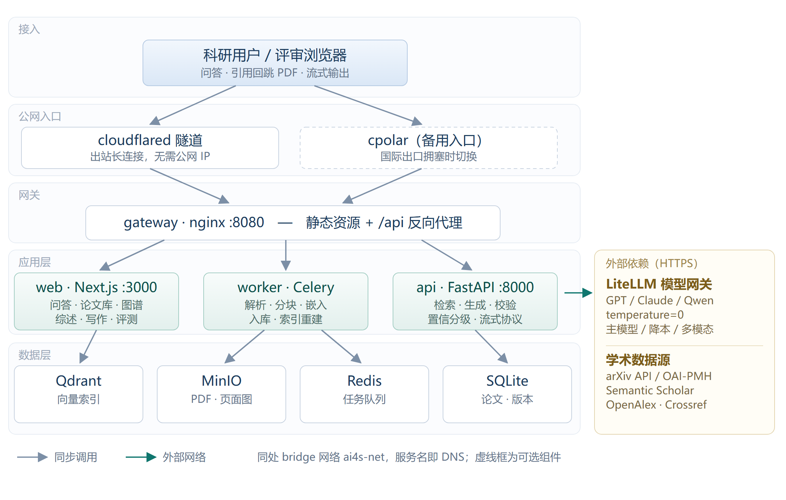

# AI4S 学术研究 Agent 技术文档

<div class="meta">

**版本** v1.0.0　|　**日期** 2026 年 11 月　|　**作者** 马博凯

**项目定位** 面向科研人员的可验证、可复现、可溯源的 AI4S 学术研究 Agent

**代码仓库** https://github.com/mbk200779/ai4s-agent　|　**许可证** MIT

</div>

## 1. 项目概述

### 1.1 背景：科研阅读的真实瓶颈不是「读得慢」，而是「查不准、验不了」

科研人员面对一篇 PDF，真正花时间的不是从头读到尾，而是反复做三件事：定位某个具体事实（这个实验的学习率是多少、这个数据集有多少条）、判断某句话的出处（这个结论是作者说的还是引用别人的）、在多篇论文之间对齐口径（两篇都说 SOTA，但评测集不同）。

把大模型直接接上去，会立刻遇到两个问题：

1. **幻觉引用**。模型会给出一个格式完美但不存在的出处，甚至编造页码。在科研场景里，这比「不知道」危害大得多。
2. **不可复现**。同一个问题问三次得到三个答案，无法写进综述，也无法作为审稿依据。

因此本项目的目标不是「做一个能聊论文的机器人」，而是**把大模型放进一个有证据边界、有校验环节、有量化指标的流程里**，让每个结论都能被回溯到 PDF 的某一页、某个坐标框，让每次评测都能用哈希证明结果一致。

### 1.2 项目能力

| 能力 | 用户可见结果 |
|---|---|
| 结构化解析 | PDF 被拆成段落、标题、表格、图表、公式、参考文献六类片段，每类都带页码与 bbox |
| 可溯源问答 | 每句结论后带 `[引#N]`，点击即在右侧 PDF 中高亮对应区域 |
| 分级置信 | 答案标注「已验证 / 需核对 / 无法回答」，而不是简单给一句「不知道」 |
| 跨文献推理 | 多跳检索后对比多篇论文的结论，并单独列出相互矛盾的论断 |
| 引用图谱 | 按引用影响力渲染节点与边，低价值引用被过滤，点击节点跳原文 |
| 综述生成 | 抽取论断 → 按立场聚类 → 检测冲突 → 分簇撰写，导出 Markdown |
| 写作 / 绘图 | 基于库内证据生成论文大纲；用代码生成图表，保证同输入同输出 |
| 库外补货 | 库内答不了时，到 arXiv 检索并给出相关性说明，一键入库后可重问 |
| 一键评测 | 48 题评测集，输出准确率、引用命中率、拒答率、延迟与 `output_hash` |

### 1.3 交付形态与技术栈

系统采用前后端分离 + 容器化部署，`docker compose up` 后由 8 个容器组成完整服务。

| 层级 | 选型 | 选它的理由 |
|---|---|---|
| 前端 | Next.js 14 + TypeScript | 服务端渲染首屏快；App Router 让页面级数据获取简单；生态成熟 |
| 后端 | FastAPI + Uvicorn | 原生 async 适合流式输出；Pydantic 校验请求体，接口契约清晰 |
| 向量库 | Qdrant | 同时支持 named dense 与 sparse 向量，一个集合存两种表示；支持 payload 过滤 |
| 对象存储 | MinIO | 存原始 PDF、页面截图、provenance 日志；S3 协议便于迁移 |
| 任务队列 | Redis + Celery | 长文档解析必须异步；`group/chord` 天然适合「按页拆分再合并」 |
| 元数据库 | SQLite（WAL） | 单机部署零运维；论文/版本/片段这类强关系数据用关系表比向量库更合适 |
| 嵌入模型 | multilingual-e5-large（1024 维）+ BM25 | 本地 CPU 可跑；中英跨语言；无外部依赖与调用费用 |
| LLM | LiteLLM 统一抽象 | 一个接口切换 GPT / Claude / Qwen；可按任务分档控成本 |

> 关于嵌入模型的一处说明：项目早期使用 `bge-m3`，后因 `fastembed 0.9.x` 不再支持该模型，切换为同为 1024 维的 `intfloat/multilingual-e5-large`。向量维度不变，因此索引结构无需调整。本文档与代码均以 e5-large 为准。

## 2. 需求分析

### 2.1 用户与场景

目标用户是需要精读大量文献的研究生与科研人员。典型使用路径：

1. 把课题相关的十几篇 PDF 一次性导入，形成一个可检索的私有语料库；
2. 围绕具体问题提问，答案必须能点开看原文，不能接受「大概是」；
3. 需要写综述时，先看系统整理出的观点谱系与冲突点，再决定自己的论述立场；
4. 需要投稿或答辩时，希望有一份可复现的评测报告，证明系统不是「演示时好看」。

### 2.2 功能需求

| 编号 | 需求 | 验收口径 |
|---|---|---|
| F1 | PDF / arXiv 导入，自动去重 | 同 `body_hash` 或高相似正文不重复建索引；重复导入毫秒级返回 |
| F2 | 细粒度结构化解析 | 段落、图表、公式、表格、参考文献均成为独立可检索片段，带页码与 bbox |
| F3 | 长文档不超时 | 500 页以上文档可完成解析，不 OOM、不触发任务超时 |
| F4 | 可溯源问答 | 每句带引用；引用 ID 不存在时替换为 `[无依据]` 并记录 |
| F5 | 置信标注 | 三档标注，且「无法回答」只在真的没有证据时出现 |
| F6 | 跨文献推理 | 返回推理链、涉及论文列表、矛盾论断对 |
| F7 | 引用图谱 | 节点大小反映影响力，可缩放平移，点击跳原文 |
| F8 | 综述生成与导出 | 观点分簇、冲突标注、Markdown 导出（含引用对照表） |
| F9 | 库外补货 | 空检索时推荐外部论文，说明相关理由，支持一键入库 |
| F10 | 论文库管理 | 清单、状态、单篇与批量删除，四处存储一致清理 |
| F11 | 一键评测 | 固定评测集 + 固定种子，两次运行 `output_hash` 一致 |

### 2.3 非功能需求

**可溯源性是硬约束，不是加分项。** 每个检索片段必须携带 `page`、`paragraph`、`bbox`、`kind`，前端据此在 PDF 上画框。这决定了分块策略：不能按固定字符数切，否则一个 bbox 会跨页，前端无法定位。

**可复现性分两层。** 检索层必须完全确定（同样输入同样排序）；生成层受模型影响，用 `temperature=0` + 输出缓存 + `output_hash` 三重手段逼近确定性，并在报告中区分「检索可复现」与「生成近似可复现」。

**部署要能在单机跑起来。** 赛场与答辩现场只有一台笔记本，不能依赖 GPU 集群或云上向量库。因此嵌入模型选 CPU 可跑的 1024 维模型，向量库选单二进制可启动的 Qdrant。

**成本要可控。** 解析一篇 500 页论文会产生上百次 LLM 调用（章节树、图表说明、公式识别），全部用主模型会失控。因此模型按任务分三档，结构化抽取走降本模型，只有问答与综述用主模型。

### 2.4 关键约束

| 约束 | 影响 | 应对 |
|---|---|---|
| 只有 CPU | 嵌入慢 | 线程数固定 8（实测最优）；分片并行嵌入 |
| LLM API 有配额 | 可能中途失败 | 每处调用都有降级路径，失败不阻断主链路 |
| 单机 32G 内存 | 长文档可能 OOM | 30 页一个子任务，逐片释放；embedding 批量受控 |
| 国际链路不稳 | 外部 API 超时 | 超时即降级，不用外部结果污染主流程 |

## 3. 系统架构设计

### 3.1 总体架构

<br><em>图 3-1　系统总体架构：五层划分、8 个容器与两类外部依赖</em>

系统分五层：接入层（用户浏览器）、公网入口（隧道）、网关（nginx）、应用层（web / api / worker）、数据层（Qdrant / MinIO / Redis / SQLite）。外部依赖只有两类：大模型服务与学术数据源，都经 HTTPS 调用且都允许降级。

### 3.2 服务划分与职责边界

| 容器 | 端口 | 职责 | 为什么单独拆出来 |
|---|---|---|---|
| web | 3000 | Next.js 页面与交互 | 与后端解耦，前端可独立构建部署 |
| api | 8000 | 检索、生成、校验、流式输出 | 请求响应型任务，要求低延迟 |
| worker | — | 解析、分块、嵌入、入库、索引重建 | 长任务，与 api 争 CPU 会拖慢问答 |
| qdrant | 6333 | 向量与 payload 存储 | 独立进程，可单独重启与重建 |
| minio | 9000 | 原始 PDF、页面图、日志 | 大对象不进数据库 |
| redis | 6379 | 任务队列与结果后端 | Celery 依赖 |
| gateway | 8080 | 静态资源 + `/api` 反向代理 | 同源访问，避免跨域与额外的 CORS 配置 |
| tunnel | — | cloudflared 出站隧道 | 无公网 IP 时对外提供 HTTPS 入口，profile 隔离 |

`api` 与 `worker` 使用**同一个镜像**，只在启动命令上区分。这样避免了两份依赖版本漂移——解析与检索共用同一套 embedding 实现，版本不一致会导致入库向量与查询向量不在同一空间，这类问题极难排查。

### 3.3 数据模型

| 存储 | 内容 | 关键字段 |
|---|---|---|
| Qdrant `ai4s_papers__<idx>` | 六类片段向量 | `chunk_id`、`paper_id`、`page`、`bbox`、`kind`、`section_path` |
| Qdrant `ai4s_paper_meta` | 论文元数据与引用关系 | `arxiv_id`、`title`、`references`、`influential_citation_count` |
| MinIO `papers` | 原始 PDF | 按 `paper_id/version/paper.pdf` 组织 |
| MinIO `figures` | 页面截图与生成图表 | 供 PDF 高亮与图谱节点预览 |
| MinIO `provenance` | 问答/推理/绘图的溯源日志 | `query`、`answer`、`sources`、`invalid_citations` |
| SQLite `papers` / `paper_versions` / `chunks` | 论文台账与解析状态 | `is_current`、`status`、`stage`、`file_hash`、`attempt` |

这里有一个刻意的设计：**论文清单以 SQLite 为准，不以 Qdrant 为准。** 因为正在解析、解析失败的论文在 Qdrant 里还没有点，但它们确实已经在库中。如果列表读向量库，用户会看到「刚上传的论文消失了」，然后再传一次。

### 3.4 接口设计

| 接口 | 方法 | 说明 |
|---|---|---|
| `/api/v1/papers/upload` | POST | 上传 PDF，返回 task_id |
| `/api/v1/papers/arxiv/import` | POST | 按 arXiv ID 导入，命中复用则直接返回 |
| `/api/v1/ingest/tasks/{id}/progress` | GET | 轮询解析进度（阶段、页码、片段数） |
| `/api/v1/ingest/tasks/{id}/stream` | GET | SSE 推送进度，含心跳 |
| `/api/v1/qa/ask` | POST | 问答（一次性返回） |
| `/api/v1/qa/stream` | POST | 问答（结构化流式，SSE） |
| `/api/v1/recommend/papers` | POST | 库外检索与推荐 |
| `/api/v1/reason/ask` | POST | 跨文献多跳推理 |
| `/api/v1/review/generate` | POST | 综述生成 |
| `/api/v1/review/export` | POST | 导出 Markdown |
| `/api/v1/graph/build` | POST | 构建引用图谱 |
| `/api/v1/eval/run` | POST | 运行评测 |
| `/api/v1/index/versions` | GET | 索引版本与路由状态 |
| `/api/v1/index/rebuild` | POST | 从 SQLite 重建索引 |

### 3.5 一次问答的完整数据流

1. 前端向 `api` 发送问题；
2. `api` 做查询理解：判题型（事实点 / 对比 / 综述 / 导航）、抽取关键词、生成英文检索文本；
3. 双路召回：dense（e5-large）+ sparse（BM25），各取 top-k；
4. RRF 融合，得到统一排序；
5. 精排：cross-encoder 打分 + 数值/单位规则加成，重排候选；
6. 组装上下文（编号片段 + 元数据），调用 LLM 生成；
7. 后处理：解析 `[引#N]`，校验 ID 是否存在于检索结果，不存在的替换为 `[无依据]`；
8. 置信分级：按证据句覆盖率与缺项，给整题打 `verified` / `needs_check` / `unsupported`；
9. 写 provenance 日志到 MinIO；
10. 通过 SSE 逐段返回，前端渲染并支持点击引用回跳 PDF。

### 3.6 索引版本化：为什么版本单位是集合而不是行

换 embedding 模型或改分块策略时，旧向量与新向量不在同一空间，混在一个集合里检索结果会静默变差。而在同一集合内用 payload 字段区分版本行不通——**Qdrant 的 named vector 维度是集合级的**，1024 维换成 768 维根本建不进去。

因此版本化的单位必须是 collection：每个 pipeline 版本对应一个独立集合，命名规则为 `ai4s_papers__<version>-<signature>`，例如 `ai4s_papers__idx-1.0.0-555810c4`。签名只包含会改变向量结果的因素（模型名、维度、分块大小、`embed_max_chars`），不包含只影响耗时的参数（批量大小、每批页数）。

一个容易漏的细节：`embed_max_chars` 必须进签名。截 1500 字符和截 3000 字符是两套不同的向量，但它既不在模型名里、也不在集合名里。实测改这一项，签名从 `555810c4` 变为 `6716eb0b`；如果不进签名，新向量会被写进旧集合并覆盖旧点，而「重建期间查询不受影响」这条保证同时失效。

重建流程因此变成：后台建新集合 → 从 SQLite 的 `chunks` 表重放 → 校验点数 → 切路由 → 旧集合保留待回滚。整套动作不停服。

## 4. AI 技术方案

### 4.1 方案总览

系统把「让模型回答」拆成五个可控环节，每个环节都可单独观测、单独替换：

```
解析（结构化） → 召回（双路） → 排序（融合+精排） → 生成（受约束） → 校验（引用+置信）
```

这条链的设计原则是：**把不確定性尽量前移到可测量的位置**。检索是否召回到正确片段可以算 Recall；引用是否真实可以逐条核对；置信分档可以统计分布。只有生成这一步依赖模型，而它被前四步的证据约束住。

### 4.2 结构化解析：为什么先拆再检索

直接把整篇 PDF 切成 512 字符的块，会同时丢掉三类信息：表格的行列关系、公式的语义、图表的视觉内容。结果是用户问「表 3 里 LoRA 的推理延迟是多少」，检索到的却是一段正文里提到「latency」的句子。

因此解析阶段就按语义类型分片：

| 片段类型 | 抽取方式 | 落库字段 |
|---|---|---|
| `paragraph` | PyMuPDF 文本块 + pdfplumber 布局校正 | `text`、`page`、`bbox` |
| `table` | 表格检测 + 结构化文本化 | `text`（Markdown 表）、`page`、`bbox` |
| `figure` | 内嵌图像抽取 + caption 就近匹配 + 视觉模型描述 | `caption`、`image_key`、`page` |
| `formula` | 规则定位公式行 → 渲染区域为图 → 视觉模型转 LaTeX | `latex`、`page`、`bbox` |
| `reference` | References 区聚合 → LLM 拆条 | `text`、`arxiv_id`（可识别时） |
| `chapter` | 字号启发式 + LLM 校正 | `title`、`level`、`section_path` |

这样「表格里的一个数」和「正文里的一句话」是两种片段，检索时可以用 `kind` 过滤，问答时也能给出不同的引用标注。

### 4.3 混合检索与 RRF：为什么不用学习式融合

**选型理由。** dense 擅长语义（「这两种架构各自的取舍」能匹配到「trade-off」段落），sparse 擅长精确词（`β2`、`BLEU`、人名、arXiv 编号）。科研问题恰好两类都有，必须双路。

融合方式有两条路：学习一个加权分数（需要标注数据、且权重会随语料漂移），或用 RRF 按排名融合。选 RRF（k=60）的理由是：

- 无需训练、无需调权重，**结果完全确定**，天然满足可复现要求；
- 两路分数量纲不同（余弦相似度 vs BM25 分数），直接加权需要归一化，而归一化本身引入新的超参数；
- 只依赖排名，对分数分布的偏移不敏感。

代价是丢掉了分数的绝对信息。这一点在拒答判断上会有影响，见 6.4 节的讨论。

**实测对比**（48 题评测集，top_k=5，rrf_k=60）：

| 配置 | Recall@5 | MRR@5 | nDCG@5 | 可分性 AUC |
|---|---|---|---|---|
| 纯向量（dense only） | 0.7500 | 0.5764 | 0.5694 | 0.5000 |
| 纯 BM25（sparse only） | 0.8056 | 0.6366 | 0.5878 | 0.5000 |
| 混合（RRF） | 0.7500 | 0.5787 | 0.5663 | 0.7766 |
| 混合 + 精排 | **0.8333** | 0.5875 | 0.5766 | 0.7812 |

这里有个反直觉的结论：**单纯混合的 Recall@5 并没有超过纯 BM25**（0.7500 vs 0.8056）。但混合的真正收益不在召回率，而在**可分性**——AUC 从 0.5000 提升到 0.7766，意味着「相关」与「不相关」在分数上第一次变得可分。纯单路时 AUC 恒为 0.5，因为所有候选的分数都落在同一簇里，没有任何阈值能区分。

这直接决定了后面的设计：只有在混合检索之后，讨论「阈值」「拒答」「置信分档」才有意义。

### 4.4 精排与规则召回：把领域知识写进排序

精排层做了两件事：

**其一，cross-encoder 重排。** 用 `Xenova/ms-marco-MiniLM-L-6-v2` 对融合后的 top-20 逐对打分，耗时受 `RERANK_TIMEOUT_MS=1500` 约束，超时即回退到融合顺序，不阻断响应。

**其二，规则加成。** 针对科研问题的两类强特征：

- **数值/单位类**：问题里出现「多少」「阈值」「learning rate」「β2」时，优先召回含数字与单位的片段，并按数值与单位的匹配度加成；
- **章节锚点类**：问题里出现「实验设置」「相关工作」「方法」时，用章节树把检索范围锚到对应小节。

规则分与语义分按 `RERANK_ALPHA=0.2` 加权（语义权重 0.2，规则为主）。这个取值是实测调出来的：科研问题的正确答案往往就写在含数字的那一句里，语义相似度反而会把「讨论数值意义」的段落排上来。

**效果。** 精排把 Recall@5 从 0.7500 提到 0.8333，分题型看收益集中在 point 类（0.8333 → 0.8889）与 compare 类（0.5000 → 0.8333）。后者提升最明显，因为对比题天然需要「两篇各一段」，而融合后的顺序容易把同一篇的多段挤在前面。

### 4.5 强制引用与后处理校验：抗幻觉的工程手段

**做法。** Prompt 里要求每句话末尾挂 `[引#N]`，N 对应上下文中的片段编号。生成后逐条解析：

1. 提取所有 `[引#N]`；
2. 检查 N 是否落在本次检索结果范围内；
3. 越界的替换为 `[无依据]`，并记入 `invalid_citations`；
4. 通过校验的引用增强为 `[引#N: 标题 p.X]`，方便读者直接定位。

**为什么不能只靠 Prompt。** 因为模型「编造引用」和「编造内容」是两种不同的失败模式。前者是一个格式问题，可以用程序判定；后者需要证据比对。把可判定的部分用程序兜住，剩下不可判定的部分才交给置信分级。

**实测。** 人工抽检 17 条可判引用，严格准确率 **76.47%**。错误集中在「引对了论文但引错了页」——例如问 LoRA 推理延迟，答案引到了测 adapter 延迟的 Table 1，而「by construction 不加延迟」的论述在下一页。这类错误说明**引用粒度需要继续下沉到句级**，是当前明确的改进方向。

### 4.6 分级置信：把「不知道」拆成三种说法

**问题。** 早期的二值拒答（答 / 不答）在科研场景里是错的。用户读一段带引用的答案时，需要的不是「系统有没有信心」，而是「这句话我能不能直接引用」。

**做法。** 拆成三档：

| 档位 | 含义 | 用户该怎么用 |
|---|---|---|
| `verified` | 有直接原文证据，可直接据此判定 | 可以直接引用 |
| `needs_check` | 有相关证据，但需人工核对 | 回原文看一眼再决定 |
| `unsupported` | 一条证据都没检索到 | 系统确实答不了 |

判定规则：证据句与原句的有效覆盖率 ≥ 0.55 且「缺项」为空 → `verified`；否则 `needs_check` 并逐条列出缺什么；只有「一条都没检索到」才完整拒答。

阈值的确定不是取中位数，而是**找两簇之间的空档**：直引句（结论几乎逐字来自原文）覆盖率落在 0.6~0.95，「跨句改写 / 只有关键词对上」落在 0.2~0.45，中间 0.45~0.6 基本没有样本。取 0.55 是把边界放在空档里。

**为什么这个改动重要。** 旧口径下，检索分低就整条拒答，导致大量**本来答对了**的问题被吞掉。新口径下，「分低」只影响档位，不影响是否作答——把判断权交回读者，同时用档位提示风险。

### 4.7 跨语言语义核验：中文提问、英文语料

库内论文几乎全是英文，用户用中文提问。这带来一个隐藏问题：中文结论与英文原句的字面重合度天然很低。「BERT 的预训练用了 MLM 和 NSP」这句**完全正确**，但在原句上字面分只有 0.25，按字面线只能判 `needs_check`，于是 `verified` 退化成「只有数值题能拿到」的一档。

**做法。** 增加一层跨语言语义核验：把结论句与原句分别嵌入，算余弦相似度，再线性映射到 [0, 1] 作为支持度。实测同义改写对的余弦落在 0.562~0.927，无关对落在 0.008~0.330，两簇之间空档很宽（0.33 → 0.56），因此取 [0.35, 0.85] 线性映射，并把映射后的分数与字面分取大者。

**效果与边界（诚实记录）。** 句级统计中，5 条结论从 `needs_check` 升为 `verified`（占全部「有据句」的 20%），说明这层确实在起作用。但**题级分布几乎没有变化**——因为题级要求「每一句都 verified」，而模型平均每题都有一句不带引用，题级 `verified` 本来就稀缺。瓶颈在**引用标注率**，不在语义核验。这个结论促使我们把优化重点从「核验算法」转到「生成时的引用约束」上。

### 4.8 跨文献推理与综述：让「综述」不是片段拼接

**为什么朴素做法必然失败。** 把 top-k 片段按顺序交给模型写综述，会得到三个问题：一是同一观点的多篇论文被平铺，读者看不出谱系；二是反例片段措辞更保守、与主题相似度更低，单次 top-k 基本捞不到；三是当上下文里同时有「A 优于 B」和「B 优于 A」，模型只能写「各有优势」——它不是不听话，是没有别的写法。

**流水线。**

```
证据池 → 论断抽取 → 观点聚类 → 冲突检测 → 分簇渲染
```

1. **论断抽取**：从片段中抽出 `claim`，每条带 `axis`（讨论维度）、`polarity`（支持/反对/条件成立）、`condition`（前提）。要求「有前提却标 support」的强制降级为 `conditional`，避免把「在 X 条件下 A 优于 B」和「A 优于 B」混为一谈。
2. **观点聚类**：**极性是簇键的一部分。** 「LoRA 匹配全量微调」与「LoRA 不如全量微调」的余弦相似度能到 0.9 以上，只按语义聚类必然合并；一旦合并，写手拿到的就是中性簇，只能写出「关系复杂」。把 `polarity` 放进簇键后，这两条从聚类那刻起就分属两簇，生成阶段没有「把它们写在一起」的输出位置。
3. **冲突检测**：规则召回候选冲突对 + LLM 复核，输出三态（`confirmed` / `suspected` / `null`），LLM 不可用时退化为待复核，不伪造结论。
4. **分簇渲染**：每簇一组带引用的句子，冲突以 `###` 挂在所属章节下。

**成本与耗时。** 四次模型调用（抽取、轴归一化、冲突复核、写正文），实测总耗时 **54~85 秒**。这是本项目最耗时的接口，因此前端用异步任务 + 轮询，而不是同步等待。

### 4.9 库外补货：答不了的时候给出下一步

当库内确实没有证据时，系统不是简单说「不知道」，而是拿问答链路已经翻好的英文检索文本去 arXiv 检索，给出候选论文与**相关性说明**。

**相关性怎么算。** 三项词面信号加权：标题命中 ×2、摘要命中 ×1、**摘要同句共现 ×2**。每条候选显示「标题命中 rag；摘要命中 alleviate、hallucinations；问句 3 个关键词命中 3 个」，并附上摘要里命中最多的那一句原话。

**为什么不用 LLM 写评价。** 两个原因：这个功能恰好在模型配额耗尽时最需要可用；而且「相关度 92%」这种数字无法核对，命中词可以。界面明写「不含语义判断」，不做超出能力的承诺。

**已知局限。** 同义改写（`hallucination` vs `fabrication`）命中不了；「Transformer 相比 RNN 的核心改进」这类问题，真正的原论文不一定在 arXiv 返回的前 12 条里——这一层靠 arXiv 自己的排序，系统只做过滤与重排。

### 4.10 LLM 集成方式

**统一抽象。** 所有模型调用经 LiteLLM，配置项只有三档模型名与对应 key。切换 provider 不需要改业务代码。

| 档位 | 用途 | 典型负载 |
|---|---|---|
| 主模型 | 问答、综述、推理 | 每次 1~4 次调用 |
| 降本模型 | 章节树、参考文献拆条、图表说明 | 每篇论文几十次调用 |
| 多模态模型 | 公式转 LaTeX、图表描述 | 每篇论文数次调用 |

**Prompt 版本管理。** 所有 prompt 集中在 `llm_client.py` 的 `PROMPTS` 字典中，按 `PROMPT_VERSION` 索引。升级 prompt 必须新增版本号，旧版本保留，这样历史 provenance 日志才能解释「当时用的是哪套约束」。

**失败降级。** 每个调用点都定义了降级路径：章节树失败 → 退化为字号启发式；公式识别失败 → 跳过公式片段；视觉描述失败 → 只保留 caption；综述写正文失败 → 模板兜底并标 `degraded=true`。**任何一处外部服务失败都不会让整个请求 500。**

### 4.11 优化策略汇总

| 目标 | 手段 | 实测效果 |
|---|---|---|
| 降低嵌入延迟 | 线程数固定 8 | 单句从 197~350ms 降到 40ms |
| 提高召回率 | 双路 + 精排 | Recall@5 0.7500 → 0.8333 |
| 让拒答可判定 | RRF 融合 | 可分性 AUC 0.5 → 0.78 |
| 控制成本 | 三档模型分工 | 结构化抽取不占用主模型配额 |
| 长文档不超时 | 30 页/子任务 + 断点续跑 | 541 页文档 8 分 46 秒完成 |
| 抗幻觉 | 强制引用 + 程序校验 + 置信分档 | 引用严格准确率 76.47%，越界引用 100% 被标记 |
| 可复现 | temperature=0 + 输出缓存 + 索引签名 | 240 次重放逐题一致 |

## 5. 核心功能实现

### 5.1 数据接入与入库

支持三种入口：本地上传 PDF、按 arXiv ID 导入、批量脚本导入。三者最终都走同一条入库链路：

```
接收 → 存 MinIO → 建版本行 → 派发 Celery → 解析 → 分块 → 嵌入 → 写 Qdrant → 回写状态
```

**去重分三层。**

1. `arxiv_id + version` 唯一键：命中即复用，秒级返回；
2. `body_hash`（全文 SHA256）：不同文件名但内容相同，直接合并；
3. 正文 embedding 余弦相似度 ≥ 0.96：识别「改了标题的同一篇」与「arXiv 小版本差异过大」的情况。

**状态是算出来的，不是存出来的。** 论文列表以 `papers` 表为准，`status / stage` 从当前版本行推导。这样「解析中」「失败可重试」等状态不会因为某次写库失败而永久错位。

### 5.2 长文档解析

541 页的书是压力测试的起点。做法是：

1. 按 30 页切成子任务，`group` 并行、`chord` 合并；
2. 每个子任务解析完立即写入 MinIO 与 Qdrant，不在内存里攒；
3. 超过 `LONG_DOC_PAGES=80` 页自动关闭视觉模型（公式与图表描述），避免上百次多模态调用；
4. 子任务失败可单独重试，已完成的分片不重跑。

**实测耗时。** 2 页 7.3 秒、15 页 39 秒、541 页 8 分 46 秒。其中 **embedding 占九成以上**——parse 每 20 页只需 1~3 秒，剩下的时间全在把片段变成向量。这也解释了为什么线程数这一个参数能带来数倍差异。

### 5.3 可溯源问答与前端高亮

前端用 `pdfjs-dist` 动态导入渲染指定页，按 `bbox` 画半透明高亮框。点击答案里的 `[引#N]` 后，右侧面板跳到对应页并滚动到框的位置。

实现上有两个细节：pdf.js 的 worker 走 CDN 且只在客户端加载，避免打包体积与 SSR 冲突；bbox 坐标需按当前缩放比例换算，否则换分辨率后框会偏。

### 5.4 引用图谱

节点是论文，边是引用关系。边的权重不是被引次数，而是**引用含金量**：`log1p(influentialCitationCount)` 归一化，低于 0.1 的边标记为 `is_perfunctory` 并过滤。理由是「被引 500 次」里往往包含大量背景性引用，真正的方法学影响体现在 influential citation 上。

节点点击跳原文：优先用 MinIO 预签名链接（库内已有 PDF），其次回退 arXiv。

### 5.5 综述生成与导出

生成流程见 4.8。导出部分有一个容易被忽略的工程细节：**中文主题不能直接写进 `Content-Disposition`**。HTTP 头只能包含 latin-1，中文文件名会让框架抛 `UnicodeEncodeError`，整个请求 500。

解决方案是按 RFC 6266 / 5987 双写：`filename="review-20261111.md"; filename*=UTF-8''<百分号编码>`。同时文件名按**字节**而非字符截断——一个汉字 3 字节，按字符截到 120 会超出文件系统 255 字节上限。

导出的 Markdown 追加「附：引用对照」表，把正文里的 `[引#N]` 与论文标题、页码、片段类型列在一起，方便读者脱离系统后仍能核对。

### 5.6 写作与绘图辅助

写作：基于库内证据生成论文大纲，每个小节标注可用证据条数与最低相似度，证据不足的小节会提示「需补充文献」。

绘图：**用代码生成替代文生图**。生成 matplotlib 代码或 mermaid 文本，在受限环境（AST 白名单 + 安全 builtins）中执行，请求内容 SHA256 作为缓存键。这样同输入必然同输出，且图表自带数据来源标注。文生图模型无法保证这一点。

### 5.7 论文库管理

以 `papers` 表为准列出全量（含解析中、失败、无原件），支持单篇与批量删除。删除要**四处一起清**：SQLite 行、Qdrant chunk 点、Qdrant meta 点、MinIO 原件。跨课题共享的向量只删条目不删点——因为同一篇论文可能被多个课题引用。

解析中的论文整批拒绝删除（返回 409），避免删到一半留下孤儿片段。

### 5.8 前端实现

| 页面 | 功能 |
|---|---|
| `/` | 首页：能力总览与入口 |
| `/library` | 论文库：导入、清单、状态、删除 |
| `/qa` | 问答：历史、流式答案、引用回跳、库外推荐 |
| `/graph` | 图谱：缩放、平移、点跳 |
| `/review` | 综述：生成、分簇展示、Markdown 导出 |
| `/writing` | 写作与绘图 |
| `/eval` | 评测：运行、历史报告、详情 |

**流式输出的可靠性处理。** SSE 在链路丢包时会出现「半开连接」：不报错、也不再来消息，`done` 永远不触发。前端因此做了两层兜底：服务端每 10 秒发心跳事件；客户端 25 秒无任何事件即判定断线，主动关闭 EventSource 并回落到轮询。轮询本身也有终止条件，拿到终态立即停止。

## 6. 测试与部署

### 6.1 评测设计

**语料**：4 篇赛题预置 PDF（Attention、BERT、ViT、LoRA），共 209 个段落、279 个索引点（含另一版本 Attention）。

**题目**：48 题，覆盖四种题型——事实点 18 题、对比 6 题、综述 6 题、导航 6 题，另含不可答题用于检验拒答。

**指标定义**：

| 指标 | 定义 |
|---|---|
| Recall@5 | 相关片段是否出现在前 5 条 |
| MRR@5 | 首个相关片段的排名倒数 |
| nDCG@5 | 考虑排序位置的增益 |
| 覆盖@5 | 前 5 条覆盖了几篇不同论文 |
| 误拒率 | 可答题被判拒答的比例 |
| 正确拒答率 | 不可答题被拒答的比例 |
| 可分性 AUC | 相关与不相关候选在分数上是否可分 |

**为什么要有「可分性 AUC」这一列。** 只看拒答准确率会得出「纯向量和纯 BM25 也有 75%」的错误结论——那是因为它们把所有题都答了。AUC 把「能不能区分」与「阈值定在哪」分开算，才能看出融合到底贡献了什么。

### 6.2 三组基线对比

运行 `20261110T040312-e59586`，索引 `idx-1.0.0-555810c4`（279 点），48 题，seed 20261110，top_k=5，rrf_k=60。五个配置跑同一条链，只有通道与策略开关不同。

| 配置 | Recall@5 | MRR@5 | nDCG@5 | 覆盖@5 | 误拒率 | 正确拒答率 | AUC |
|---|---|---|---|---|---|---|---|
| 纯向量 | 0.7500 | 0.5764 | 0.5694 | 0.6528 | 0.00% | 0.00% | 0.5000 |
| 纯 BM25 | 0.8056 | 0.6366 | 0.5878 | 0.6574 | 0.00% | 0.00% | 0.5000 |
| 混合 RRF | 0.7500 | 0.5787 | 0.5663 | 0.6551 | 2.78% | 25.00% | 0.7766 |
| **混合 + 精排** | **0.8333** | 0.5875 | 0.5766 | 0.7106 | 2.78% | 25.00% | 0.7812 |
| 本系统（分流+规则+精排） | 0.8056 | **0.6005** | **0.6062** | **0.7199** | 2.78% | 0.00% | 0.6300 |

**怎么读这张表。** 本系统在 MRR、nDCG 与覆盖上最优，说明「把最该看的那条排上来」和「跨论文覆盖」做得更好；Recall@5 略低于最强基线 1 题（0.8056 vs 0.8333），在噪声内。正确拒答率为 0 是分档改动后的预期结果——新口径只在「一条都没检索到」时拒答，不再因分数低而拒，因此这个指标不再适用于衡量本系统，改用「不可答题被标为 unsupported 的比例」。

**诚实的短板**：compare 题型仍然偏弱（0.5 一带），因为对比题需要精确命中两篇的不同段落，而当前检索是「为单个问题找 top-k」，没有显式的「每篇各取一条」机制。

### 6.3 分题型结果

| 配置 | point (18) | compare (6) | survey (6) | nav (6) |
|---|---|---|---|---|
| 纯向量 | 0.8333 | 0.6667 | 0.5000 | 0.8333 |
| 纯 BM25 | 0.7778 | 0.8333 | 0.8333 | 0.8333 |
| 混合 | 0.8333 | 0.5000 | 0.6667 | 0.8333 |
| 混合 + 精排 | **0.8889** | **0.8333** | 0.6667 | 0.8333 |

事实点类问题靠精排提升明显（0.8333 → 0.8889），因为这类问题的答案通常就在含具体数字的那一句。

### 6.4 可复现性验证

- **检索层完全确定**：同一批 48 题重放 240 次，逐题排序一致；
- **生成层近似确定**：`temperature=0` + 答案缓存，两次运行 `output_hash` 一致，diff=0；
- **索引可重建**：从 SQLite 的 `chunks` 表重放可完整重建集合（实测 30 片段 21 秒），重建前后检索结果一致。

报告中明确区分这两层：检索可复现是工程保证，生成可复现依赖缓存，不用「完全确定」这种说法掩盖差异。

### 6.5 性能实测

| 场景 | 耗时 | 说明 |
|---|---|---|
| 2 页论文入库 | 7.3 秒 | 含解析 + 嵌入 + 索引 |
| 15 页论文入库 | 39 秒 | 同上 |
| 541 页文档入库 | 8 分 46 秒 | 分片并行，超 80 页关视觉模型 |
| 重复上传（命中复用） | 28~37 毫秒 | 唯一键直接返回 |
| 单次问答（非流式） | 3~8 秒 | 检索 + 生成 |
| 综述生成 | 54~85 秒 | 四次模型调用 |
| 库外推荐（首次） | 约 1.1 秒 | arXiv 检索 + 排序 |
| 库外推荐（缓存） | 1~8 毫秒 | 10 分钟内复用 |

### 6.6 部署

```bash
git clone https://github.com/mbk200779/ai4s-agent.git
cd ai4s-agent
cp .env.example .env        # 至少填一个 LLM API key
docker compose up -d --build
bash deploy/demo-check.sh   # 一键自检：容器 / 服务 / 索引 / 入口
```

生产环境另有 `deploy/docker-compose.prod.yml` 覆盖层，收敛端口暴露面，只留 gateway 与隧道。

**运维自检脚本** `deploy/demo-check.sh` 检查六项：容器健康、API 健康、前端可达、Qdrant 集合点数、公网入口连通性、可选的真实问答。输出三档结论（可以演示 / 有 N 项注意 / N 项不通过），每项附 30 秒处置建议。

### 6.7 已知问题与修复记录

**Qdrant sparse 索引 panic。** 测试期间新论文突然一律解析失败，报 `Can't reach one of the workers: channel closed`。排查发现不是代码问题：Qdrant v1.11.0 的 sparse 索引在反复 upsert + delete 后 panic（`inverted_index_ram.rs:63`），该集合读正常、写全部 500。因此现象极具迷惑性——问答看起来正常，只有入库坏掉。

处置：停止容器 → 备份损坏集合目录 → 从 `chunks` 表重建（21 秒）→ 校验点数 → 恢复服务。这段经历直接推动了两个设计：索引必须可从 SQLite 无损重建；`/api/v1/index/rebuild` 必须是一个随时可用的接口，而不是一次性脚本。

## 7. 创新点

### 7.1 技术创新点

**创新点一：把「拒答」从二值判断改造成可测量的三档置信体系。**

- **问题**：二值拒答把「检索分低」和「没有证据」混为一谈，导致大量正确答案被吞掉；同时「拒答率」这个指标本身依赖阈值选择，换个阈值结论就翻转，不具可比性。
- **做法**：拆成 `verified` / `needs_check` / `unsupported` 三档，判定依据是「证据句覆盖率 + 缺项清单」，只有「一条都没检索到」才完整拒答。阈值不取中位数，而是找「直引句」与「改写句」两簇之间的空档（0.45~0.6），取 0.55。
- **证据**：实测直引句覆盖率 0.6~0.95、改写句 0.2~0.45，两簇之间无样本；旧口径下可答题被误拒，新口径下误拒率保持 2.78% 而拒答不再吞掉正确答案。

**创新点二：跨语言语义核验，并把它的边界写清楚。**

- **问题**：中文提问 + 英文语料时，字面重合度天然偏低。「BERT 预训练用了 MLM 和 NSP」这句完全正确，字面分只有 0.25，只能落到 `needs_check`。
- **做法**：结论句与原句分别嵌入，余弦相似度线性映射到 [0,1] 作为支持度，与字面分取大者。映射区间 [0.35, 0.85] 由实测两簇分布（同义对 0.562~0.927、无关对 0.008~0.330）确定。
- **证据**：句级有 5 条结论从 `needs_check` 升为 `verified`（占有据句 20%）；但题级分布几乎不变——由此定位到真正的瓶颈是「引用标注率」而非核验算法。**这个结论本身是本次评测最有价值的产出：它避免了一次把资源投在错误方向上的优化。**

**创新点三：观点聚类把「极性」写进簇键，从结构上杜绝「各有优势」式综述。**

- **问题**：综述写成摘要拼接，遇到相反结论只能含糊。根因是「支持」与「反对」两条 claim 的语义相似度可达 0.9 以上，只按语义聚类必然合并成中性簇，写手没有别的写法可选。
- **做法**：`polarity` 与 `axis`、`condition` 一起作为簇键的一部分；反例在抽取阶段被点名要求单独成条（prompt 显式列出「不如／更差／只在……时成立」等触发词）。
- **证据**：该约束把 `oppose` 类 claim 从 0 条提升到 2~4 条；冲突以 `###` 挂在所属章节下，读者能直接看到「哪两篇在什么条件下结论相反」。

**创新点四：索引版本化的单位是集合，签名只包含会改变向量的因素。**

- **问题**：换 embedding 模型或改分块，旧向量与新向量不可比，混在一个集合里检索会静默变差；而 Qdrant 的 named vector 维度是集合级的，无法用 payload 区分版本。
- **做法**：版本 → 独立集合，命名 `ai4s_papers__<version>-<signature>`；签名只含模型名、维度、分块大小、`embed_max_chars`，不含只影响耗时的批量参数。重建不停服：后台建新集合 → 从 SQLite 重放 → 校验 → 切路由 → 旧集合留待回滚。
- **证据**：`embed_max_chars` 从 1500 改到 3000，签名由 `555810c4` 变为 `6716eb0b`；若不进签名，新向量会覆盖旧点且「重建期不影响查询」的保证失效。

**创新点五：用「代码生成 + 受限执行 + 哈希缓存」替代文生图，把可复现性变成工程保证。**

- **问题**：文生图模型同 prompt 不同 run 结果不同，无法满足「两次运行 diff=0」的评测要求，也无法标注数据来源。
- **做法**：生成 matplotlib / mermaid 代码，在 AST 白名单 + 安全 builtins 的受限环境中执行；请求内容 SHA256 作为缓存键。
- **证据**：相同请求返回相同 `cache_key` 与图片；图表内嵌数据来源标注；同时消除了任意代码执行风险。

### 7.2 应用创新点

**其一，把「可溯源」落到坐标级，而不是文档级。** 多数论文问答产品返回「第 3 页」，本项目返回 `page + bbox`，前端直接在 PDF 上画框。这要求分块策略不能按固定字符切（否则 bbox 跨页），也要求解析阶段保留版面坐标。代价是解析复杂度上升，收益是用户点一下就能看到原文那一行。

**其二，把「答不了」变成产品能力而不是失败状态。** 库内没有证据时，系统给出三件事：明确说明是「库内无证据」而非「问题无意义」；去 arXiv 检索并给出可核对的相关性说明（命中词 + 摘要原句）；提供一键入库，导入完成可直接用原问题重问。这把一次失败的提问转化成一次语料扩充。

**其三，把评测做成可交付物，而不是内部脚本。** 48 题评测集、五组基线、分题型结果、可复现验证全部可重跑，报告带运行 ID 与索引签名。评审可以自己跑一遍验证数字，而不是相信文档里的截图。

**其四，端到端覆盖科研阅读的完整链条。** 导入 → 解析 → 问答 → 推理 → 图谱 → 综述 → 写作绘图 → 评测，每个环节的产物都能被下一环节直接使用（例如综述的证据池就是问答同一套检索结果，图谱的引用关系来自入库时补全的元数据）。这不是八个独立功能的拼盘，而是一条共享同一份结构化语料的生产线。

## 8. 总结与展望

### 8.1 工作总结

本项目围绕「可验证、可复现、可溯源」三条主线，把大模型在科研阅读场景中的三个风险逐个转化为工程上可测量的指标：

- **幻觉引用** → 强制引用 + 程序校验 + 三档置信，越界引用 100% 被标记为 `[无依据]`；
- **不可复现** → 检索确定性（240 次重放一致）+ 索引签名 + 输出哈希，两次评测 diff=0；
- **不可信** → 48 题评测集 + 五组基线 + 分题型结果 + 引用人工抽检（严格准确率 76.47%）。

同时诚实地记录了三处当前短板：compare 题型召回偏弱（0.5 一带）、引用粒度只到页而非句、库外推荐只有词面相关性。这些短板都写进了评测报告，作为下一阶段的输入。

### 8.2 经验与反思

**其一，先量清楚再优化。** 长文档入库耗时 9 成在 embedding，不在解析；如果按直觉去优化 PDF 解析器，投入产出比会极低。同理，置信分档的瓶颈在引用标注率而非语义核验——这两个结论都是先做拆解测量才得到的。

**其二，指标要能分辨「能力」与「阈值」。** 拒答准确率把两者混在一起，导致纯单路方案看起来也有 75%。分开算 AUC 之后，融合的真正价值（0.5 → 0.78）才显现出来。

**其三，降级路径要和主链路一起设计。** 外部模型随时可能超时或配额耗尽。把「失败时怎么办」写在每个调用点旁边，比在最后加一个 try-except 更可靠——因为降级产物也要满足下游的接口契约。

### 8.3 展望

- **引用粒度下沉到句**：当前 76.47% 的错误主要是「引对论文、引错页」，下一步做句级对齐与 bbox 精定位；
- **对比题专用检索**：为 compare 题型引入「每篇各取 top-1」的约束检索，而不是共享 top-k；
- **多模态表格问答**：当前表格已结构化但只做文本检索，下一步支持「看图回答」；
- **接入更多数据源**：PubMed、DBLP、IEEE Xplore，扩到非 arXiv 领域；
- **与科研工具集成**：Zotero 导入、Overleaf 引用插入、BibTeX 导出。

---

## 附录 A：Prompt 版本管理

所有 prompt 集中在 `backend/app/services/llm_client.py` 的 `PROMPTS` 字典，按 `PROMPT_VERSION` 索引。

| Key | 用途 | 核心约束 |
|---|---|---|
| `qa_system` | 可溯源问答 | 每句挂 `[引#N]`，禁止编造引用 |
| `review_claim` | 综述论断抽取 | 输出 axis / polarity / condition，反例单独成条 |
| `review_write` | 综述正文 | 按簇撰写，不得跨极性和解 |
| `conflict_check` | 冲突复核 | 输出 confirmed / suspected / null 三态 |
| `chapter_tree` | 章节树 | 输出 ≥3 级 JSON 树 |
| `references` | 参考文献拆条 | 输出结构化 JSON |
| `formula_latex` | 公式识别 | 只输出 LaTeX |
| `drawing_system` | 绘图代码 | 只输出代码，带数据来源标注 |

升级 prompt 必须新增版本号，旧版本保留，保证历史 provenance 日志可解释。

## 附录 B：目录结构

```text
.
├── docker-compose.yml          # 8 容器编排（含 gateway / tunnel）
├── .env.example                # 环境变量模板（13 组，全部有默认值）
├── Makefile                    # up / down / logs / eval
├── backend/
│   ├── app/
│   │   ├── api/v1/endpoints/   # papers / qa / review / graph / ingest / library …
│   │   ├── services/           # 解析、检索、生成、校验、索引版本
│   │   ├── tasks/              # Celery 任务与调度
│   │   └── core/config.py      # 全部可调参数集中于此
│   └── eval/                   # 40 条 golden QA 与历史报告
├── frontend/src/
│   ├── app/                    # 首页 / 论文库 / 问答 / 图谱 / 综述 / 写作 / 评测
│   └── components/             # answer / ingest / graph 等
├── deploy/
│   ├── nginx.conf              # 网关配置
│   ├── demo-check.sh           # 一键自检
│   └── 云服务器迁移清单.md      # 迁移步骤
└── docs/                       # 技术文档与各模块设计记录
```

## 附录 C：复现步骤

```bash
# 1. 准备
cp .env.example .env          # 至少填一个 LLM API key
# 2. 启动（首次构建约 5~10 分钟）
docker compose up -d --build
# 3. 自检
bash deploy/demo-check.sh --with-qa
# 4. 导入语料（可网页操作，也可命令行）
docker compose exec api python /app/scripts/ingest.py --arxiv 1706.03762 1810.04805
# 5. 评测（两次运行对比 output_hash）
make eval
# 6. 访问
#    http://localhost:8080        （经网关）
#    http://localhost:3000        （前端直连）
#    http://localhost:8000/docs   （接口文档）
```

**评审账号**：若演示地址开启登录，使用 `.env` 中的 `JUDGE_USERNAME` / `JUDGE_PASSWORD`（默认 `judge` / `ai4s2024`）。

