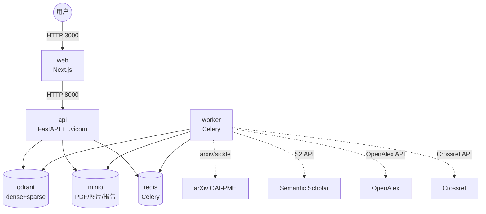

# AI4S 学术研究 Agent 技术文档

> 版本：v1.0.0  
> 生成时间：2026-10-21

---

## 1. 项目概述

### 1.1 背景

科研人员每天需要阅读大量 PDF 论文，提取细粒度事实（如超参数、实验结果、作者机构、参考文献），并在多篇文章之间建立联系。传统大模型问答存在两个致命问题：

1. **幻觉引用**：模型会编造不存在的来源；
2. **无法复现**：同一问题多次询问结果不一致，难以审稿或复现实验。

### 1.2 项目定位

本项目是一个面向科研人员的 **AI4S 学术研究 Agent**，以“**可验证、可复现、可溯源**”为核心目标，提供：

- PDF 上传 / arXiv 拉取与细粒度结构化解析；
- 基于检索增强（RAG）的可溯源问答；
- 跨文献推理与矛盾发现；
- 引用图谱与综述生成；
- 绘图辅助；
- 一键评测与可复现报告。

### 1.3 技术栈

| 层级 | 技术 |
|---|---|
| 后端 | Python + FastAPI + Uvicorn |
| 前端 | Next.js 14（React + TypeScript） |
| 向量库 | Qdrant（named vectors：dense bge-m3 + sparse BM25） |
| 对象存储 | MinIO（papers / figures / provenance） |
| 任务队列 | Redis + Celery |
| 数据接入 | arXiv + Semantic Scholar + OpenAlex + Crossref |
| LLM 抽象 | LiteLLM（GPT / Claude / Qwen），`temperature=0` |

---

## 2. 需求分析

### 2.1 用户场景

| 场景 | 需求 |
|---|---|
| 读论文 | 把 PDF 解析成章节树、图表、公式、参考文献等结构化知识 |
| 查事实 | 针对细粒度问题（如 β1/β2、BLEU 分数）给出可验证答案 |
| 跨文献 | 对比多篇论文观点，发现矛盾 |
| 找关系 | 基于引用关系构建图谱，识别高影响力工作 |
| 写综述 | 生成带引用的综述草稿 |
| 做图表 | 根据论文数据生成可复现的 matplotlib / mermaid 图表 |
| 评系统 | 一键评测并保证两次运行 diff=0 |

### 2.2 非功能需求

- **可复现性**：同输入同输出，两次运行 diff=0；
- **可溯源性**：每句结论都能回链到 PDF 原位（page / bbox）；
- **可扩展性**：新增数据源或 LLM 无需改核心代码；
- **易部署性**：`make up` 一键启动 6 个服务；
- **安全性**：API key 通过环境变量注入，不进入代码仓库。

---

## 3. 系统架构设计

### 3.1 总体架构

系统采用前后端分离 + 微服务化部署，共 6 个 Docker 服务：



**关键设计决策**：

- 6 个服务挂在一个 bridge 网络 `ai4s-net` 上，服务名即 DNS；
- 单镜像同时承载 API 与 Celery Worker，避免依赖版本漂移；
- MinIO bucket 在容器启动脚本中初始化，不额外创建一次性 init 服务。

### 3.2 数据模型

| 存储 | 内容 | 说明 |
|---|---|---|
| Qdrant `ai4s_papers` | chunk / figure / formula / table / reference / chapter 片段向量 | named vectors：dense 1024 维 + sparse BM25 |
| Qdrant `ai4s_paper_meta` | 论文元数据、引用关系、章节树 | 用于去重与图谱构建 |
| MinIO `papers` | 原始 PDF | 按 `arxiv_id/version/paper.pdf` 组织 |
| MinIO `figures` | 页面图、生成图表 | 公开下载 |
| MinIO `provenance` | QA / 推理 / 绘图 / 评测 provenance 日志 | 可审计、可回链 |

### 3.3 接口概览

| 接口 | 说明 |
|---|---|
| `POST /api/v1/papers/upload` | 上传 PDF |
| `POST /api/v1/papers/arxiv/import` | 导入 arXiv 论文 |
| `POST /api/v1/qa/ask` | 可溯源问答 |
| `POST /api/v1/reason/ask` | 跨文献多跳推理 |
| `POST /api/v1/graph/build` | 构建引用图谱 |
| `POST /api/v1/review/generate` | 生成综述 |
| `POST /api/v1/drawing/generate` | 生成图表 |
| `POST /api/v1/eval/run` | 运行评测 |

---

## 4. AI 技术方案

### 4.1 检索层：dense + sparse + RRF

**方案**：

- dense 向量使用本地 `bge-m3` 模型，1024 维，Cosine 距离；
- sparse 向量使用 BM25，由 `fastembed` 生成；
- 两路分别检索后，使用 Reciprocal Rank Fusion（RRF，k=60）融合。

**为什么这样选**：

- dense 擅长语义匹配（同义改写、概念泛化）；
- sparse 擅长关键词精确匹配（公式、超参数、人名）；
- RRF 无训练、无黑盒权重，结果稳定可解释，天然满足可复现要求；
- 返回片段必须携带 `page` / `paragraph` / `bbox` / `kind`，支撑前端溯源。

### 4.2 去重策略

唯一键 `arxiv_id+version`，叠加两层去重：

1. `body_hash`（全文 SHA256）精确去重；
2. `bge-m3` 正文 embedding 余弦相似度 ≥0.96 语义去重。

**为什么这样选**：

- 同名同文、不同文件名但内容相同、arXiv 小版本差异过大的情况都能识别；
- 三层策略既快又准，避免向量库重复建索引。

### 4.3 可溯源抗幻觉问答

**方案**：

- 强制模型每句话末尾挂 `[引#N]`；
- 后处理逐条校验 ID 是否存在于检索结果，不存在替换为 `[无依据]`；
- 检索为空或最佳 RRF 分数低于 `MIN_RRF_SCORE=0.03` 时直接拒答。

**为什么这样选**：

- 大模型会“幻觉”引用，不能依赖模型自觉；
- 后处理校验把不可验证的引用显性化，把“拒答率”变成可量化的抗幻觉指标。

### 4.4 引用图谱：引用含金量

**方案**：

- 从 Semantic Scholar 获取 `influentialCitationCount`；
- `influence_score = log1p(inf) / log1p(max_inf)`；
- 边权重低于 0.1 的标记为 `is_perfunctory` 并过滤。

**为什么这样选**：

- 传统“被引次数”包含大量应付式引用；
- `influentialCitationCount` 刻画“引用含金量”，帮助研究者快速定位关键工作。

### 4.5 绘图辅助：代码生成替代文生图

**方案**：

- 生成 matplotlib Python 代码或 mermaid 文本；
- matplotlib 代码在受限环境（AST 白名单 + 安全 builtins）中执行；
- 请求内容 SHA256 作为缓存键，保证同输入同输出。

**为什么这样选**：

- 文生图模型同 prompt 不同 run 可能不一致，破坏可复现性；
- 代码生成是确定性的，且图表自带数据来源标注。

### 4.6 可复现性兜底：缓存输出

**方案**：

- `temperature=0` 消除采样随机性；
- 评测脚本将每条 QA 输出按问题哈希缓存到 `/app/.eval_cache/`；
- 二次运行直接复用，并生成 `output_hash` 与历史报告对比。

**为什么这样选**：

- 即使 `temperature=0`，API 网关、负载均衡、模型 patch 仍可能带来微小差异；
- 缓存把“可复现”从依赖模型变成可验证的工程保证。

---

## 5. 核心功能实现

### 5.1 数据接入与入库

- `arxiv_client.py`：arxiv 库单篇 + sickle OAI-PMH 增量追新；
- `s2_client.py` / `openalex_client.py` / `crossref_client.py`：补齐引用关系与元数据；
- `ingest.py`：PDF 目录 / arXiv ID 列表批量入队。

入库流程：接收 PDF → MinIO `papers` → Celery 异步解析 → 去重 → Qdrant 索引 → S2/OpenAlex/Crossref 补齐元数据。

### 5.2 结构化 PDF 解析

| 组件 | 实现 |
|---|---|
| 文本/布局 | `pdf_parser.py`（PyMuPDF + pdfplumber） |
| 图表 | `figure_extractor.py`（内嵌图像 + caption 匹配 + vision 说明） |
| 公式 | `formula_extractor.py`（规则定位 → 渲染为图 → vision LLM 转 LaTeX） |
| 章节树 | `chapter_parser.py`（字体大小启发式 + LLM 校正） |
| 参考文献 | `bibliography_extractor.py`（LLM 拆条结构化） |
| 异步调度 | `tasks.py`（30 页子任务 + group/chord 合并） |

### 5.3 检索服务

`retrieval_service.py` 显式拆分 `dense_search` 与 `sparse_search`，再用 `_reciprocal_rank_fusion` 融合。`vector_store.py` 使用 Qdrant named vectors 统一索引各类 fragment。

### 5.4 问答服务

`qa_service.py` 实现：

1. RRF 检索；
2. 拒答判断；
3. 构造带编号片段的上下文；
4. LLM 生成答案；
5. 引用校验与降级；
6. provenance 日志写入 MinIO。

### 5.5 跨文献推理

`reasoning_service.py` 实现：

- 最多 3 跳子问题迭代检索；
- 每跳结论 grounding 回原文；
- 独立矛盾检测 pass，显式返回 `claim_a` / `claim_b` / `chunk_id`。

### 5.6 综述与图谱

- `graph_service.py`：基于 S2/OpenAlex 建图，计算引用含金量，过滤应付式引用；
- `review_service.py`：强制句句引用，校验后导出 Markdown 到 MinIO。

### 5.7 前端实现

| 页面 | 功能 |
|---|---|
| `/` | PDF 上传 / arXiv 导入 |
| `/qa` | 对话历史、点击引用高亮回跳 PDF 原位 |
| `/graph` | 引用图谱缩放 / 平移 / 点跳 |
| `/review` | 综述生成 + Markdown 导出 |
| `/writing` | 论文大纲 + 绘图辅助 |
| `/eval` | 评测报告列表与详情 |

PDF 高亮使用 `pdfjs-dist` 动态导入 + CDN worker，按 `page` / `bbox` 绘制高亮框。

---

## 6. 测试与部署

### 6.1 一键启动

```bash
cp .env.example .env
# 编辑 .env 填入 OPENAI_API_KEY 等
make up
make eval
```

### 6.2 一键评测

`make eval` 执行：

1. 等待 6 个服务 healthy；
2. 检查 `/health` 与首页 200；
3. 运行 40 条 golden QA；
4. 输出 Markdown 报告到 `backend/eval/reports/`；
5. 生成 `output_hash`，与历史报告对比 diff。

### 6.3 评测报告 + 溯源截图

下图左侧为 `make eval` 一键生成的报告核心指标，右侧为问答页点击引用后 PDF 原位高亮的示意。


### 6.4 环境变量

| 变量 | 说明 |
|---|---|
| `TEMPERATURE` | 固定为 0 |
| `PROMPT_VERSION` | 固定为 v1.0.0 |
| `LITELLM_MODEL` / `LITELLM_CHEAP_MODEL` / `LITELLM_VISION_MODEL` | LLM 模型选择 |
| `OPENAI_API_KEY` / `ANTHROPIC_API_KEY` / `DASHSCOPE_API_KEY` | 各厂商 API key |
| `QDRANT_URL` / `QDRANT_COLLECTION` / `QDRANT_PAPER_META_COLLECTION` | 向量库配置 |
| `MINIO_*` | 对象存储配置 |
| `JUDGE_USERNAME` / `JUDGE_PASSWORD` | 评审专用账号 |

---

## 7. 技术创新点与应用创新点

### 7.1 技术创新点

1. **双路 RRF 可解释检索**：dense + sparse named vectors，无参数融合，结果天然可复现。
2. **强制引用 + 后处理校验**：把“引用命中率 / 拒答率”作为可量化的抗幻觉指标。
3. **引用含金量算法**：基于 `influentialCitationCount` 过滤应付式引用。
4. **代码生成图表**：用 matplotlib / mermaid 替代文生图，保证同输入同输出。
5. **输出缓存兜底 diff=0**：评测脚本缓存 QA 输出并生成 `output_hash`，两次运行严格一致。

### 7.2 应用创新点

1. **科研场景细粒度溯源**：不是返回整篇摘要，而是定位到 PDF 具体 page / bbox。
2. **端到端科研 workflow**：上传 → 解析 → 问答 → 推理 → 图谱 → 综述 → 绘图 → 评测，一站式覆盖。
3. **可复现性工程化**：把“可复现”从模型层承诺变成 `make eval` 可验证的指标。

---

## 8. 总结与展望

本项目围绕“可验证、可复现、可溯源”三条主线，构建了一套面向科研人员的 AI4S Agent。通过 Qdrant named vectors + RRF、强制引用校验、引用含金量、代码生成图表、输出缓存评测等设计，把大模型在科研场景中的幻觉与不可复现风险降到了工程可验证的水平。

**后续可扩展方向**：

- 接入更多专业数据库（PubMed、IEEE Xplore、DBLP）；
- 支持多模态表格/图表问答；
- 引入 Agentic Workflow，支持自主文献调研；
- 与 Overleaf / Zotero 等科研工具集成。

---

## 附录 A：Prompt 版本管理

所有 LLM prompt 集中在 `backend/app/services/llm_client.py` 的 `PROMPTS` 字典中，按 `PROMPT_VERSION`（默认 `v1.0.0`）索引。

| Prompt Key | 用途 | 核心约束 |
|---|---|---|
| `qa_system` | 可溯源问答 | 每句后挂 `[引#N]`，禁止编造引用 |
| `review_system` | 综述生成 | 关键论断标注 arXiv ID |
| `drawing_system` | 绘图代码生成 | 只输出代码，可复现、带数据来源标注 |
| `figure_caption` | 图表说明 | 概括核心内容 |
| `formula_latex` | 公式识别 | 只输出 LaTeX |
| `chapter_tree` | 章节树 | 输出≥三级 JSON 树 |
| `references` | 参考文献拆分 | 输出结构化 JSON |

升级 prompt 时必须新增版本号，旧版本保留，确保历史 provenance 日志可解释。
